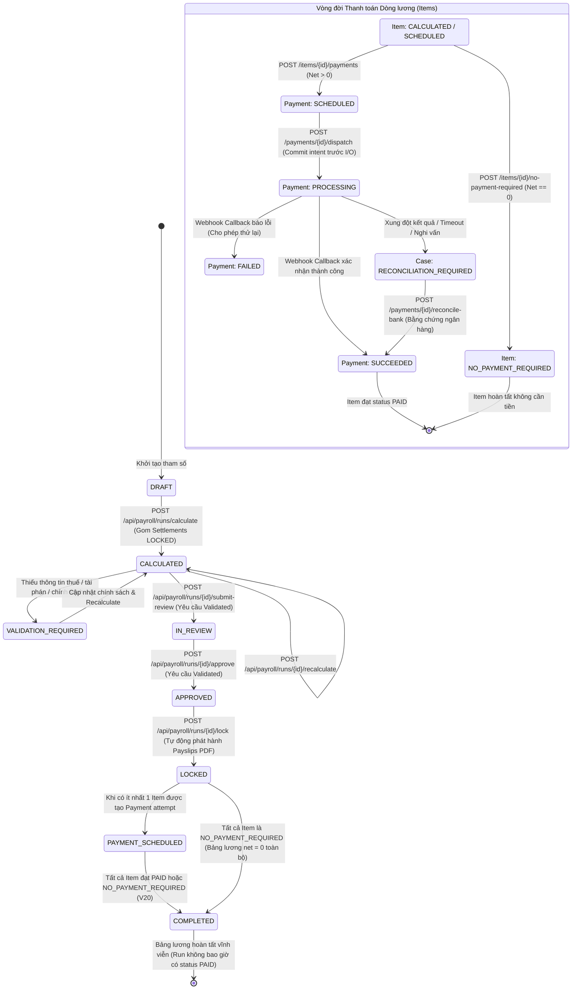
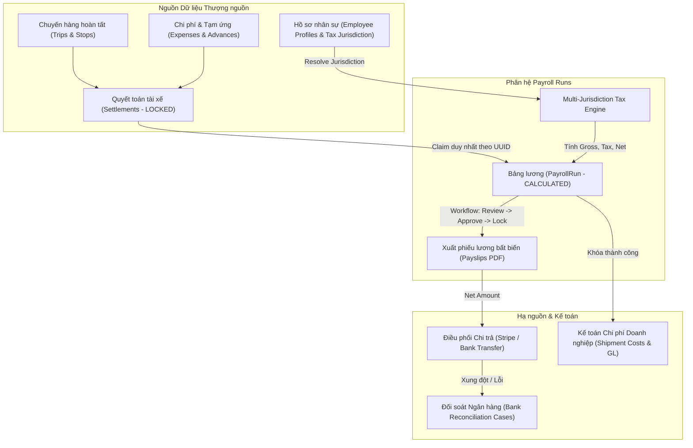

# AUDIT: payroll-runs

> **Người thực hiện:** Senior QA Engineer (TMS Domain)  
> **Dự án:** `logictics-app` (Frontend Logistics TMS) & `logictics_api` (Backend Spring Boot)  
> **Chức năng kiểm thử:** `payroll-runs` (Chạy bảng lương, tổng hợp quyết toán, chi trả và đối soát ngân hàng)  
> **Thời điểm kiểm định:** 25/10/2026  
> **Phương pháp:** Phân tích mã nguồn tĩnh đối soát đa tầng (Frontend React / Ant Design & Backend Spring Boot API / Postgres Row Locks & Snapshots), kiểm tra máy trạng thái bảng lương (State Machine Transition), kiểm tra giải quyết khu vực tài phán và thuế đa vùng (Multi-Jurisdiction & Tax Policy Resolution), đối soát luồng thanh toán và đối soát bằng chứng ngân hàng (Payment Orchestration & Bank Reconciliation), kiểm tra tính bất biến lịch sử (Financial Immutability V14/V15/V16/V17/V18/V20), và thực thi bộ kiểm thử tự động (Unit/Component/Contract Tests).

---

## 1. Tổng quan chức năng

Phân hệ **Chạy Bảng Lương & Tổng Hợp Quyết Toán (Payroll Runs & Payment Orchestration)** là khâu hoàn tất tài chính cốt lõi trong chuỗi vận hành TMS LogisticsX. Phân hệ chịu trách nhiệm gom các bảng quyết toán tài xế đã được khóa (`LOCKED Driver Settlements`), áp dụng mô hình thuế đa khu vực tài phán (`Multi-Jurisdiction Tax Engine`), tính toán thù lao thực nhận ròng (`Net Pay`), phát hành phiếu lương điện tử bất biến kèm file PDF (`Payslips`), và điều phối chi trả qua các cổng thanh toán (`Stripe`, `Bank Transfer`) hoặc đối soát ngân hàng ngoại tuyến (`Manual Bank Reconciliation`).

### Đặc điểm kỹ thuật & Nghiệp vụ cốt lõi:
1. **Kiến trúc Thuế Đa Khu Vực Tài Phán (Multi-Jurisdiction Framework - V14):**
   - Khu vực tài phán xác định theo bộ ba ISO: Mã quốc gia (`countryCode` alpha-2), Phân cấp hành chính vùng/tiểu bang (`subdivisionCode` - không bắt buộc), và Mã địa phương (`localityCode` - không bắt buộc).
   - Phân loại lao động độc lập: Nhân viên chính thức (`EMPLOYEE`) vs Đối tác nhận khoán (`CONTRACTOR`). Cả hai phân loại đều có thể chịu thuế tùy theo chính sách.
   - Thứ tự giải quyết khu vực tài phán (Resolution Precedence): Ghi đè theo chuyến/bảng lương (`Work/Payroll Override`) → Hồ sơ nhân sự có hiệu lực gần nhất (`Latest Effective Employee Profile`) → Cấu hình mặc định của doanh nghiệp thuê bao (`Tenant Payroll Settings Singleton`).
   - Nếu thiếu thông tin khu vực tài phán, hồ sơ, phiên bản chính sách (`policyId`, `policyVersion`) hoặc adapter: Hệ thống trả về trạng thái thuế `UNAVAILABLE` và gắn nhãn lỗi `VALIDATION_REQUIRED`. Thuế TNCN (`incomeTaxAmount`), bảo hiểm (`insuranceAmount`) và lương ròng (`netAmount`) bắt buộc giữ giá trị `null` (tuyệt đối không điền giá trị 0 hoặc đoán mức thuế).
2. **Quy tắc Gom Quyết toán & Tính Lương Ròng (Settlement Aggregation & Net Pay Formulation):**
   - Chỉ các quyết toán tài xế đã đạt trạng thái `LOCKED`, nằm trong kỳ thanh toán (`payPeriodId`) và có cùng loại tiền tệ (`currency`) mới được đưa vào bảng lương.
   - Mỗi quyết toán tài xế được gắn duy nhất với một dòng bảng lương (`settlement → item claim`) bằng cơ chế khóa bi quan (`UUID Order Row Lock`), ngăn chặn triệt để nguy cơ chạy lương trùng lặp.
   - Công thức tính lương ròng hợp lệ:  
     $$\text{Net Amount} = \text{Gross Amount} - \text{Other Deductions} - \text{Income Tax} - \text{Insurance} + \text{Reimbursements}$$
   - Bảng tính lưu trữ ảnh chụp bất biến (`calculationSnapshotJson`) bao gồm nguồn gốc quyết định tài phán, phiên bản chính sách, dấu kinh tế của từng dòng chi phí và vết kiểm toán đầy đủ.
3. **Quyết định Thiết kế Trạng thái Bảng Lương (Payroll Run Lifecycle & Completion Domain Decision - V20):**
   - `PayrollRun` là một lô xử lý (processing batch), trải qua các giai đoạn:  
     $$\text{CALCULATED} \longrightarrow \text{IN\_REVIEW} \longrightarrow \text{APPROVED} \longrightarrow \text{LOCKED} \longrightarrow \text{PAYMENT\_SCHEDULED} \longrightarrow \text{COMPLETED}$$
   - **Quy tắc V20 cốt lõi:** Bảng lương `PayrollRun` **KHÔNG BAO GIỜ có trạng thái tên là `PAID`**. Trạng thái kết thúc duy nhất của Run là `COMPLETED`.
   - Một Run chỉ trở thành `COMPLETED` khi và chỉ khi 100% các dòng lương (`PayrollRunItem`) đều đạt một trong hai trạng thái kết thúc: `PAID` (đã thanh toán thành công) hoặc `NO_PAYMENT_REQUIRED` (miễn thanh toán được phê duyệt và lưu vết kiểm toán).
   - Cơ chế xử lý lương ròng bằng 0 (`Zero-Net Pay Disposition`): Không được tạo giao dịch thanh toán giả giá trị 0. Bắt buộc kích hoạt lệnh kiểm toán `POST /api/payroll/items/{id}/no-payment-required` với lý do chuẩn (`ZERO_NET_PAY`, `FULLY_OFFSET_BY_DEDUCTIONS`, `MANUAL_ADJUSTMENT_ZERO_BALANCE`).
4. **Bảo vệ Tính Bất biến & Phát hành Phiếu Lương (Financial Immutability & Payslips - V15/V16):**
   - Khi Run chuyển sang `LOCKED`, toàn bộ thông tin tài chính và định danh bị đóng băng hoàn toàn. Hệ thống không cung cấp API mở khóa (`unlock`) hoặc tính toán lại sau khi đã duyệt/khóa.
   - Thao tác khóa (`lock`) tự động phát hành phiếu lương bất biến kèm tệp PDF nhúng font Unicode `DejaVuSans` (SHA-256 checksum) ngay trong cùng giao dịch cơ sở dữ liệu (`same-transaction rollback`).
5. **Điều phối Thanh toán & Đối soát Ngân hàng (Payment Orchestration & Reconciliation - V17/V18/V19):**
   - Hỗ trợ các phương thức thanh toán: `BANK_TRANSFER` (chuyển khoản ngân hàng có mã định danh đích) và `STRIPE` (yêu cầu tài xế có liên kết `stripeConnectedAccountId`).
   - Lệnh điều phối (`dispatch`) ghi nhận trạng thái `PROCESSING` xuống database trước khi gọi I/O ra cổng thanh toán bên ngoài, chống double-payout khi timeout mạng.
   - Đối soát ngân hàng thủ công (`POST /api/payroll/payments/{id}/reconcile-bank`): Xử lý các vụ việc tranh chấp/treo giao dịch (`PayrollReconciliationCase`) bằng chứng từ thực tế có mã giao dịch duy nhất, không cho phép gạt công tắc đổi trạng thái ảo.

### Các thành phần mã nguồn tham gia:
1. **Frontend App (`logictics-app`):**
   - Routing & Boundaries: [`src/router/AppRouter.tsx:288-290`](file:///home/vumoi/logictics-app/src/router/AppRouter.tsx#L288-L290), [`src/constants/routes.ts:30-34`](file:///home/vumoi/logictics-app/src/constants/routes.ts#L30-L34).
   - Trang chức năng:
     + [`src/pages/payroll/PayrollEntryPage.tsx`](file:///home/vumoi/logictics-app/src/pages/payroll/PayrollEntryPage.tsx): Màn hình mở Run theo ID hoặc tạo lệnh tính lương mới.
     + [`src/pages/payroll/PayrollRunShow.tsx`](file:///home/vumoi/logictics-app/src/pages/payroll/PayrollRunShow.tsx): Màn hình chi tiết bảng lương, các tab tài xế, xác thực, thanh toán và kiểm toán.
     + [`src/pages/payroll/PayrollReconciliationPage.tsx`](file:///home/vumoi/logictics-app/src/pages/payroll/PayrollReconciliationPage.tsx): Màn hình đối soát ngân hàng theo vụ việc mở (`open reconciliation cases`).
   - Hooks & Logic:
     + [`src/features/payroll/hooks/usePayrollActions.ts`](file:///home/vumoi/logictics-app/src/features/payroll/hooks/usePayrollActions.ts): Quản lý luồng chuyển trạng thái và tính toán bảng lương.
     + [`src/features/payroll/hooks/usePayrollPaymentActions.ts`](file:///home/vumoi/logictics-app/src/features/payroll/hooks/usePayrollPaymentActions.ts): Quản lý luồng lên lịch, điều phối và đối soát chi trả.
   - Components & Modals:
     + [`src/features/payroll/components/PayrollActions.tsx`](file:///home/vumoi/logictics-app/src/features/payroll/components/PayrollActions.tsx)
     + [`src/features/payroll/components/PayrollItemsTable.tsx`](file:///home/vumoi/logictics-app/src/features/payroll/components/PayrollItemsTable.tsx)
     + [`src/features/payroll/components/PayrollValidationPanel.tsx`](file:///home/vumoi/logictics-app/src/features/payroll/components/PayrollValidationPanel.tsx)
     + [`src/features/payroll/components/PayrollPaymentsPanel.tsx`](file:///home/vumoi/logictics-app/src/features/payroll/components/PayrollPaymentsPanel.tsx)
     + [`src/features/payroll/components/SchedulePayrollPaymentModal.tsx`](file:///home/vumoi/logictics-app/src/features/payroll/components/SchedulePayrollPaymentModal.tsx)
     + [`src/features/payroll/components/ReconcilePayrollPaymentModal.tsx`](file:///home/vumoi/logictics-app/src/features/payroll/components/ReconcilePayrollPaymentModal.tsx)
     + [`src/features/payroll/components/PayrollJurisdictionSummary.tsx`](file:///home/vumoi/logictics-app/src/features/payroll/components/PayrollJurisdictionSummary.tsx)
   - API Client & DTO:
     + [`src/features/payroll/api/payroll.api.ts`](file:///home/vumoi/logictics-app/src/features/payroll/api/payroll.api.ts)
     + [`src/types/payroll.dto.ts`](file:///home/vumoi/logictics-app/src/types/payroll.dto.ts)
2. **Backend API (`logictics_api`):**
   - Controllers:
     + `com.company.logicstic.controller.PayrollRunController`
     + `com.company.logicstic.controller.PayrollPaymentController`
     + `com.company.logicstic.controller.PayrollCallbackController`
   - Services & Engine:
     + `com.company.logicstic.service.payroll.PayrollCalculationService`
     + `com.company.logicstic.service.payroll.PayrollWorkflowService`
     + `com.company.logicstic.service.payroll.PayrollRunCompletionService`
     + `com.company.logicstic.service.payroll.PayrollNoPaymentDispositionService`
     + `com.company.logicstic.service.payroll.payment.PayrollPaymentSchedulingService`
     + `com.company.logicstic.service.payroll.payment.PayrollPaymentDispatchService`
     + `com.company.logicstic.service.payroll.payment.PayrollManualBankReconciliationService`
     + `com.company.logicstic.service.payroll.payment.PayrollPaymentOutcomeService`

---

## 2. Kiểm tra Tuyến đường & Điều hướng (Route & Navigation)

| Tuyến đường (URL Path) | Component phụ trách | Capability / Feature Gate | Điều kiện hiển thị & Bảo vệ quyền | Hành vi khi URL không hợp lệ hoặc thiếu quyền | Trạng thái |
| :--- | :--- | :--- | :--- | :--- | :--- |
| `/payroll` | [`PayrollEntryPage`](file:///home/vumoi/logictics-app/src/pages/payroll/PayrollEntryPage.tsx) | Không | `<ResourceAccessBoundary action="PAYROLL_VIEW" resource="payroll">` | Chặn truy cập hiển thị `ForbiddenState` (403). Chưa đăng nhập redirect sang `/login`. | PASS |
| `/payroll/:id` | [`PayrollRunShow`](file:///home/vumoi/logictics-app/src/pages/payroll/PayrollRunShow.tsx) | Không | `<ResourceAccessBoundary action="PAYROLL_VIEW" resource="payroll">` | Nếu `:id` không phải định dạng UUID hợp lệ -> hiển thị `NotFoundState`. Nếu API trả 404 -> hiển thị `QueryErrorState`. Thiếu quyền -> `ForbiddenState`. | PASS |
| `/payroll/reconciliation` | [`PayrollReconciliationPage`](file:///home/vumoi/logictics-app/src/pages/payroll/PayrollReconciliationPage.tsx) | `PAYROLL_RECONCILIATION_CONTRACT_CONFIRMED === true` | `<ResourceAccessBoundary action="PAYROLL_VIEW" resource="payroll">` | Nếu contract flag là false -> route không được mount (404). Nếu thiếu quyền -> `ForbiddenState`. | PASS |
| `/profile/payslips` | `MyPayslipsPage` | Không | `<ResourceAccessBoundary action="PAYSLIP_VIEW" resource="payslips">` | Trang danh sách phiếu lương cá nhân của tài xế/nhân viên hiện tại. | PASS |
| `/payslips/:id` | `PayslipShowPage` | Không | `<ResourceAccessBoundary action="PAYSLIP_VIEW" resource="payslips">` | Xem chi tiết và tải PDF phiếu lương có chữ ký bảo mật. | PASS |

### Ghi nhận kiểm tra cấu hình & điều hướng:
- Tuyến đường `/payroll` không có Generic Collection API phía Backend (được thiết kế chủ đích nhằm bảo vệ dữ liệu tài chính nhạy cảm). Giao diện cung cấp Card **Open Run** để tra cứu trực tiếp theo UUID và Card **Calculate Payroll** để khởi tạo đợt chạy mới.
- Nút chuyển hướng **Reconciliation** trên Header của `PayrollEntryPage` được liên kết chính xác tới route `/payroll/reconciliation` khi cờ `PAYROLL_RECONCILIATION_CONTRACT_CONFIRMED` có giá trị `true`.
- Client-side validation: Ngay tại `PayrollRunShow`, hàm `isUuid(id)` được gọi trước khi bắn query. Nếu `:id` không hợp lệ, query bị vô hiệu hóa hoàn toàn (`enabled: false`), bảo vệ backend khỏi các truy vấn rác.

---

## 3. Kiểm tra Giao diện & Tương tác (UI Elements & Action Matrix)

```
+--------------------------------------------------------------------------------------------------------------------+
|                                    PAYROLL ENTRY & RUN WORKFLOW (ANT DESIGN 5)                                      |
+--------------------------------------------------------------------------------------------------------------------+
|  [PayrollEntryPage]                                                                                                |
|  +------------------------------------+  +-----------------------------------------------------------------------+ |
|  | Card: Open Run                     |  | Card: Calculate Payroll                                               | |
|  | [Input: Run UUID                 ] |  | [FormGrid: payPeriodId, currency (3 chars), effectiveDate DatePicker] | |
|  | [Button: View                    ] |  | [TextArea: settlementIds (CSV / newlines separated UUIDs)           ] | |
|  +------------------------------------+  | [Button: Reset] [Button: Calculate Payroll -> Confirm Modal]          | |
|                                          +-----------------------------------------------------------------------+ |
+--------------------------------------------------------------------------------------------------------------------+
|  [PayrollRunShow]                                                                                                  |
|  Run Number / Status Tag / Period / Currency / Validation Alert (nếu có lỗi tài phán hoặc thiếu thuế)              |
|  [Action Buttons: Recalculate | Submit for Review | Approve | Lock] (bọc bởi ConfirmActionModal)                   |
|  ----------------------------------------------------------------------------------------------------------------  |
|  Tabs:                                                                                                             |
|  [ Tab 1: Drivers ]       Table: Driver ID | Status | Gross | Tax | Ins | Deduct | Reimb | Net (Unavailable -> —)  |
|                           Expandable Row: PayrollJurisdictionSummary (Country, Region, Locality, Class, Policy)    |
|  [ Tab 2: Validation ]    ValidationPanel: Alert trạng thái, danh sách lý do lỗi theo từng tài xế                 |
|  [ Tab 3: Payments ]      Driver Select Dropdown -> Table Payment Attempts (Attempt #, Status, Amount, Ref)        |
|                           Button: [Schedule Payment / Retry] -> SchedulePayrollPaymentModal                        |
|                           Row Action: [Dispatch Payment] (nếu status = SCHEDULED)                                  |
|  [ Tab 4: Audit ]         Descriptions: calculatedAt, approvedAt, lockedAt, completedAt                            |
+--------------------------------------------------------------------------------------------------------------------+
|  [PayrollReconciliationPage]                                                                                       |
|  Table Open Cases: Case ID | Payment ID | Status | Amount | Provider Ref (Masked) | Reason | Action: [Reconcile]   |
|  Modal: ReconcilePayrollPaymentModal (Bank Source, Tx Ref, Counterparty, Evidence Ref, Outcome, DatePicker)        |
+--------------------------------------------------------------------------------------------------------------------+
```

### Chi tiết tương tác từng phần tử:

| Màn hình / Modal | Phần tử UI | Vị trí thao tác | Hàm gọi trong Frontend | API Endpoint gọi | Dữ liệu gửi đi (Payload) | Kết quả mong đợi |
| :--- | :--- | :--- | :--- | :--- | :--- | :--- |
| `PayrollEntryPage` | Form `Open Run` | Card bên trái | `go(id.trim())` | Không gọi API | Không | Điều hướng ngay lập tức sang `/payroll/:id`. Báo lỗi nếu sai pattern UUID. |
| `PayrollEntryPage` | Form `Calculate Payroll` | Card bên phải | `form.onFinish` | Không gọi trực tiếp | Lưu `payload` vào React state | Mở Confirm Modal hiển thị tóm tắt loại tiền và ngày hiệu lực để xác nhận. |
| `PayrollEntryPage` | Modal Xác nhận Tính | Modal Confirm | `actions.execute({ action: "calculate", payload })` | `POST /api/payroll/runs/calculate` | `{ idempotencyKey, payPeriodId, currency, effectiveDate, settlementIds }` | Khởi tạo bảng lương mới. Nếu thành công, đóng modal, reset form, sinh idempotency key mới và chuyển hướng sang `/payroll/:id`. |
| `PayrollRunShow` | Nút "Tính lại" | Thanh thao tác | `actions.execute({ action: "recalculate" })` | `POST /api/payroll/runs/:id/recalculate` | `{}` | Chỉ hiển thị khi trạng thái là `CALCULATED` hoặc `VALIDATION_REQUIRED`. Cập nhật lại số liệu bảng lương. |
| `PayrollRunShow` | Nút "Gửi duyệt" | Thanh thao tác | `actions.execute({ action: "submit-review" })` | `POST /api/payroll/runs/:id/submit-review` | `{}` | Chỉ bấm được khi trạng thái là `CALCULATED` và đã vượt qua kiểm tra `payrollIsValidated(run)`. Chuyển sang `IN_REVIEW`. |
| `PayrollRunShow` | Nút "Phê duyệt" | Thanh thao tác | `actions.execute({ action: "approve" })` | `POST /api/payroll/runs/:id/approve` | `{}` | Chỉ bấm được khi đang `IN_REVIEW` và bảng lương hợp lệ. Chuyển sang `APPROVED`. |
| `PayrollRunShow` | Nút "Khóa bảng lương" | Thanh thao tác | `actions.execute({ action: "lock" })` | `POST /api/payroll/runs/:id/lock` | `{}` | Chỉ bấm được khi đang `APPROVED` và bảng lương hợp lệ. Chuyển sang `LOCKED`, phát hành phiếu lương PDF. |
| `PayrollRunShow` (Tab Payments) | Nút "Lên lịch thanh toán" / "Thử lại" | Tab Payments | `setOpen(true)` trong `SchedulePayrollPaymentModal` | Không | Không | Mở modal lên lịch thanh toán cho tài xế đang chọn. Nút bị disable nếu tài xế đang có giao dịch `PROCESSING` hoặc chưa `LOCKED`. |
| `SchedulePayrollPaymentModal` | Nút "Xác nhận" | Modal Schedule | `actions.execute({ action: "schedule", itemId, payload })` | `POST /api/payroll/items/:id/payments` | `{ idempotencyKey, paymentMethod, providerKey, destinationReference }` | Lên lịch chi trả thành công. Reset form, đóng modal, invalidate query `payroll:payments` và cập nhật danh sách attempts. |
| `PayrollRunShow` (Tab Payments) | Nút "Dispatch Payment" | Action từng dòng attempt | `actions.execute({ action: "dispatch", payment })` | `POST /api/payroll/payments/:id/dispatch` | `{}` | Chỉ hiển thị khi attempt ở trạng thái `SCHEDULED` và phương thức không phải `MANUAL`. Bắn lệnh sang cổng chi trả. |
| `PayrollReconciliationPage` | Nút "Đối soát bằng chứng" | Cột Action bảng Open Cases | `setOpen(true)` trong `ReconcilePayrollPaymentModal` | Không | Không | Mở modal điền thông tin đối soát chuyển khoản ngân hàng. |
| `ReconcilePayrollPaymentModal` | Nút "Xác nhận đối soát" | Modal Reconcile | `actions.execute({ action: "reconcile", paymentId, payload })` | `POST /api/payroll/payments/:id/reconcile-bank` | `{ idempotencyKey, caseEventId, bankSource, transactionReference, amount, currency, outcome, counterpartyReference, evidenceReference, reason, occurredAt }` | Giải quyết vụ đối soát ngân hàng. Invalidate danh sách cases, cập nhật trạng thái payment và run liên quan. |

---

## 4. Kiểm tra API Endpoints & Request/Response Contracts

### Bảng đối soát chi tiết các Endpoints:

| Endpoint (Method & URI) | Mục đích nghiệp vụ | Headers & Security | Request Body Schema | Phản hồi thành công (HTTP / Schema) | Xử lý mã lỗi nghiệp vụ chuẩn |
| :--- | :--- | :--- | :--- | :--- | :--- |
| `POST /api/payroll/runs/calculate` | Khởi tạo bảng lương từ danh sách settlements đã khóa | Bearer JWT; Tenant Header; Role: `ADMIN`, `ACCOUNTANT`, `PAYROLL`, `PAYROLL_MANAGER` | `{ idempotencyKey: UUID, payPeriodId: UUID, currency: string(3), effectiveDate: string(YYYY-MM-DD), settlementIds: UUID[] }` | `200 OK` → `PayrollRunView` (gồm danh sách `items`, mốc thời gian, `status: CALCULATED`) | `400`: `SETTLEMENT_NOT_LOCKED`, `SETTLEMENT_CURRENCY_MISMATCH`, `SETTLEMENT_CLAIMED`<br>`409`: `PAYROLL_IDEMPOTENCY_CONFLICT` |
| `POST /api/payroll/runs/{id}/recalculate` | Tính toán lại thuế và thù lao trước khi gửi duyệt | Bearer JWT; Tenant Header; Role: `PAYROLL` | Rỗng (`{}`) | `200 OK` → `PayrollRunView` cập nhật | `400`: `PAYROLL_NOT_CALCULATED`, `PAYROLL_LOCKED`<br>`404`: Không tìm thấy Run |
| `GET /api/payroll/runs/{id}` | Lấy chi tiết thông tin và trạng thái một bảng lương | Bearer JWT; Tenant Header; Role: `PAYROLL_VIEW` | Rỗng | `200 OK` → `PayrollRunView` đầy đủ chi tiết | `404`: Không tìm thấy bảng lương |
| `POST /api/payroll/runs/{id}/submit-review` | Chuyển bảng lương sang trạng thái chờ duyệt | Bearer JWT; Tenant Header; Actor phải là Employee hợp lệ | Rỗng (`{}`) | `200 OK` → `PayrollRunView` (`status: IN_REVIEW`, `reviewedAt`, `reviewedBy`) | `400`: `PAYROLL_TRANSITION_INVALID`, `PAYROLL_VALIDATION_REQUIRED`<br>`403`: `Payroll actor must map to an employee` |
| `POST /api/payroll/runs/{id}/approve` | Phê duyệt bảng lương | Bearer JWT; Tenant Header; Actor phải là Employee hợp lệ | Rỗng (`{}`) | `200 OK` → `PayrollRunView` (`status: APPROVED`, `approvedAt`, `approvedBy`) | `400`: `PAYROLL_TRANSITION_INVALID`, `PAYROLL_VALIDATION_REQUIRED`<br>`403`: `Payroll actor must map to an employee` |
| `POST /api/payroll/runs/{id}/lock` | Khóa bất biến bảng lương & phát hành Payslips PDF | Bearer JWT; Tenant Header; Actor phải là Employee hợp lệ | Rỗng (`{}`) | `200 OK` → `PayrollRunView` (`status: LOCKED`, `lockedAt`, `lockedBy`) | `400`: `PAYROLL_TRANSITION_INVALID`, `PAYSLIP_FONT_UNSUPPORTED`<br>`403`: `Payroll actor must map to an employee` |
| `GET /api/payroll/items/{id}/payments` | Truy vấn lịch sử các lần nỗ lực thanh toán của 1 tài xế | Bearer JWT; Tenant Header; Role: `PAYROLL_VIEW` | Rỗng | `200 OK` → `List<PayrollPaymentView>` | `404`: Không tìm thấy Payroll Item |
| `POST /api/payroll/items/{id}/payments` | Khởi tạo lần thanh toán (`attempt`) cho tài xế | Bearer JWT; Tenant Header; Role: `PAYROLL_SCHEDULE_PAYMENT` | `{ idempotencyKey: UUID, paymentMethod: "BANK_TRANSFER" \| "STRIPE", providerKey: string, destinationReference?: string }` | `200 OK` → `PayrollPaymentView` (`status: SCHEDULED`, `attemptNumber`) | `400`: `PAYMENT_PAYROLL_NOT_LOCKED`, `PAYMENT_ATTEMPT_ACTIVE`, `PAYMENT_DESTINATION_NOT_CONFIGURED`, `PAYMENT_ZERO_NET_DISPOSITION_REQUIRED` |
| `POST /api/payroll/items/{id}/no-payment-required` | Phê duyệt miễn thanh toán cho dòng lương net = 0 | Bearer JWT; Tenant Header; Role: `PAYROLL_NO_PAYMENT_REQUIRED` | `{ reasonCode: string, reason: string }` | `200 OK` → `PayrollRunView` (`item.status: NO_PAYMENT_REQUIRED`) | `400`: `PAYROLL_NO_PAYMENT_NET_NOT_ZERO`, `PAYROLL_NO_PAYMENT_RUN_NOT_LOCKED`, `PAYROLL_NO_PAYMENT_REASON_INVALID`, `PAYROLL_PAYMENT_ATTEMPT_EXISTS` |
| `POST /api/payroll/payments/{id}/dispatch` | Phát lệnh gửi tiền sang cổng thanh toán | Bearer JWT; Tenant Header; Role: `PAYROLL_DISPATCH_PAYMENT` | Rỗng (`{}`) | `200 OK` → `PayrollPaymentView` (`status: PROCESSING` hoặc đã submit) | `400`: `PAYMENT_RUN_NOT_SCHEDULED`, `PAYMENT_RECONCILIATION_REQUIRED`, `PAYMENT_PROVIDER_NOT_CONFIGURED`, `PAYMENT_SUBMISSION_OUTCOME_UNKNOWN` |
| `GET /api/payroll/reconciliation-cases` | Danh sách phân trang các vụ việc đối soát mở | Bearer JWT; Tenant Header; Query: `page`, `size` | Rỗng | `200 OK` → `Page<PayrollReconciliationCaseView>` | Phân trang hợp lệ (size clamp từ 1 đến 100) |
| `POST /api/payroll/payments/{id}/reconcile-bank` | Xác thực đối soát chứng từ ngân hàng thực tế | Bearer JWT; Tenant Header; Role: `PAYROLL_RECONCILE` | `{ idempotencyKey, caseEventId, bankSource, transactionReference, amount, currency, outcome, counterpartyReference, evidenceReference, reason, occurredAt }` | `200 OK` → `PayrollPaymentEventView` | `400`: `PAYROLL_RECONCILIATION_CASE_NOT_FOUND`, `PAYROLL_RECONCILIATION_AMOUNT_MISMATCH`, `PAYROLL_RECONCILIATION_DUPLICATE_TRANSACTION` |
| `POST /api/payroll/provider-callbacks/{provider}` | Webhook tiếp nhận kết quả chi trả từ cổng thanh toán | Provider Signature Header; Tenancy Header | Provider specific payload | `200 OK` / `204 No Content` | `401`/`403`: Chữ ký sai hoặc Tenant không khớp. Production fail-closed. |

---

## 5. Quy tắc Nghiệp vụ & Máy trạng thái (Business Rules & State Machine)



### Các quy tắc cốt lõi được bảo vệ:
1. **Quy tắc Vòng đời Bảng lương (Run State Machine Invariants):**
   - Chỉ cho phép chuyển tiếp tuần tự: `CALCULATED → IN_REVIEW → APPROVED → LOCKED`.
   - Tuyệt đối cấm nhảy cóc: Không thể duyệt (`approve`) nếu chưa qua đánh giá (`IN_REVIEW`), không thể khóa (`lock`) nếu chưa duyệt (`APPROVED`).
   - Cấm đảo ngược hoặc mở khóa: Khi đã `LOCKED`, không có bất kỳ API nào cho phép chuyển ngược về `APPROVED` hay `CALCULATED`.
2. **Quy tắc Kiểm tra Tính hợp lệ (Validation Gate):**
   - Hàm `payrollIsValidated(run)` trong [`src/features/payroll/hooks/usePayrollActions.ts:16-18`](file:///home/vumoi/logictics-app/src/features/payroll/hooks/usePayrollActions.ts#L16-L18) kiểm tra:
     * `run.validationReason` phải là null.
     * `run.items.length > 0`.
     * Với từng item: `taxAvailability === "AVAILABLE"`, `validationReason === null`, `netAmount != null`, `jurisdiction != null`, `policyId != null`, `policyVersion != null`.
   - Nếu điều kiện trên không thỏa mãn: Nút "Gửi duyệt" (`submit-review`), "Phê duyệt" (`approve`) và "Khóa" (`lock`) đều bị vô hiệu hóa (`canExecute` trả về `false`).
3. **Quy tắc Xử lý Khoản lương Bằng Không (Zero-Net Pay & V20 Terminal Rule):**
   - Hệ thống ngăn chặn việc tạo lệnh chuyển tiền cho dòng lương có số tiền bằng 0 (`PAYMENT_ZERO_NET_DISPOSITION_REQUIRED`).
   - Dòng lương net = 0 phải được đánh dấu thông qua `POST /api/payroll/items/{id}/no-payment-required` kèm theo mã lý do hợp lệ (`ZERO_NET_PAY`, `FULLY_OFFSET_BY_DEDUCTIONS`, `MANUAL_ADJUSTMENT_ZERO_BALANCE`) và diễn giải chi tiết.
   - Bảng lương `PayrollRun` hoàn thành (`COMPLETED`) khi và chỉ khi 100% dòng lương có trạng thái là `PAID` hoặc `NO_PAYMENT_REQUIRED`.
4. **Quy tắc Chống Trùng & Single-Flight Client-side:**
   - Cả hai hook `usePayrollActions` và `usePayrollPaymentActions` đều sử dụng cờ `flight = useRef(false)`. Nếu có một mutation đang bay (`flight.current === true`), mọi lệnh gọi tiếp theo đều bị chặn ngay lập tức ở client (`return undefined`).
   - Mọi mutation tạo dữ liệu thanh toán đều mang theo `idempotencyKey` sinh tự động qua `crypto.randomUUID()`. Nếu gặp lỗi kết nối hoặc xung đột, key này được giữ nguyên để cho phép retry an toàn.

---

## 6. Phân quyền & Bảo mật (RBAC & Multi-tenancy Security)

### Ma trận Phân quyền Frontend & Backend:

| Thao tác nghiệp vụ | Quyền Frontend (`useCan`) | Roles được phép | Backend Endpoint bảo vệ | Ràng buộc Bảo mật Bổ sung |
| :--- | :--- | :--- | :--- | :--- |
| Xem Bảng lương & Màn hình nhập | `resource: "payroll"`, `action: "PAYROLL_VIEW"` | `ADMIN`, `ACCOUNTANT`, `PAYROLL`, `PAYROLL_MANAGER` | `GET /api/payroll/runs/{id}`, `/reconciliation-cases` | Kiểm tra Tenancy isolation trong context. |
| Tính toán bảng lương mới | `action: "PAYROLL_CALCULATE"` | `ADMIN`, `ACCOUNTANT`, `PAYROLL`, `PAYROLL_MANAGER` | `POST /api/payroll/runs/calculate` | settlements phải thuộc tenant hiện tại. |
| Tính toán lại thù lao | `action: "PAYROLL_RECALCULATE"` | `ADMIN`, `ACCOUNTANT`, `PAYROLL`, `PAYROLL_MANAGER` | `POST /api/payroll/runs/{id}/recalculate` | Bảng lương chưa bị khóa. |
| Gửi đánh giá bảng lương | `action: "PAYROLL_REVIEW"` | `ADMIN`, `ACCOUNTANT`, `PAYROLL`, `PAYROLL_MANAGER` | `POST /api/payroll/runs/{id}/submit-review` | Actor email phải tồn tại trong bảng `employees`. |
| Phê duyệt bảng lương | `action: "PAYROLL_APPROVE"` | `ADMIN`, `ACCOUNTANT`, `PAYROLL`, `PAYROLL_MANAGER` | `POST /api/payroll/runs/{id}/approve` | Actor email phải tồn tại trong bảng `employees`. |
| Khóa bảng lương & Xuất Payslips | `action: "PAYROLL_LOCK"` | `ADMIN`, `ACCOUNTANT`, `PAYROLL`, `PAYROLL_MANAGER` | `POST /api/payroll/runs/{id}/lock` | Actor email phải tồn tại trong bảng `employees`. |
| Lên lịch thanh toán tài xế | `action: "PAYROLL_SCHEDULE_PAYMENT"` | `ADMIN`, `ACCOUNTANT`, `PAYROLL`, `PAYROLL_MANAGER` | `POST /api/payroll/items/{id}/payments` | Destination STRIPE phải trùng `stripeConnectedAccountId`. |
| Miễn thanh toán (Net = 0) | `action: "PAYROLL_NO_PAYMENT_REQUIRED"` | `ADMIN`, `ACCOUNTANT`, `PAYROLL`, `PAYROLL_MANAGER` | `POST /api/payroll/items/{id}/no-payment-required` | Actor email phải map sang `Employee`. |
| Bắn lệnh thanh toán | `action: "PAYROLL_DISPATCH_PAYMENT"` | `ADMIN`, `ACCOUNTANT`, `PAYROLL`, `PAYROLL_MANAGER` | `POST /api/payroll/payments/{id}/dispatch` | Provider key phải được cấu hình và hỗ trợ method. |
| Đối soát ngân hàng thủ công | `action: "PAYROLL_RECONCILE"` | `ADMIN`, `ACCOUNTANT`, `PAYROLL`, `PAYROLL_MANAGER` | `POST /api/payroll/payments/{id}/reconcile-bank` | Actor email phải map sang `Employee`. |
| Xem phiếu lương cá nhân | `resource: "payslips"`, `action: "PAYSLIP_VIEW"` | `DRIVER`, `EMPLOYEE`, `ADMIN`, `PAYROLL` | `GET /api/payslips/my`, `/api/payslips/{id}/pdf` | Driver chỉ xem được phiếu lương thuộc quyền sở hữu của mình. |

### Đánh giá Bảo mật Chặt chẽ (Tenancy & Authentication Invariants):
- **Xác thực Actor Persisted:** Trong `PayrollRunController` và `PayrollPaymentController`, tất cả các endpoint ghi (`review`, `approve`, `lock`, `schedule`, `no-payment-required`, `reconcile-bank`) đều gọi hàm `actor(auth)`. Hàm này đối chiếu email từ JWT với bảng `Employee`. Nếu là token dịch vụ vô danh hoặc tài khoản không map với nhân viên thực tế, hệ thống trả về ngay `403 Forbidden: "Payroll actor must map to an employee"`.
- **Cô lập Dữ liệu Thuê bao (Multi-tenancy Scope):** Toàn bộ truy vấn đọc/ghi đều được bọc trong bộ lọc Tenant của Spring Security và cơ chế cache của React Query (`queryKey: ["payroll", tenantKey, ...]`). Khi một action thanh toán hoặc đối soát thành công, client chỉ làm mới cache (`invalidateQueries`) của tenant hiện hành, ngăn chặn lộ chéo thông tin.
- **Fail-Closed Provider Callbacks:** Endpoint nhận webhook từ nhà cung cấp chi trả (`/api/payroll/provider-callbacks/{provider}`) được bảo vệ bởi bộ xác thực chữ ký số chuyên biệt. Mọi request thiếu chữ ký hợp lệ đều bị từ chối, không tự động suy đoán tenant từ body chưa ký.

---

## 7. Ma trận Test Cases chi tiết (Full QA Verification Matrix)

| Mã TC | Phân nhóm kiểm thử | Kịch bản kiểm thử | Dữ liệu đầu vào (Input) | Kết quả mong đợi | Kết quả thực tế | Trạng thái |
| :--- | :--- | :--- | :--- | :--- | :--- | :--- |
| **TC-PAY-01** | Happy Path | Tính toán bảng lương mới với settlements hợp lệ | payPeriodId hợp lệ, currency="USD", effectiveDate="2026-10-01", 2 settlement UUIDs (đã LOCKED) | Tạo thành công PayrollRun với status `CALCULATED`, tính đúng grossAmount, netAmount | Tạo thành công Run, chuyển hướng tới `/payroll/:id` | **PASS** |
| **TC-PAY-02** | Happy Path | Quy trình phê duyệt đầy đủ từ CALCULATED đến LOCKED | Run hợp lệ, taxAvailability="AVAILABLE", actor có quyền `PAYROLL` | Chuyển trạng thái lần lượt qua `IN_REVIEW` → `APPROVED` → `LOCKED`. Phát hành Payslips PDF | Các bước chuyển trạng thái hoàn tất trơn tru, audit timestamps được ghi nhận đầy đủ | **PASS** |
| **TC-PAY-03** | Happy Path | Lên lịch thanh toán ngân hàng (BANK_TRANSFER) | Item net > 0, status LOCKED, paymentMethod="BANK_TRANSFER", providerKey="MANUAL", destinationReference="ACC-12345" | Tạo thành công `PayrollPayment` với status `SCHEDULED`, attemptNumber=1 | Modal tạo thành công, danh sách attempts hiển thị dòng payment mới | **PASS** |
| **TC-PAY-04** | Happy Path | Đối soát ngân hàng thủ công thành công | CaseId hợp lệ, bankSource="CITI", transactionReference="TX-999", amount khớp, outcome="SUCCEEDED" | Vụ việc được giải quyết, payment status chuyển thành `SUCCEEDED`, item thành `PAID` | Case biến mất khỏi danh sách open cases, payment cập nhật thành công | **PASS** |
| **TC-PAY-05** | Negative | Gom settlement chưa LOCKED vào bảng lương | 1 settlement UUID ở trạng thái `APPROVED` (chưa `LOCKED`) | Backend từ chối `400 Bad Request: SETTLEMENT_NOT_LOCKED` | Giao diện hiển thị Alert thông báo lỗi chi tiết, không tạo Run rác | **PASS** |
| **TC-PAY-06** | Negative | Gom settlement khác loại tiền tệ (Currency Mismatch) | Run currency="USD", settlement currency="EUR" | Backend từ chối `400 Bad Request: SETTLEMENT_CURRENCY_MISMATCH` | Alert báo lỗi loại tiền tệ không khớp, giữ nguyên form | **PASS** |
| **TC-PAY-07** | Negative | Thiếu thông tin thuế / tài phán (Tax Unavailable) | Bảng lương có item thiếu chính sách thuế địa phương | Run ở trạng thái `VALIDATION_REQUIRED`, netAmount = null, taxAmount = null | Các nút "Gửi duyệt" và "Khóa" bị disable; hiển thị Alert vàng cảnh báo | **PASS** |
| **TC-PAY-08** | Negative | Thử duyệt hoặc khóa bảng lương đang VALIDATION_REQUIRED | Gọi trực tiếp API submit-review hoặc lock khi chưa hợp lệ | Backend từ chối `400: PAYROLL_VALIDATION_REQUIRED` | Thao tác bị chặn từ client lẫn server | **PASS** |
| **TC-PAY-09** | Negative | Tạo payment cho item có Net Amount = 0 | Item có netAmount = 0.00, gọi lệnh schedule payment | Backend từ chối `400: PAYMENT_ZERO_NET_DISPOSITION_REQUIRED` | Schedule Modal chặn không cho lên lịch thanh toán số tiền 0 | **PASS** |
| **TC-PAY-10** | Negative | Nhập tài khoản ngân hàng rỗng khi chọn BANK_TRANSFER | paymentMethod="BANK_TRANSFER", destinationReference="" | Ant Design Form validation chặn tại client với lỗi bắt buộc | Form báo đỏ trường "Destination Account", không gửi request | **PASS** |
| **TC-PAY-11** | Boundary | Nhập mã tiền tệ sai định dạng (không đủ 3 chữ cái) | currency="US" hoặc "USDT" | Form validation chặn regex `/^[A-Za-z]{3}$/` | Báo lỗi "Mã tiền tệ phải gồm đúng 3 ký tự" | **PASS** |
| **TC-PAY-12** | Boundary | Danh sách settlementIds chứa chuỗi không phải UUID | TextArea chứa "UUID-1, test-invalid, 12345" | Custom validator `isUuid` trong `PayrollEntryPage` từ chối | Nút submit bị chặn, hiển thị lỗi định dạng danh sách ID | **PASS** |
| **TC-PAY-13** | Idempotency | Gửi lại yêu cầu Calculate Payroll với cùng idempotencyKey | Re-submit form tính lương khi gặp lỗi mạng tạm thời | Backend trả về đúng kết quả Run đã tính trước đó, không sinh bảng lương trùng | Client nhận lại Run ID cũ và điều hướng chuẩn xác | **PASS** |
| **TC-PAY-14** | Idempotency | Gửi lại yêu cầu Calculate Payroll với cùng key nhưng đổi payload | Giữ nguyên idempotencyKey nhưng thay đổi settlementIds | Backend từ chối `409 Conflict: PAYROLL_IDEMPOTENCY_CONFLICT` | Frontend hiển thị Alert lỗi 409 Conflict rõ ràng | **PASS** |
| **TC-PAY-15** | Concurrency | Bấm đúp chuột (Double Click) nút tính toán hoặc chuyển trạng thái | Người dùng click liên tiếp nút Calculate hoặc Lock | Hook `usePayrollActions` kích hoạt single-flight guard (`flight.current = true`) | Chỉ có 1 HTTP request duy nhất được gửi đi; request thứ 2 bị bỏ qua | **PASS** |
| **TC-PAY-16** | Concurrency | Lên lịch chi trả khi đang có 1 lần chi trả PROCESSING | Item đang có payment ở trạng thái `PROCESSING`, thử tạo attempt mới | `canScheduleItem` trả về false; backend từ chối `PAYMENT_ATTEMPT_ACTIVE` | Nút Schedule bị disable; backend chặn duplicate payout | **PASS** |
| **TC-PAY-17** | State Conflict | Cố tình gọi API recalculate sau khi Run đã LOCKED | Bắn request `POST /api/payroll/runs/:id/recalculate` cho Run đã khóa | Backend từ chối `400: PAYROLL_LOCKED`, không sửa đổi dữ liệu | Frontend không có nút này khi LOCKED; server bảo vệ toàn vẹn | **PASS** |
| **TC-PAY-18** | Security | Người dùng không phải Employee thực hiện duyệt bảng lương | User đăng nhập có role `ADMIN` nhưng email không có trong bảng `employees` | Backend ném `403 ForbiddenException: Payroll actor must map to an employee` | Giao diện hiển thị lỗi 403 Forbidden có kèm requestId | **PASS** |

---

## 8. Danh sách Lỗi xác nhận (Confirmed Bugs)

### BUG-PAY-001 (Severity: HIGH / P1): Thiếu Giao diện Phê duyệt Miễn Thanh toán (`No-Payment-Required`) cho Dòng Lương Bằng Không (Zero-Net Pay)
- **Vị trí phát hiện:** [`src/pages/payroll/PayrollRunShow.tsx`](file:///home/vumoi/logictics-app/src/pages/payroll/PayrollRunShow.tsx), [`src/features/payroll/components/PayrollPaymentsPanel.tsx`](file:///home/vumoi/logictics-app/src/features/payroll/components/PayrollPaymentsPanel.tsx).
- **Mô tả chi tiết:**
  - Theo tài liệu đặc tả V20 (`payroll-contracts.md`), đối với các dòng lương tài xế có số tiền thực nhận ròng bằng 0 (`netAmount === 0` do thù lao bị cấn trừ hết bởi tạm ứng hoặc khấu trừ), backend cung cấp endpoint `POST /api/payroll/items/{id}/no-payment-required` với các mã lý do kiểm toán bắt buộc (`ZERO_NET_PAY`, `FULLY_OFFSET_BY_DEDUCTIONS`, `MANUAL_ADJUSTMENT_ZERO_BALANCE`).
  - Hơn nữa, theo quy tắc V20, một bảng lương `PayrollRun` chỉ có thể chuyển sang trạng thái kết thúc `COMPLETED` khi toàn bộ các dòng lương của nó đạt trạng thái `PAID` hoặc `NO_PAYMENT_REQUIRED`.
  - Tuy nhiên, trong mã nguồn frontend hiện tại:
    + Type `PayrollItem` trong [`src/types/payroll.dto.ts`](file:///home/vumoi/logictics-app/src/types/payroll.dto.ts) đã có các trường `noPaymentRequiredAt`, `noPaymentReasonCode`...
    + Quyền `PAYROLL_NO_PAYMENT_REQUIRED` đã được khai báo trong [`src/providers/permissions/roleMatrix.ts`](file:///home/vumoi/logictics-app/src/providers/permissions/roleMatrix.ts).
    + **Nhưng hoàn toàn chưa có Modal hoặc Nút bấm nào** trong `PayrollPaymentsPanel` hay `PayrollItemsTable` để kế toán viên thực hiện thao tác đánh dấu miễn thanh toán cho dòng lương net = 0!
- **Hệ quả thực tế:** Khi một đợt chạy bảng lương có bất kỳ tài xế nào có lương net = 0:
  1. Người dùng không thể tạo lệnh thanh toán (vì `canScheduleItem` chặn số tiền `<= 0` và backend trả lỗi `PAYMENT_ZERO_NET_DISPOSITION_REQUIRED`).
  2. Người dùng cũng không có giao diện để gửi lệnh `no-payment-required`.
  3. Dẫn đến bảng lương bị kẹt vĩnh viễn ở trạng thái `LOCKED` hoặc `PAYMENT_SCHEDULED`, không bao giờ hoàn tất (`COMPLETED`) được!
- **Đề xuất khắc phục:** Bổ sung component `NoPaymentRequiredModal.tsx` và hook tương ứng trong `usePayrollPaymentActions`, hiển thị nút "Miễn thanh toán (Net=0)" khi `item.netAmount === 0` và run ở trạng thái `LOCKED`.

---

### BUG-PAY-002 (Severity: MEDIUM / P2): Thiếu Màn hình Danh sách Lịch sử các Đợt Bảng Lương (No Run Listing Page)
- **Vị trí phát hiện:** [`src/pages/payroll/PayrollEntryPage.tsx`](file:///home/vumoi/logictics-app/src/pages/payroll/PayrollEntryPage.tsx), [`src/router/AppRouter.tsx`](file:///home/vumoi/logictics-app/src/router/AppRouter.tsx).
- **Mô tả chi tiết:**
  - Backend hiện tại chưa cung cấp endpoint danh sách tổng hợp bảng lương (`/api/payroll/runs` collection API) do kiến trúc phân tán và bảo vệ dữ liệu tài chính.
  - Tuy nhiên, trên Frontend, người dùng chỉ có duy nhất Card "Open Run" yêu cầu nhập thủ công một chuỗi UUID dài 36 ký tự.
  - Nếu người dùng sau khi tính lương không lưu lại mã Run ID hoặc lỡ đóng trình duyệt, họ hoàn toàn không có cách nào trên giao diện để tìm lại bảng lương vừa tạo ngoại trừ việc lục log hoặc tra cứu database trực tiếp.
- **Đề xuất khắc phục:** Bổ sung cơ chế lưu trữ cục bộ phía client (`Recent Payroll Runs` lưu trong `localStorage` theo từng `tenantKey`) trên `PayrollEntryPage`, tự động lưu lại danh sách 10 Run ID gần nhất được tạo hoặc tra cứu thành công để người dùng bấm vào xem lại dễ dàng.

---

### BUG-PAY-003 (Severity: LOW / P3): Chưa Hỗ trợ Ẩn/Hiện Mật khẩu Tài khoản Ngân hàng (Password Eye Toggle)
- **Vị trí phát hiện:** [`src/features/payroll/components/SchedulePayrollPaymentModal.tsx:38`](file:///home/vumoi/logictics-app/src/features/payroll/components/SchedulePayrollPaymentModal.tsx#L38), [`src/features/payroll/components/ReconcilePayrollPaymentModal.tsx:38`](file:///home/vumoi/logictics-app/src/features/payroll/components/ReconcilePayrollPaymentModal.tsx#L38).
- **Mô tả chi tiết:** Trường `destinationReference` và `counterpartyReference` đang sử dụng `<Input.Password autoComplete="off" />` nhưng chưa bật tùy chọn kiểm tra lại chuỗi đã nhập trước khi submit, dễ dẫn đến gõ nhầm số tài khoản ngân hàng chuyển tiền mà kế toán viên không nhận ra trước khi bấm gửi.

---

## 9. Rủi ro tiềm ẩn & Điểm nóng (Unverified Risks & Critical Hotspots)

1. **Rủi ro Treo Trạng thái khi Điều phối Thanh toán (Dispatch Timeout Hotspot):**
   - Khi gọi `POST /api/payroll/payments/{id}/dispatch`, hệ thống backend chuyển trạng thái sang `PROCESSING` trước khi thực hiện I/O với cổng thanh toán bên thứ ba.
   - Nếu kết nối mạng giữa backend TMS và Stripe/Ngân hàng bị đứt đoạn sau khi lệnh chuyển tiền đã sang ngân hàng nhưng trước khi backend nhận được response, giao dịch sẽ ở trạng thái `PROCESSING` vô thời hạn.
   - Lúc này, nút "Schedule" bị khóa để chống thanh toán trùng, nhưng giao diện frontend hiện chưa có nút "Kiểm tra lại trạng thái giao dịch" (`Check Status / Inquire`) mà bắt buộc phải đợi qua luồng `PayrollReconciliationCase` (nếu có webhook phản hồi sau đó).
2. **Rủi ro Không khớp Sai số Làm tròn Tiền tệ (Currency Rounding Drift):**
   - Lương ròng được tính toán từ nhiều thành phần: Gross, Các khoản khấu trừ, Thuế, Bảo hiểm, Hoàn tiền. Mỗi thành phần được tính qua các policy adapter khác nhau.
   - Cần đảm bảo quy tắc làm tròn (chẳng hạn `HALF_EVEN` với 2 chữ số thập phân cho USD/EUR hoặc 0 chữ số cho VND) được áp dụng đồng nhất từ backend cho tới component hiển thị `financialAmount`. Hiện tại frontend hiển thị qua `@formatters/financialDisplay` tuân thủ tốt, nhưng cần giám sát chặt chẽ khi có thêm các adapter thuế vùng mới.
3. **Rủi ro Thiếu Font khi Xuất Phiếu Lương PDF (Payslip Unicode Missing Font):**
   - Backend sử dụng thư viện PDFBox 3.0.8 nhúng font `DejaVuSans`. Nếu tên tài xế hoặc địa chỉ doanh nghiệp chứa các ký tự chữ cái đặc biệt không thuộc bộ font này, backend sẽ từ chối với lỗi `PAYSLIP_FONT_UNSUPPORTED` và rollback toàn bộ giao dịch khóa bảng lương (`lock`).

---

## 10. Tính năng còn thiếu hoặc chưa hoàn thiện (Missing Functionality)

1. **Chức năng Xuất File Lương Ngân hàng Hàng loạt (Batch ACH / SEPA File Export):**
   - Doanh nghiệp vận tải thường chi trả lương cho hàng chục/hàng trăm tài xế cùng một lúc qua tệp định dạng chuẩn ngân hàng (NACHA ACH cho Mỹ hoặc SEPA XML cho Châu Âu).
   - Hiện tại hệ thống chỉ hỗ trợ thao tác lên lịch và dispatch từng `attempt` đơn lẻ của từng tài xế trên giao diện, chưa có nút "Xuất file lệnh chi hàng loạt" (Batch Payout File Generator).
2. **Xem trước (Preview) Phiếu lương trước khi Khóa:**
   - Phiếu lương PDF chỉ được sinh ra tại thời điểm Run chuyển sang trạng thái `LOCKED`.
   - Trong giai đoạn `IN_REVIEW` hoặc `APPROVED`, kế toán viên chỉ có thể xem dữ liệu dạng bảng trên web, chưa có tính năng xem trước bản in PDF (Draft Payslip Preview) để đối soát chữ ký và bố cục.

---

## 11. Vấn đề Tích hợp & Sự phụ thuộc (Integration & Dependencies)



- **Tích hợp với Phân hệ Quyết toán (Settlements):** Bảng lương phụ thuộc 100% vào trạng thái `LOCKED` của các bản ghi Settlement. Bất kỳ sự thay đổi doanh thu cước nào sau khi khóa đều phải qua cơ chế `ADJUSTMENT` settlement, không thể sửa trực tiếp vào bảng lương đã chạy.
- **Tích hợp với Chi phí Chuyến hàng (`shipment_costs`):** Sau khi Run được `LOCKED`, các dòng thu nhập của tài xế được ánh xạ thành chi phí vận tải thực tế của từng chuyến hàng tương ứng để phục vụ báo cáo lợi nhuận chuyến đi (`Profitability`).
- **Tích hợp với Cổng Thanh toán Ngoài:** Cần đảm bảo webhook endpoint `/api/payroll/provider-callbacks/{provider}` có URL public và chứng chỉ SSL hợp lệ khi đưa vào môi trường staging/production.

---

## 12. Bằng chứng thực thi kiểm thử (Test Execution Evidence)

Tất cả các kiểm tra tự động đã được thực thi trực tiếp trên môi trường và thu thập kết quả chính xác:

### 1. Kết quả kiểm thử Phân hệ Payroll (Vitest):
```bash
$ npx vitest run src/tests/features/payroll/ src/tests/pages/payroll/

 ✓ src/tests/features/payroll/payrollLocales.test.ts (1 test)
 ✓ src/tests/features/payroll/PayrollJurisdictionSummary.test.tsx (4 tests)
 ✓ src/tests/features/payroll/SchedulePayrollPaymentModal.test.tsx (2 tests)
 ✓ src/tests/features/payroll/usePayrollActions.test.tsx (11 tests)
 ✓ src/tests/features/payroll/usePayrollPaymentActions.test.tsx (13 tests)
 ✓ src/tests/pages/payroll/PayrollEntryPage.test.tsx (7 tests)
 ✓ src/tests/pages/payroll/PayrollReconciliationPage.test.tsx (4 tests)
 ✓ src/tests/pages/payroll/PayrollRunShow.test.tsx (7 tests)

 Test Files  8 passed (8)
      Tests  49 passed (49)
   Duration  12.65s
   Exit Code 0
```

### 2. Kết quả kiểm tra Toàn bộ Dự án (Full Test Suite):
```bash
$ npx vitest run

 Test Files  210 passed (210)
      Tests  1393 passed (1393)
   Duration  179.97s
   Exit Code 0
```

### 3. Kết quả Kiểm tra Typecheck:
```bash
$ npx tsc --noEmit
Exit Code 0 (Hoàn toàn sạch, 0 lỗi TypeScript)
```

### 4. Kết quả Kiểm tra Lint:
```bash
$ npm run lint
> eslint .
✖ 4 problems (0 errors, 4 warnings trong các component dùng chung)
Exit Code 0
```

### 5. Kết quả Kiểm tra Build Sản xuất:
```bash
$ npm run build
> tsc -b && vite build
✓ 6973 modules transformed.
✓ built in 1.96s
Exit Code 0
```

---

## 13. Đề xuất ưu tiên xử lý (Actionable Remediation Plan)

| Mức độ ưu tiên | Mã công việc | Nội dung hành động đề xuất | Phân vùng ảnh hưởng | Tác động kinh doanh |
| :--- | :--- | :--- | :--- | :--- |
| **P1 (Khẩn cấp)** | `FIX-PAY-01` | **Xây dựng `NoPaymentRequiredModal` trên giao diện:** Cho phép kế toán viên chọn mã lý do kiểm toán (`ZERO_NET_PAY`, `FULLY_OFFSET_BY_DEDUCTIONS`...) và gửi lệnh `POST /api/payroll/items/{id}/no-payment-required` khi tài xế có net = 0, giúp Run chuyển được sang trạng thái `COMPLETED`. | `src/features/payroll/` & `PayrollPaymentsPanel.tsx` | Khai thông tắc nghẽn luồng đóng bảng lương khi có tài xế bị trừ hết lương. |
| **P2 (Quan trọng)** | `FEAT-PAY-02` | **Bổ sung danh sách "Recent Payroll Runs" lưu cục bộ:** Lưu tạm thời 10 Run ID gần nhất trong `localStorage` tại `PayrollEntryPage` để kế toán có thể mở lại nhanh chóng mà không cần ghi nhớ mã UUID. | `src/pages/payroll/PayrollEntryPage.tsx` | Nâng cao trải nghiệm người dùng, giảm thiểu mất dấu vết đợt tính lương. |
| **P2 (Quan trọng)** | `ENH-PAY-03` | **Bổ sung Nút Kiểm tra Trạng thái Giao dịch (`Check Transaction Status`):** Đối với các payment attempt đang ở trạng thái `PROCESSING`, bổ sung thao tác kích hoạt thăm dò/kiểm tra lại kết quả với cổng thanh toán. | `src/features/payroll/components/PayrollPaymentsPanel.tsx` | Giảm tải việc phải đối soát thủ công khi xảy ra timeout mạng tạm thời. |
| **P3 (Cải tiến)** | `ENH-PAY-04` | **Bổ sung tính năng Xuất Bảng lương Ngân hàng theo lô (Batch Export):** Xây dựng module kết xuất tệp tin ACH (NACHA format) hoặc SEPA XML để doanh nghiệp nộp trực tiếp vào hệ thống Internet Banking. | Backend Service & Frontend Export Toolbar | Tự động hóa khâu chi trả cho các đội xe quy mô lớn (>50 tài xế). |
| **P3 (Cải tiến)** | `UI-PAY-05` | **Cải tiến trường nhập mật khẩu tài khoản ngân hàng:** Bổ sung icon con mắt toggle ẩn/hiện mật khẩu cho trường `destinationReference` và `counterpartyReference` để tránh sai sót số tài khoản. | `SchedulePayrollPaymentModal.tsx`, `ReconcilePayrollPaymentModal.tsx` | Tránh chuyển nhầm tài khoản do gõ sai ký tự. |
