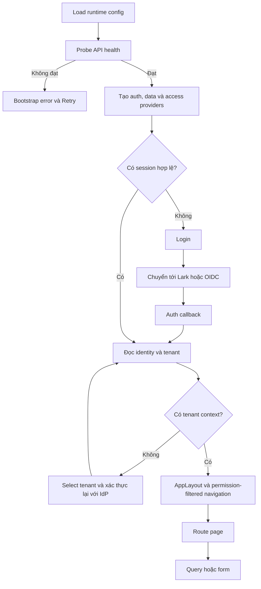
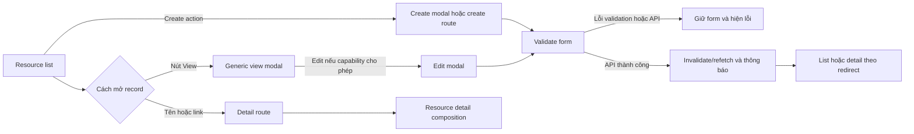
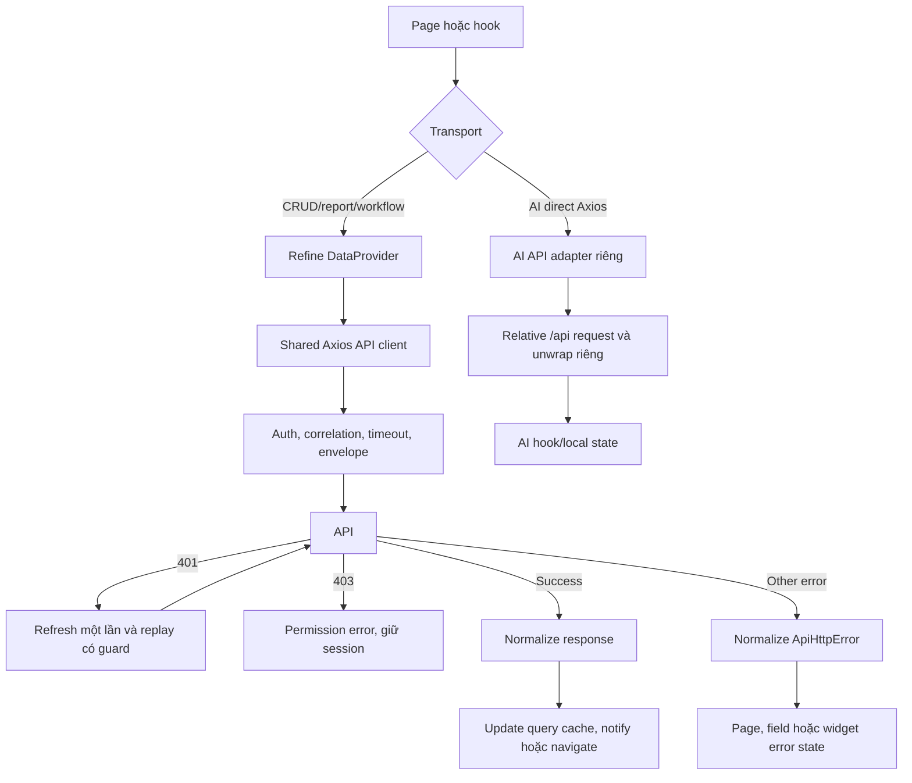
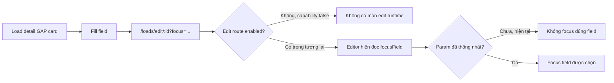
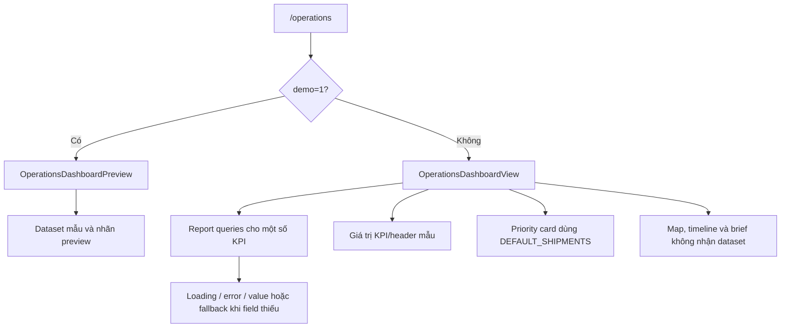

# 1. Project Overview

**Mục đích:** mô tả UI, điều hướng và hành vi thực sự có trong frontend LogisticsX để đối chiếu với UI/UX reference video. Đây là bản phân tích hiện trạng, không phải đặc tả tính năng sẽ xây dựng.

**Thời điểm:** 19/10/2026. **HEAD:** `cff6c8c89b80e5f5501feb4747caf786722a55c8`. Phân tích working tree hiện tại, bao gồm thay đổi chưa commit và chế độ mock Operations đã có từ phiên trước. Chỉ file báo cáo này được tạo trong phiên phân tích.

## 1.1 Phạm vi và cách đọc

- Quét 595 file `.ts`, `.tsx`, `.scss`, `.css` thuộc source ứng dụng, không tính test; có 99 file trang `.tsx`. Dependency, ảnh, DTO sinh tự động và test không được coi là màn hình.
- `src/pages/index.ts` khai báo 72 route CRUD cho 18 domain. Runtime trong `App.tsx` dùng **foundationResourcePageRoutes**, nên chỉ **31 route CRUD** được bật. Router còn **24 route tường minh**, tổng cộng **55 mẫu URL**, chưa tính redirect index `/` và wildcard. Một URL có thể chỉ là alias hoặc redirect, không phải một thiết kế màn hình riêng.
- Đọc registry, guard, capability flag, component, handler và hook/API; không suy luận màn đang hoạt động chỉ từ tên file, comment hoặc locale.
- GitNexus đang chậm 48 commit so với HEAD; không tái lập index vì phạm vi chỉ cho phép tạo báo cáo. Mã nguồn hiện tại có ưu tiên cao hơn graph và tài liệu cũ.
- Không có reference video trong đầu vào; tài liệu này tạo baseline để so sánh sau, không nhận định thiết kế nào đã giống/khác video.

**Nhãn bằng chứng dùng xuyên suốt:**

| Nhãn | Ý nghĩa |
|---|---|
| SOURCE | Có logic trong source; chưa chứng minh request thành công với backend hiện tại. |
| BROWSER-FIXTURE | Đã thao tác bằng Chromium với fixture dùng Refine/axios giả lập. Xác minh render và chuyển UI, không xác minh nghiệp vụ backend. |
| BROWSER-LIVE | Quan sát được từ entry ứng dụng thật, không có session đăng nhập. |
| MOCK/STATIC | Giá trị mẫu, hằng số, mô phỏng thời gian hoặc state cục bộ; không phải sự thật vận hành. |
| GATED | Có code nhưng bị cờ hợp đồng/capability chặn ở runtime. |
| UNROUTED | Có file/component nhưng không có route đang được runtime đăng ký. |
| CHƯA XÁC MINH | Cần backend/session hoặc trường hợp dữ liệu cụ thể; không được hiểu là đã chạy thành công. |

## 1.2 Kết luận chính

Ứng dụng là TMS nhiều tenant, gồm đăng nhập SSO, shell điều hướng bằng icon rail, Operations, quản lý Load/Trip/xe/khách hàng/nhân viên/bến bãi, tài liệu, thông báo, AI điều phối, tối ưu điều phối, báo cáo đội xe, lợi nhuận, settlement, chính sách trả tài xế, payroll và payslip.

UI hiện có ba lớp độ hoàn thiện: CRUD đang nối API; workflow chuyên biệt có permission/state guard và invalidation; các phần mẫu hoặc dormant. Operations mặc định thuộc lớp pha trộn API/static, còn `/operations?demo=1` là chế độ mẫu được ghi nhãn rõ. Không nên coi toàn bộ dashboard hay mọi nút AI là đã có backend thực thi.

Nguồn nền: [App.tsx](../src/App.tsx), [AppRouter.tsx](../src/router/AppRouter.tsx), [resourceRegistry.ts](../src/pages/resourceRegistry.ts), [resourceCapabilities.ts](../src/components/resources/resourceCapabilities.ts).

# 2. Technology Stack

Các phiên bản dưới đây là khai báo trong [package.json](../package.json), không phải kết quả tra cứu phiên bản mới nhất trên internet.

| Thành phần | Công nghệ và vai trò thực tế |
|---|---|
| Framework | React `^18.3.1`, TypeScript `~6.0.2`; Vite `^8.1.1`; SPA, không có SSR framework trong entry. |
| Application framework | Refine core v4, Refine Ant Design adapter v5; resource metadata, auth, permissions, data hooks, CRUD helpers. |
| UI Library | Ant Design `^5.29.3`; icon từ Ant Design Icons và Lucide React. |
| Styling | Sass/SCSS, CSS variables, style inline, CSS grid/flex, media/container queries. Không thấy Tailwind/Bootstrap CSS framework được cấu hình. Refine Antd reset được nạp ở `main.tsx`. |
| Routing | React Router DOM `^6.30.3`, BrowserRouter, nested Routes/Outlet, Navigate, Link; adapter Refine React Router v6. |
| State management | TanStack Query `^4.41.0` thông qua Refine và hook trực tiếp; React state/ref/context; Zustand `^5.0.15` ở map store. |
| Animation | Không có thư viện motion riêng trong dependencies. Chủ yếu CSS transition/keyframes, state + requestAnimationFrame/setTimeout và motion mặc định của Ant Design/Recharts. |
| API | Axios; client nền có bearer/refresh/envelope/error normalization; Refine DataProvider; API adapter chuyên biệt; nhánh AI còn dùng axios trực tiếp. |
| Map | Leaflet `^1.9.4` cho mini-map dashboard; react-map-gl + MapLibre GL cho bản đồ candidate và map module; deck.gl/H3/Turf cho module map chưa được route. |
| Charts | Recharts `^3.10.1` ở Fleet và executive dormant; Progress, Timeline và chart dạng CSS cho các panel khác. |
| Forms/validation | Antd Form, `useForm`/`useModalForm`; quy tắc field, UUID, date/currency; Zod trong nền cấu hình/contract. Không thấy React Hook Form trong stack đang dùng. |
| Authentication | OIDC client, Lark gateway, session manager, JWT verification với jose; quyền theo JWT role matrix. |
| Locale/date/money | i18next + react-i18next; locale Antd vi/en/ja; dayjs; Decimal.js và formatter. Một số UI mới vẫn hard-code tiếng Việt. |
| Verification | Vitest + Testing Library, Playwright. Các fixture e2e là môi trường giả lập, không phải nguồn dữ liệu vận hành. |

Entry: [main.tsx](../src/main.tsx). Provider locale: [AntdLocaleProvider.tsx](../src/components/AntdLocaleProvider.tsx). Map store: [mapStore.ts](../src/features/map/store/mapStore.ts).

# 3. Project Structure

```text
src/
├── main.tsx / App.tsx             entry, bootstrap, providers, BrowserRouter, Refine
├── config/                       runtime config, health gate, bootstrap states
├── router/                       AppRouter, ProtectedRoute, TenantGuard, lazy loader
├── pages/                        route pages; generic wrappers và màn chuyên biệt
│   ├── auth/ tenant/ errors/ diagnostics/
│   ├── dashboard/ loads/ trips/ trucks/ customers/ employees/ terminals/
│   ├── documents/ notifications/ invoices/ payments/
│   ├── ai-dispatch/ optimization/ fleet/ profitability/
│   ├── settlements/ payroll/ payslips/
│   └── accidents/ containers/ dvir/ expenses/ hos-eld/ load-board/
│       maintenance/ products/ map/  có source, nhiều phần chưa được route
├── components/                   AppLayout, AppSider, CRUD shell, modal, toolbar
│   ├── resources/                form definitions, capability, modal frame, detail view
│   ├── dashboard/                card/map và Operations preview
│   ├── ai/                       AI GAP chat, load AI panel, run history drawer
│   └── lark-base/                panel đồng bộ Load
├── features/                     domain components/hooks/API; vẫn tồn tại trong code hiện tại
│   ├── dashboard/                Operations layout và panel
│   ├── loads/components/redesign/ shipment detail composition
│   ├── executive/                component/report code dormant
│   └── ...                       finance, settlement, payroll, fleet, optimization, map
├── hooks/                        identity, tenant, search/filter, mutation, AI, preview
├── api/                          AI và Lark Base adapters
├── providers/                    auth, access control, data provider, notification, API
├── forms/ table/                 shared form grid/footer/section, BaseTable
├── resources/                    accidents resource đã chuyển ra global
├── constants/                    routes
├── styles/ locales/ formatters/  tokens, style, bản dịch, định dạng
├── types/ utils/                 transport/domain contracts và hàm nền
└── tests/                        test; một số test nằm cạnh component/hook/page
e2e/fixtures/                     browser fixtures, bao gồm sider và dashboard panels
public/                           runtime config và static resources
docs/                             tài liệu, thiết kế, handoff
```

Không có một thư mục `layouts/` hoặc `services/` thống nhất trong runtime này. Layout thật ở `components/AppLayout.tsx`; service/API nằm trong `providers/`, `api/`, `features/*/api/`. Cấu trúc đang kết hợp global và feature folders; báo cáo không thay đổi cấu trúc này.

# 4. Screen Inventory

## 4.1 Quy ước để mô tả đủ từng screen

**L0:** trang công khai/SSO/bootstrap, không có shell. **L1:** `AppLayout` với sidebar cố định, nội dung cuộn trong khung, không có global top header; AI GAP widget gắn ở cấp layout. **L2:** select-tenant, sau xác thực nhưng trước TenantGuard, không có shell nghiệp vụ.

**T-LIST:** toolbar/tìm kiếm/lọc nếu resource có khai báo, bảng, sort/pagination server, loading/empty/error/retry, create/view/edit modal tùy capability. Selected nằm ở `showId`/`editId`; state mở modal không thay URL list. **T-CREATE:** Form dọc, Create wrapper, validation/disabled/loading/error/success; submit POST và redirect list. **T-EDIT:** GET record + Form, submit PUT, lỗi field/conflict, redirect tùy page. **T-SHOW:** GET record, Show + Descriptions hoặc composition riêng; retry/error/loading/empty và action capability.

Các ký hiệu hành động `C01–C16` được khai chi tiết ở §8, có trigger, handler, state, API, đích điều hướng, feedback và source. Mỗi hàng CRUD kế thừa đúng template và bộ action ghi trong hàng; khác biệt theo domain được mô tả ngay sau bảng. API paths là path tương đối mà source gửi qua provider, không khẳng định backend hiện tại trả thành công.

## 4.2 Các route chuyên biệt đang đăng ký

| Screen / route | Source page | Layout, purpose, UI chính | Data source và screen states | User actions |
|---|---|---|---|---|
| Login `/login` | [LoginPage.tsx](../src/pages/auth/LoginPage.tsx) | L0; card LX ở giữa, mô tả SSO, nút Lark và OIDC; không có username/password form. | Auth provider + query `returnTo`; default, pending hai login mutation; lỗi qua auth notification. | A01–A02. User đã đăng nhập bị chuyển Operations vì executive flag=false. |
| Callback `/auth/callback` | [LarkCallbackPage.tsx](../src/pages/auth/LarkCallbackPage.tsx) | L0; Result + Spin; Result lỗi/hủy có nút về Login. | URL code/state/error → auth mutation; loading, canceled, error. | A03–A04; callback effect single-start bằng ref. |
| Tenant `/select-tenant` | [SelectTenantPage.tsx](../src/pages/tenant/SelectTenantPage.tsx) | L2; danh sách card công ty, tenant name/key, nút xác thực lại. | Identity tenants; card loading, warning không có tenant, pending switch. | A05; nút mỗi tenant đều gọi cùng `switchTenant()` không truyền tenant ID. |
| Diagnostics `/diagnostics` | [DiagnosticsPage.tsx](../src/pages/diagnostics/DiagnosticsPage.tsx) | L0; PageHeader, Card, Descriptions môi trường/health/database/request ID. | Ready bootstrap state, không tự fetch báo cáo. | Copy request ID; không có dashboard nghiệp vụ trong màn này. Route chỉ có khi bootstrap ready. |
| Forbidden `/403` | [ForbiddenPage.tsx](../src/pages/errors/ForbiddenPage.tsx) | L0; Result 403 và nút về dashboard. | Static locale; default. | A06 → `/dashboard` → `/operations` khi có session/tenant. |
| Not found `/404` và wildcard | [NotFoundPage.tsx](../src/pages/errors/NotFoundPage.tsx) | L0; Result 404 và nút về dashboard. | Static locale; default. | A06; app bootstrap phải hoàn thành trước khi router xuất hiện. |
| Dashboard `/dashboard` | [DashboardPage.tsx](../src/pages/dashboard/DashboardPage.tsx) | Hiện là **redirect** tới Operations. File page lại render OperationsDashboardView, không ghép executive components. | GATED bởi `EXECUTIVE_CONTRACT_CONFIRMED=false`; không có executive screen đang hoạt động. | Navigate replace; không coi dormant executive charts là UI hiện hành. |
| Operations `/operations` | [OperationsDashboardPage.tsx](../src/pages/dashboard/OperationsDashboardPage.tsx) | L1; banner công tắc Mẫu/Thật; greeting/search/actions; 6 KPI; priority + brief; map + dispatch timeline. | API pha static ở mode mặc định; `?demo=1` là mock rõ ràng. Loading/error ở một số KPI; panel khác có empty. | O01–O11; xem §4.4. |
| AI dispatch `/ai-dispatch` | [AiDispatchPage.tsx](../src/pages/ai-dispatch/AiDispatchPage.tsx) | L1; header + tag model/config, banner; tab kế hoạch, tạo kế hoạch, lịch sử; modal config/approve/reject. | Axios API + local plans/activePlan + localStorage settings; pending/error/empty/proposed/approved/rejected. | D01–D09. |
| AI aliases `/ai-dispatch/:id`, `/ai-dispatch/show/:id` | Cùng [AiDispatchPage.tsx](../src/pages/ai-dispatch/AiDispatchPage.tsx) | Cùng screen trên. | Page không đọc route ID; không khôi phục một session cụ thể từ ID URL. | Những thao tác như trên; deep link chưa hoàn thiện. |
| Optimization `/optimization` | [OptimizationPage.tsx](../src/pages/optimization/OptimizationPage.tsx) | L1; card mở run bằng UUID bên trái; form policy/resources/targets/evidence bên phải; confirm trước run. | Local form + POST runs; permission/loading/validation/pending/error. | P01–P04. |
| Optimization result `/optimization/runs/:id` | [OptimizationRunShow.tsx](../src/pages/optimization/OptimizationRunShow.tsx) | L1; run metadata/statistics; feasible/infeasible tables; visualizations; candidate explanation drawer; accept confirmation. | GET immutable outcome; loading/403/invalid UUID/error/empty/selected/accepted/conflict. | P05–P10. |
| Fleet report `/reports/fleet` | [FleetReportPage.tsx](../src/pages/fleet/FleetReportPage.tsx) | L1; policy + trucks + period + timezone form; metadata; KPI; utilization bars, mileage donut nếu có dữ liệu, coverage table; Gantt placeholder. | GET policy/truck options khi mở dropdown; GET health report khi URL đủ scope; default/loading/empty/error/403/unavailable metric. | F01–F07. |
| Profitability `/finance/profitability` | [ProfitabilityPage.tsx](../src/pages/profitability/ProfitabilityPage.tsx) | L1; Load UUID filter; reporting table; selected-row summary; classified/unallocated cost tables. | GET by-load report; local filters/selectedLoad; loading/error/empty/selected. | F08–F10. |
| Settlements `/settlements` | [SettlementList.tsx](../src/pages/settlements/SettlementList.tsx) | L1; header actions, total-count card, filters, search, table, calculate modal. | API list + server filters; local search trên tập đã tải, pagination table 15; loading/error/empty. | S01–S04. |
| Settlement `/settlements/:id` | [SettlementShow.tsx](../src/pages/settlements/SettlementShow.tsx) | L1; header/back/actions; tab summary, lines, source work, adjustments/history, audit; adjustment/reversal/validation modals. | GET detail; state guards từ server status; error/403/not found/loading/empty/pending. | S05–S10. |
| Driver pay policies `/settlements/policies` | [DriverPayPolicyList.tsx](../src/pages/settlements/DriverPayPolicyList.tsx) | L1; search/filter/table; create, new-version và version-history modals. | Policy queries + local filters; loading/error/empty/selected. | S11–S14. |
| Policy detail `/settlements/policies/:id` | [DriverPayPolicyShow.tsx](../src/pages/settlements/DriverPayPolicyShow.tsx) | L1; read-only policy descriptions, current/latest version actions, version history, new-version form modal. | GET policy/version family; loading/error/not found/current-version state. | S12–S15. |
| Payroll `/payroll` | [PayrollEntryPage.tsx](../src/pages/payroll/PayrollEntryPage.tsx) | L1; open-by-UUID card + calculate form + confirmation; link reconciliation. Không có run-list screen trong page. | Local form; POST calculate; permission/loading/validation/pending/error/success redirect. | Y01–Y04. |
| Payroll run `/payroll/:id` | [PayrollRunShow.tsx](../src/pages/payroll/PayrollRunShow.tsx) | L1; metadata/actions; tabs drivers, validation, payments, audit; payment dialogs ở payments tab. | GET raw run; validation/status guards; error/not found/403/loading/empty/pending. | Y05–Y09. |
| Bank reconciliation `/payroll/reconciliation` | [PayrollReconciliationPage.tsx](../src/pages/payroll/PayrollReconciliationPage.tsx) | L1; server-paginated cases, masked references, evidence modal. | GET cases; page/size local; permission/loading/error/empty/selected/pending. Flag=true. | Y10–Y11. |
| My payslips `/profile/payslips` | [MyPayslipsPage.tsx](../src/pages/payslips/MyPayslipsPage.tsx) | L1; table kỳ lương, gross/net, issued-at, payment status unavailable, View. | GET employee-bound payslips; permission/loading/error/empty; invalid row UUID disables View. | Y12. |
| Payslip `/payslips/:id` | [PayslipShow.tsx](../src/pages/payslips/PayslipShow.tsx) | L1; immutable snapshot summary và PDF download. | GET raw payslip + authorized Blob download; invalid snapshot/UUID, 403, error, loading, pending PDF. | Y13. |

**Bootstrap không có URL riêng:** loading config → probing health → ready, hoặc config error/API offline/API unhealthy. Component [BootstrapStateView.tsx](../src/config/BootstrapStateView.tsx) hiển thị Spin/Result, mã request copyable và Retry. Khi gate thất bại, toàn bộ router chưa mount; không nhầm trang lỗi bootstrap với 404 của route.

## 4.3 Catalog CRUD theo từng file trang

Mọi screen dưới đây có file thật. `ON` nghĩa là có route runtime, còn khả năng truy cập vẫn phụ thuộc session/tenant/role. `OFF` không có route runtime; hành vi template chỉ là code lưu sẵn, không phải tính năng người dùng hiện có.

| ID | Screen | Route | Source file | UI/data khi hoạt động | Actions & states | Runtime |
|---|---|---|---|---|---|---|
| R01 | Chuyến hàng — list | `/loads` | [src/pages/loads/list.tsx](../src/pages/loads/list.tsx) | UNROUTED / GATED; không render ở runtime | Không có thao tác runtime; source-only | OFF: ngoài foundation allowlist |
| R02 | Chuyến hàng — create | `/loads/create` | [src/pages/loads/create.tsx](../src/pages/loads/create.tsx) | UNROUTED / GATED; không render ở runtime | Không có thao tác runtime; source-only | OFF: ngoài foundation allowlist |
| R03 | Chuyến hàng — edit | `/loads/edit/:id` | [src/pages/loads/edit.tsx](../src/pages/loads/edit.tsx) | UNROUTED / GATED; không render ở runtime | Không có thao tác runtime; source-only | OFF: ngoài foundation allowlist |
| R04 | Chuyến hàng — show | `/loads/show/:id` | [src/pages/loads/show.tsx](../src/pages/loads/show.tsx) | UNROUTED / GATED; không render ở runtime | Không có thao tác runtime; source-only | OFF: ngoài foundation allowlist |
| R05 | Xe tải — list | `/trucks` | [src/pages/trucks/list.tsx](../src/pages/trucks/list.tsx) | UNROUTED / GATED; không render ở runtime | Không có thao tác runtime; source-only | OFF: ngoài foundation allowlist |
| R06 | Xe tải — create | `/trucks/create` | [src/pages/trucks/create.tsx](../src/pages/trucks/create.tsx) | UNROUTED / GATED; không render ở runtime | Không có thao tác runtime; source-only | OFF: ngoài foundation allowlist |
| R07 | Xe tải — edit | `/trucks/edit/:id` | [src/pages/trucks/edit.tsx](../src/pages/trucks/edit.tsx) | UNROUTED / GATED; không render ở runtime | Không có thao tác runtime; source-only | OFF: ngoài foundation allowlist |
| R08 | Xe tải — show | `/trucks/show/:id` | [src/pages/trucks/show.tsx](../src/pages/trucks/show.tsx) | UNROUTED / GATED; không render ở runtime | Không có thao tác runtime; source-only | OFF: ngoài foundation allowlist |
| R09 | Chuyến xe — list | `/trips` | [src/pages/trips/list.tsx](../src/pages/trips/list.tsx) | UNROUTED / GATED; không render ở runtime | Không có thao tác runtime; source-only | OFF: ngoài foundation allowlist |
| R10 | Chuyến xe — create | `/trips/create` | [src/pages/trips/create.tsx](../src/pages/trips/create.tsx) | UNROUTED / GATED; không render ở runtime | Không có thao tác runtime; source-only | OFF: ngoài foundation allowlist |
| R11 | Chuyến xe — edit | `/trips/edit/:id` | [src/pages/trips/edit.tsx](../src/pages/trips/edit.tsx) | UNROUTED / GATED; không render ở runtime | Không có thao tác runtime; source-only | OFF: ngoài foundation allowlist |
| R12 | Chuyến xe — show | `/trips/show/:id` | [src/pages/trips/show.tsx](../src/pages/trips/show.tsx) | UNROUTED / GATED; không render ở runtime | Không có thao tác runtime; source-only | OFF: ngoài foundation allowlist |
| R13 | Nhân viên — list | `/employees` | [src/pages/employees/list.tsx](../src/pages/employees/list.tsx) | UNROUTED / GATED; không render ở runtime | Không có thao tác runtime; source-only | OFF: ngoài foundation allowlist |
| R14 | Nhân viên — create | `/employees/create` | [src/pages/employees/create.tsx](../src/pages/employees/create.tsx) | UNROUTED / GATED; không render ở runtime | Không có thao tác runtime; source-only | OFF: ngoài foundation allowlist |
| R15 | Nhân viên — edit | `/employees/edit/:id` | [src/pages/employees/edit.tsx](../src/pages/employees/edit.tsx) | UNROUTED / GATED; không render ở runtime | Không có thao tác runtime; source-only | OFF: ngoài foundation allowlist |
| R16 | Nhân viên — show | `/employees/show/:id` | [src/pages/employees/show.tsx](../src/pages/employees/show.tsx) | UNROUTED / GATED; không render ở runtime | Không có thao tác runtime; source-only | OFF: ngoài foundation allowlist |
| R17 | Khách hàng — list | `/customers` | [src/pages/customers/list.tsx](../src/pages/customers/list.tsx) | UNROUTED / GATED; không render ở runtime | Không có thao tác runtime; source-only | OFF: ngoài foundation allowlist |
| R18 | Khách hàng — create | `/customers/create` | [src/pages/customers/create.tsx](../src/pages/customers/create.tsx) | UNROUTED / GATED; không render ở runtime | Không có thao tác runtime; source-only | OFF: ngoài foundation allowlist |
| R19 | Khách hàng — edit | `/customers/edit/:id` | [src/pages/customers/edit.tsx](../src/pages/customers/edit.tsx) | UNROUTED / GATED; không render ở runtime | Không có thao tác runtime; source-only | OFF: ngoài foundation allowlist |
| R20 | Khách hàng — show | `/customers/show/:id` | [src/pages/customers/show.tsx](../src/pages/customers/show.tsx) | UNROUTED / GATED; không render ở runtime | Không có thao tác runtime; source-only | OFF: ngoài foundation allowlist |
| R21 | Hóa đơn — list | `/invoices` | [src/pages/invoices/list.tsx](../src/pages/invoices/list.tsx) | UNROUTED / GATED; không render ở runtime | Không có thao tác runtime; source-only | OFF: ngoài foundation allowlist |
| R22 | Hóa đơn — create | `/invoices/create` | [src/pages/invoices/create.tsx](../src/pages/invoices/create.tsx) | UNROUTED / GATED; không render ở runtime | Không có thao tác runtime; source-only | OFF: ngoài foundation allowlist |
| R23 | Hóa đơn — edit | `/invoices/edit/:id` | [src/pages/invoices/edit.tsx](../src/pages/invoices/edit.tsx) | UNROUTED / GATED; không render ở runtime | Không có thao tác runtime; source-only | OFF: ngoài foundation allowlist |
| R24 | Hóa đơn — show | `/invoices/show/:id` | [src/pages/invoices/show.tsx](../src/pages/invoices/show.tsx) | UNROUTED / GATED; không render ở runtime | Không có thao tác runtime; source-only | OFF: ngoài foundation allowlist |
| R25 | Thanh toán — list | `/payments` | [src/pages/payments/list.tsx](../src/pages/payments/list.tsx) | UNROUTED / GATED; không render ở runtime | Không có thao tác runtime; source-only | OFF: ngoài foundation allowlist |
| R26 | Thanh toán — create | `/payments/create` | [src/pages/payments/create.tsx](../src/pages/payments/create.tsx) | UNROUTED / GATED; không render ở runtime | Không có thao tác runtime; source-only | OFF: ngoài foundation allowlist |
| R27 | Thanh toán — edit | `/payments/edit/:id` | [src/pages/payments/edit.tsx](../src/pages/payments/edit.tsx) | UNROUTED / GATED; không render ở runtime | Không có thao tác runtime; source-only | OFF: ngoài foundation allowlist |
| R28 | Thanh toán — show | `/payments/show/:id` | [src/pages/payments/show.tsx](../src/pages/payments/show.tsx) | UNROUTED / GATED; không render ở runtime | Không có thao tác runtime; source-only | OFF: ngoài foundation allowlist |
| R29 | Chi phí — list | `/expenses` | [src/pages/expenses/list.tsx](../src/pages/expenses/list.tsx) | UNROUTED / GATED; không render ở runtime | Không có thao tác runtime; source-only | OFF: ngoài foundation allowlist |
| R30 | Chi phí — create | `/expenses/create` | [src/pages/expenses/create.tsx](../src/pages/expenses/create.tsx) | UNROUTED / GATED; không render ở runtime | Không có thao tác runtime; source-only | OFF: ngoài foundation allowlist |
| R31 | Chi phí — edit | `/expenses/edit/:id` | [src/pages/expenses/edit.tsx](../src/pages/expenses/edit.tsx) | UNROUTED / GATED; không render ở runtime | Không có thao tác runtime; source-only | OFF: ngoài foundation allowlist |
| R32 | Chi phí — show | `/expenses/show/:id` | [src/pages/expenses/show.tsx](../src/pages/expenses/show.tsx) | UNROUTED / GATED; không render ở runtime | Không có thao tác runtime; source-only | OFF: ngoài foundation allowlist |
| R33 | Bảo trì — list | `/maintenance` | [src/pages/maintenance/list.tsx](../src/pages/maintenance/list.tsx) | UNROUTED / GATED; không render ở runtime | Không có thao tác runtime; source-only | OFF: ngoài foundation allowlist |
| R34 | Bảo trì — create | `/maintenance/create` | [src/pages/maintenance/create.tsx](../src/pages/maintenance/create.tsx) | UNROUTED / GATED; không render ở runtime | Không có thao tác runtime; source-only | OFF: ngoài foundation allowlist |
| R35 | Bảo trì — edit | `/maintenance/edit/:id` | [src/pages/maintenance/edit.tsx](../src/pages/maintenance/edit.tsx) | UNROUTED / GATED; không render ở runtime | Không có thao tác runtime; source-only | OFF: ngoài foundation allowlist |
| R36 | Bảo trì — show | `/maintenance/show/:id` | [src/pages/maintenance/show.tsx](../src/pages/maintenance/show.tsx) | UNROUTED / GATED; không render ở runtime | Không có thao tác runtime; source-only | OFF: ngoài foundation allowlist |
| R37 | HOS/ELD — list | `/hos-eld` | [src/pages/hos-eld/list.tsx](../src/pages/hos-eld/list.tsx) | UNROUTED / GATED; không render ở runtime | Không có thao tác runtime; source-only | OFF: ngoài foundation allowlist |
| R38 | HOS/ELD — create | `/hos-eld/create` | [src/pages/hos-eld/create.tsx](../src/pages/hos-eld/create.tsx) | UNROUTED / GATED; không render ở runtime | Không có thao tác runtime; source-only | OFF: ngoài foundation allowlist |
| R39 | HOS/ELD — edit | `/hos-eld/edit/:id` | [src/pages/hos-eld/edit.tsx](../src/pages/hos-eld/edit.tsx) | UNROUTED / GATED; không render ở runtime | Không có thao tác runtime; source-only | OFF: ngoài foundation allowlist |
| R40 | HOS/ELD — show | `/hos-eld/show/:id` | [src/pages/hos-eld/show.tsx](../src/pages/hos-eld/show.tsx) | UNROUTED / GATED; không render ở runtime | Không có thao tác runtime; source-only | OFF: ngoài foundation allowlist |
| R41 | Tai nạn — list | `/accidents` | [src/pages/accidents/list.tsx](../src/pages/accidents/list.tsx) | UNROUTED / GATED; không render ở runtime | Không có thao tác runtime; source-only | OFF: ngoài foundation allowlist |
| R42 | Tai nạn — create | `/accidents/create` | [src/pages/accidents/create.tsx](../src/pages/accidents/create.tsx) | UNROUTED / GATED; không render ở runtime | Không có thao tác runtime; source-only | OFF: ngoài foundation allowlist |
| R43 | Tai nạn — edit | `/accidents/edit/:id` | [src/pages/accidents/edit.tsx](../src/pages/accidents/edit.tsx) | UNROUTED / GATED; không render ở runtime | Không có thao tác runtime; source-only | OFF: ngoài foundation allowlist |
| R44 | Tai nạn — show | `/accidents/show/:id` | [src/pages/accidents/show.tsx](../src/pages/accidents/show.tsx) | UNROUTED / GATED; không render ở runtime | Không có thao tác runtime; source-only | OFF: ngoài foundation allowlist |
| R45 | Kiểm tra xe DVIR — list | `/dvir` | [src/pages/dvir/list.tsx](../src/pages/dvir/list.tsx) | UNROUTED / GATED; không render ở runtime | Không có thao tác runtime; source-only | OFF: ngoài foundation allowlist |
| R46 | Kiểm tra xe DVIR — create | `/dvir/create` | [src/pages/dvir/create.tsx](../src/pages/dvir/create.tsx) | UNROUTED / GATED; không render ở runtime | Không có thao tác runtime; source-only | OFF: ngoài foundation allowlist |
| R47 | Kiểm tra xe DVIR — edit | `/dvir/edit/:id` | [src/pages/dvir/edit.tsx](../src/pages/dvir/edit.tsx) | UNROUTED / GATED; không render ở runtime | Không có thao tác runtime; source-only | OFF: ngoài foundation allowlist |
| R48 | Kiểm tra xe DVIR — show | `/dvir/show/:id` | [src/pages/dvir/show.tsx](../src/pages/dvir/show.tsx) | UNROUTED / GATED; không render ở runtime | Không có thao tác runtime; source-only | OFF: ngoài foundation allowlist |
| R49 | Tài liệu — list | `/documents` | [src/pages/documents/list.tsx](../src/pages/documents/list.tsx) | UNROUTED / GATED; không render ở runtime | Không có thao tác runtime; source-only | OFF: ngoài foundation allowlist |
| R50 | Tài liệu — create | `/documents/create` | [src/pages/documents/create.tsx](../src/pages/documents/create.tsx) | UNROUTED / GATED; không render ở runtime | Không có thao tác runtime; source-only | OFF: ngoài foundation allowlist |
| R51 | Tài liệu — edit | `/documents/edit/:id` | [src/pages/documents/edit.tsx](../src/pages/documents/edit.tsx) | UNROUTED / GATED; không render ở runtime | Không có thao tác runtime; source-only | OFF: ngoài foundation allowlist |
| R52 | Tài liệu — show | `/documents/show/:id` | [src/pages/documents/show.tsx](../src/pages/documents/show.tsx) | UNROUTED / GATED; không render ở runtime | Không có thao tác runtime; source-only | OFF: ngoài foundation allowlist |
| R53 | Thông báo — list | `/notifications` | [src/pages/notifications/list.tsx](../src/pages/notifications/list.tsx) | UNROUTED / GATED; không render ở runtime | Không có thao tác runtime; source-only | OFF: ngoài foundation allowlist |
| R54 | Thông báo — create | `/notifications/create` | [src/pages/notifications/create.tsx](../src/pages/notifications/create.tsx) | UNROUTED / GATED; không render ở runtime | Không có thao tác runtime; source-only | OFF: ngoài foundation allowlist |
| R55 | Thông báo — edit | `/notifications/edit/:id` | [src/pages/notifications/edit.tsx](../src/pages/notifications/edit.tsx) | UNROUTED / GATED; không render ở runtime | Không có thao tác runtime; source-only | OFF: ngoài foundation allowlist |
| R56 | Thông báo — show | `/notifications/show/:id` | [src/pages/notifications/show.tsx](../src/pages/notifications/show.tsx) | UNROUTED / GATED; không render ở runtime | Không có thao tác runtime; source-only | OFF: ngoài foundation allowlist |
| R57 | Bến bãi — list | `/terminals` | [src/pages/terminals/list.tsx](../src/pages/terminals/list.tsx) | UNROUTED / GATED; không render ở runtime | Không có thao tác runtime; source-only | OFF: ngoài foundation allowlist |
| R58 | Bến bãi — create | `/terminals/create` | [src/pages/terminals/create.tsx](../src/pages/terminals/create.tsx) | UNROUTED / GATED; không render ở runtime | Không có thao tác runtime; source-only | OFF: ngoài foundation allowlist |
| R59 | Bến bãi — edit | `/terminals/edit/:id` | [src/pages/terminals/edit.tsx](../src/pages/terminals/edit.tsx) | UNROUTED / GATED; không render ở runtime | Không có thao tác runtime; source-only | OFF: ngoài foundation allowlist |
| R60 | Bến bãi — show | `/terminals/show/:id` | [src/pages/terminals/show.tsx](../src/pages/terminals/show.tsx) | UNROUTED / GATED; không render ở runtime | Không có thao tác runtime; source-only | OFF: ngoài foundation allowlist |
| R61 | Container — list | `/containers` | [src/pages/containers/list.tsx](../src/pages/containers/list.tsx) | UNROUTED / GATED; không render ở runtime | Không có thao tác runtime; source-only | OFF: ngoài foundation allowlist |
| R62 | Container — create | `/containers/create` | [src/pages/containers/create.tsx](../src/pages/containers/create.tsx) | UNROUTED / GATED; không render ở runtime | Không có thao tác runtime; source-only | OFF: ngoài foundation allowlist |
| R63 | Container — edit | `/containers/edit/:id` | [src/pages/containers/edit.tsx](../src/pages/containers/edit.tsx) | UNROUTED / GATED; không render ở runtime | Không có thao tác runtime; source-only | OFF: ngoài foundation allowlist |
| R64 | Container — show | `/containers/show/:id` | [src/pages/containers/show.tsx](../src/pages/containers/show.tsx) | UNROUTED / GATED; không render ở runtime | Không có thao tác runtime; source-only | OFF: ngoài foundation allowlist |
| R65 | Sàn hàng — list | `/load-board` | [src/pages/load-board/list.tsx](../src/pages/load-board/list.tsx) | UNROUTED / GATED; không render ở runtime | Không có thao tác runtime; source-only | OFF: ngoài foundation allowlist |
| R66 | Sàn hàng — create | `/load-board/create` | [src/pages/load-board/create.tsx](../src/pages/load-board/create.tsx) | UNROUTED / GATED; không render ở runtime | Không có thao tác runtime; source-only | OFF: ngoài foundation allowlist |
| R67 | Sàn hàng — edit | `/load-board/edit/:id` | [src/pages/load-board/edit.tsx](../src/pages/load-board/edit.tsx) | UNROUTED / GATED; không render ở runtime | Không có thao tác runtime; source-only | OFF: ngoài foundation allowlist |
| R68 | Sàn hàng — show | `/load-board/show/:id` | [src/pages/load-board/show.tsx](../src/pages/load-board/show.tsx) | UNROUTED / GATED; không render ở runtime | Không có thao tác runtime; source-only | OFF: ngoài foundation allowlist |
| R69 | Sản phẩm — list | `/products` | [src/pages/products/list.tsx](../src/pages/products/list.tsx) | UNROUTED / GATED; không render ở runtime | Không có thao tác runtime; source-only | OFF: ngoài foundation allowlist |
| R70 | Sản phẩm — create | `/products/create` | [src/pages/products/create.tsx](../src/pages/products/create.tsx) | UNROUTED / GATED; không render ở runtime | Không có thao tác runtime; source-only | OFF: ngoài foundation allowlist |
| R71 | Sản phẩm — edit | `/products/edit/:id` | [src/pages/products/edit.tsx](../src/pages/products/edit.tsx) | UNROUTED / GATED; không render ở runtime | Không có thao tác runtime; source-only | OFF: ngoài foundation allowlist |
| R72 | Sản phẩm — show | `/products/show/:id` | [src/pages/products/show.tsx](../src/pages/products/show.tsx) | UNROUTED / GATED; không render ở runtime | Không có thao tác runtime; source-only | OFF: ngoài foundation allowlist |

**Chi tiết theo domain và giới hạn:**

- `customers`, `employees`, `invoices`, `terminals`: list/create/edit/show đang có route. Invoice edit chỉ hợp lệ với legacy draft; lịch sử invoice không được coi là dữ liệu có thể sửa tự do.
- `loads`, `trips`, `trucks`: list/create/show có; edit bị khóa bởi `CORE_VERSIONED_WRITES_RUNTIME_VERIFIED=false`. Các file editor tồn tại nhưng URL sửa hiện không match route.
- `payments`: list/show read-only. `allowGenericMutation=false`; dedicated commands có source nhưng flag=false.
- `documents`, `notifications`: chỉ list/show. Tài liệu có delete riêng; thông báo chỉ mark-all-read, không delete/create/edit.
- `accidents`, `containers`, `dvir`, `expenses`, `hos-eld`, `load-board`, `maintenance`, `products`: có đủ 4 file wrapper nhưng cả nhóm bị lọc khỏi runtime. Không mô tả các CRUD này như thao tác đang làm được.
- `drivers`, `roles`: có adapter trong foundation API nhưng không có bộ page CRUD trong registry; dùng làm option cho form, không phải màn độc lập.

**Form đang hoạt động:** Customer gồm nhận diện/liên hệ/thuế/địa chỉ; Employee gồm email/tên/họ/phone/salary/status/joinedDate/role/địa chỉ; Truck chia identification/specs/drivers/hazmat-ADR; Load có thông tin hàng, customer/xe/dispatcher, thời gian, origin/destination/coordinates, hazmat/terminal/container references và giá; Trip có name/distance/status/truck và các field bổ sung theo ResourceFormFields; Invoice có type/status/tax/dueDate, Load/customer và subtotal/tax/total/currency; Terminal có name/code/country/type/địa chỉ/notes. Nguồn chi tiết: [resourceForms.ts](../src/components/resources/resourceForms.ts), [ResourceFormFields.tsx](../src/components/resources/ResourceFormFields.tsx), các form domain được tham chiếu ở từng page.

**Hai đường xem chi tiết khác nhau:** `ActionButtons` trong T-LIST dùng ResourceActionContext để mở generic view modal; Link ở số Load/tên Customer/định danh một số domain dẫn tới route detail chuyên biệt. Modal generic không tương đương full detail có tab/AI/timeline. Không coi mọi click “Xem” là full-page navigation.

## 4.4 Operations: nguồn dữ liệu và bố cục thực tế

Nguồn: [OperationsDashboardView.tsx](../src/features/dashboard/components/OperationsDashboardView.tsx), [useDashboardData.ts](../src/features/dashboard/hooks/useDashboardData.ts), [OperationsDashboardPreview.tsx](../src/components/dashboard/OperationsDashboardPreview.tsx).

| Khu vực | Mode mặc định | Mode `demo=1` |
|---|---|---|
| Header | Identity/tenant từ auth; số theo dõi 28, chờ duyệt 3 được truyền bằng hằng số. | Header vẫn dùng identity context; cùng số theo dõi mẫu 28/3. |
| KPI | On-road 28, delivered 46, available 14 và delta/context là hằng số. OTD/delays/exceptions nhận API; có fallback 94/3/2 nhưng render loading/error tùy query. Không phải toàn bộ KPI là live. | 6 số 28/3/94/46/14/2 là mẫu; không có KPI links vì fixture không truyền `href`. |
| Priority shipment | Import **feature** PriorityShipmentCard; không truyền shipments nên dùng `DEFAULT_SHIPMENTS` Cát Lái–VSIP. Đây là mock không có nhãn riêng trong mode mặc định. | Dùng **global** PriorityShipmentCard; 2 shipments mẫu, pager hoạt động, telemetry/route/stops được cung cấp rõ ràng. |
| Operations brief | Không truyền summary/causes/actions nên empty; không có query lấy bản tin trong composition. | Summary 3 chuyến nguy cơ trễ, 3 nguyên nhân, 3 đề xuất mẫu. Modal mở được, approve/reject bị disable vì không có callbacks. |
| Mini-map | Không truyền vehicles/routes → trạng thái chưa có vị trí. | 5 marker, 3 tuyến mẫu, including proposed route; `isLive` không bật, header là vị trí gần nhất. |
| Dispatch timeline | Không truyền drivers → empty. | 4 tài xế, mẫu lịch active/delayed/scheduled/overrun/AI suggested; mốc `now="15:20"` cố định, không phải đồng hồ live. |

Desktop grid 12 cột: header/KPI full width; priority 8 + brief 4; map 4 + timeline 8. Container <=1100px đổi bố cục trung gian; <=640px xếp một cột. KPI chuyển 6 → 3 → 2 cột theo container. Chi tiết token ở §10.

Hành động Header: nút Tạo đơn → `/loads/create`; pill theo dõi → `/ai-dispatch`; chuông trong header → danh sách notifications, khác chuông popover của sidebar; trợ giúp → diagnostics. Search mở modal, submit dẫn `/loads?search=...`. Ký hiệu `⌘K` chỉ được hiển thị, không tìm thấy handler phím tắt tương ứng trong DashboardHeader; trigger dạng `div role=button` có `tabIndex` nhưng thiếu `onKeyDown`.

Prop `onRefresh` được truyền từ view vào DashboardHeader nhưng component không đọc prop này và không render nút refresh. Không ghi nhận đây là thao tác làm mới có sẵn trên header.

## 4.5 Các detail page có composition riêng

### Load detail — `/loads/show/:id`

[show.tsx](../src/pages/loads/show.tsx) dùng `useShow(loads)` rồi render tabs. Mặc định `overview`; Lark Base có thể nằm trước Overview nhưng không phải tab mặc định. AI tab chỉ xuất hiện khi `useAiFeatures().enabled`; Financial tab theo permission costs/accessorials. Tab children chỉ mount khi active.

- Overview: [ShipmentDetailView.tsx](../src/features/loads/components/redesign/ShipmentDetailView.tsx); header back/breadcrumb/title/status; main ~65% chứa hero xe/ETA/route và load-plan + documents; side ~35% chứa route agent, GAP checklist, timeline.
- Hero dùng dữ liệu Load và suggestion AI để trình bày, không phải vị trí GPS live; không tự kết luận telemetry là có thật khi field vắng. Xem [ShipmentHeroCard.tsx](../src/features/loads/components/redesign/ShipmentHeroCard.tsx).
- Agent: phê duyệt/từ chối suggestion qua modal nếu capabilities cho phép; chỉ hiện suggestion đầu. GAP card cho fill hoặc dismiss warning. Hai card redesign này không có đầy đủ error/expiry/permission feedback như panel AI chuyên biệt.
- Timeline tab có LoadTimelinePanel; Financial có các tab con summary/costs/accessorials/rating; Documents có bảng server-pagination 20; Trip & Truck có link xem xe; Exceptions chỉ có thông báo pending backend; Lark Base có push/recreate/retry.
- Page ngoài tắt breadcrumb/goBack/headerButtons mặc định của Show. Nút quay lại nằm trong ShipmentHeader ở Overview; đổi tab có thể làm mất nút quay lại này.
- SOURCE: fill GAP dẫn `/loads/edit/:id`, nhưng route này đang GATED. Redesign dùng `?focus=...`; editor hiện đọc `?focusField=...`. Có cả mismatch query lẫn route bị tắt.
- BROWSER-FIXTURE: đã thấy tab Lark Base, Tổng quan, Lịch trình, Tài chính & Chi phí, Tài liệu, Chuyến & Xe, Sự cố & Ngoại lệ; AI tab không hiện trong context fixture đó. Không dùng việc vắng AI tab trong fixture để kết luận luôn vắng ở production.

### Trip detail — `/trips/show/:id`

[show.tsx](../src/pages/trips/show.tsx): header name/number/status/truck; mileage summary; tabs Stops & Timeline (mặc định), Driver Assignments, Full Details. Stop cards sắp theo order, có trạng thái, appointment và actual timestamps/dwell; chỉ một hành động next-state theo status. Driver tab có table, assign modal, unassign Popconfirm. Các hành động này gọi API thật theo source, không phải mock; chưa chạy mutation với backend trong audit.

### Customer / Truck / Terminal detail

- Customer: [show.tsx](../src/pages/customers/show.tsx), Card/Descriptions thông tin nhận diện, liên hệ, thuế/địa chỉ, status; Show actions theo framework. Tên trong list là link full page; icon xem mở generic modal.
- Truck: [show.tsx](../src/pages/trucks/show.tsx), Card/Descriptions xe, trạng thái, thiết bị/tài xế; `canEdit=false` tại capability hiện hành; không suy thêm màn bảo trì từ thông tin hiển thị.
- Terminal: [show.tsx](../src/pages/terminals/show.tsx), header tên/code/type/country; nút List/Edit/Delete có permission; tabs details và containers. Containers tab gọi custom `/api/containers?currentTerminalId=...`, có table/empty hoặc notice API chưa sẵn sàng. Containers không có CRUD route đang bật nhưng custom GET này vẫn có thể được thử.

## 4.6 Documents và notifications

**Documents `/documents`:** [DocumentDropboxView.tsx](../src/features/documents/components/DocumentDropboxView.tsx). Bố cục breadcrumb → title/grid-list toggle/refresh → stats → dropzone → category pills → search/status/sort → cards hoặc table → pagination → inspector drawer rộng 480px. Data từ `useTable(documents)` server-pagination. Search/category/status/sort hiện lọc **chỉ tập bản ghi của trang đang tải**; count toàn bộ API và thống kê theo trang có phạm vi khác nhau. Error query chưa có nhánh riêng trong view, nên có thể bị trình bày như danh sách rỗng.

Card click/Enter/Space mở inspector; menu dropdown có View/Download/Delete, không propagate click lên card. Delete có confirmation và mutation pessimistic; delete từ drawer đóng drawer ngay sau gọi callback, không chờ thành công. Download tạo anchor tới `blobPath` hoặc endpoint download, báo success ngay khi click anchor; chưa đợi nhận file hoặc xác minh response.

Upload: `DOCUMENT_UPLOAD_CONTRACT_CONFIRMED=false`. Dropzone vẫn mở file picker và kiểm tra 25 MB, nhưng chỉ báo pending/chọn file. `DocumentUploadModal` return null, kể cả trigger ở Load Documents. Không có upload thành công từ UI hiện tại. Có multipart code dormant, không được tính là tính năng hoạt động.

**Notifications `/notifications`:** [list.tsx](../src/pages/notifications/list.tsx) dùng T-LIST + MarkAllRead. Detail route là generic Descriptions. Sidebar popover hiển thị tối đa 5 thông báo từ GET list, poll mỗi 10 giây khi query không lỗi; badge là số unread trong 5 bản ghi đã tải, không phải tổng unread toàn hệ thống. Click một thông báo đi tới list, không đánh dấu riêng đã đọc và không đi tới đối tượng nghiệp vụ. MarkAllRead có confirmation, POST và invalidate list/detail/header. Âm thanh phát theo biến động unread, phụ thuộc giới hạn autoplay của browser.

Nguồn: [NotificationHeaderIcon.tsx](../src/features/notifications/components/NotificationHeaderIcon.tsx), [useNotificationActions.ts](../src/features/notifications/hooks/useNotificationActions.ts), [NotificationMarkAllRead.tsx](../src/features/notifications/components/NotificationMarkAllRead.tsx).

## 4.7 Screen/component có source nhưng chưa phải màn runtime

| Thành phần | Route dự kiến / source | Tình trạng hiện tại |
|---|---|---|
| MapPage | `/map`; [MapPage.tsx](../src/pages/map/MapPage.tsx) | UNROUTED. Không có route `/map` trong AppRouter hoặc registry. `useDeliveryPoints()` trả arrays rỗng, routes prop=[]; có geocoding/map/layer UI nhưng chưa có dữ liệu giao vận. |
| Map filters/layers | [MapView.tsx](../src/features/map/components/MapView.tsx), [mapStore.ts](../src/features/map/store/mapStore.ts) | Zustand viewport/vehicle/status/points/H3/zones/routes/hover/selection; chỉ là module chưa được route. Không nhầm với Leaflet mini-map đang dùng. |
| Fleet mileage attribution | `/fleet/mileage-attributions`; [routes.ts](../src/constants/routes.ts), [FleetMetricCard.tsx](../src/features/fleet/components/FleetMetricCard.tsx) | Có đích CTA nhưng không có page/route tương ứng. Flow nhập mileage evidence chưa hoàn thiện. |
| Profile | `/profile` trong [routes.ts](../src/constants/routes.ts) | Không có profile page route tổng. `/profile/payslips` có hoạt động riêng. |
| Executive | [executive/](../src/features/executive/), [executive.contract.ts](../src/features/executive/config/executive.contract.ts) | GATED=false contract; có metric/filter/financial/aging/customer components nhưng không được DashboardPage ghép vào. |
| AI CRUD wrappers | [create.tsx](../src/pages/ai-dispatch/create.tsx), [edit.tsx](../src/pages/ai-dispatch/edit.tsx), [list.tsx](../src/pages/ai-dispatch/list.tsx), [show.tsx](../src/pages/ai-dispatch/show.tsx) | Không nằm trong `appResourcePageRoutes`. List/show wrapper chỉ gọi AiDispatchPage; create/edit alias generic không có resource prop, không phải flow runtime hỗ trợ. |
| Conversations | [conversations.resource.ts](../src/features/conversations/conversations.resource.ts), [columns.tsx](../src/features/conversations/components/columns.tsx) | Có types/resource/columns, không có conversation page được đăng ký. AI GAP chat không phải conversation backend UI. |
| Payment create/edit/cancel | [paymentCommands.ts](../src/features/payments/api/paymentCommands.ts) | `PAYMENT_COMMANDS_RUNTIME_VERIFIED=false`; routes create/edit và cancel form không hoạt động. List/show vẫn có. |
| Rating accept → primary invoice | [RatingAcceptance.tsx](../src/features/rates/components/RatingAcceptance.tsx), [PrimaryInvoiceForm.tsx](../src/features/invoices/components/PrimaryInvoiceForm.tsx) | `BILLING_COMMANDS_RUNTIME_VERIFIED=false`: rating preview có hoạt động theo source; accept/generate invoice bị ẩn. |
| Pickup business date | [PickupBusinessDateForm.tsx](../src/features/loads/components/PickupBusinessDateForm.tsx) | `PICKUP_BUSINESS_DATE_RUNTIME_VERIFIED=false`, lại nằm trong LoadOverviewPanel cũ không phải overview redesign đang mount. |

# 5. Navigation Architecture

## 5.1 Navigation tree đang có trong runtime

```text
Application
├── Bootstrap: config + API health → lỗi/Retry hoặc RuntimeApplication
├── / → /login
├── /login → Lark/OIDC bên ngoài → /auth/callback
├── /diagnostics                    chỉ sau bootstrap ready
├── /403, /404, wildcard
└── ProtectedRoute
    ├── /select-tenant              xác thực lại với IdP
    └── TenantGuard → AppLayout
        ├── /dashboard → /operations
        ├── /operations [demo=1 tùy chọn]
        ├── /loads → /loads/create, /loads/show/:id
        │   └── overview / AI* / timeline / financial* / documents / trip / exceptions / Lark*
        ├── /trips → /trips/create, /trips/show/:id
        │   └── stops / drivers / details
        ├── /trucks → /trucks/create, /trucks/show/:id
        ├── /customers → create / edit/:id / show/:id
        ├── /employees → create / edit/:id / show/:id
        ├── /terminals → create / edit/:id / show/:id
        │   └── details / containers
        ├── /documents → show/:id + inspector drawer
        ├── /notifications → show/:id + popover ở sidebar
        ├── /ai-dispatch [+ hai alias có ID]
        │   └── plan / new plan / history + config, approve, reject modal
        ├── /optimization → /optimization/runs/:id
        │   └── candidate tables / visualizations / explanation drawer / accept modal
        ├── /reports/fleet
        ├── Finance flyout
        │   ├── /invoices → create / edit/:id / show/:id
        │   ├── /payments → show/:id
        │   └── /finance/profitability
        ├── Payroll flyout
        │   ├── /settlements → /settlements/:id
        │   ├── /settlements/policies → /settlements/policies/:id
        │   ├── /payroll → /payroll/:id
        │   ├── /payroll/reconciliation
        │   └── /profile/payslips → /payslips/:id
        └── AI GAP overlay, account dropdown, tenant switch, logout
```

`*` phụ thuộc quyền hoặc feature flag. “create/edit/show” trong cây là suffix của domain tương ứng, không dùng cho settlement/payroll vốn có URL chuyên biệt. Generic view/create/edit modal mở trên list còn là một đường thao tác khác với các full-page URL này.

## 5.2 Menu thực tế khác comment và metadata cũ

[AppSider.tsx](../src/components/AppSider.tsx) hiện chứa nhiều **leaf icon liên tiếp** cho Operations, AI, Optimization, Load/Trip/Container/Terminal, Truck/safety/Fleet, Customers/Products; chỉ Finance và Payroll còn là nhóm flyout. Comment đầu file nói 9 phân khu không còn phản ánh chính xác array `NAV_ZONES` hiện tại. Không dựng navigation tree từ comment đó.

Mỗi item được kiểm tra permission bất đồng bộ qua `useCanWithoutCache`. Leaf không được phép bị ẩn; group hết children bị ẩn. Role matrix không khai quyền list cho các module legacy như products/maintenance/expenses/containers, nên khai báo icon trong array không đồng nghĩa sẽ thấy icon ở runtime thật. Fixture cấp `can=true` cho tất cả nên có thể nhìn thấy nhiều item không có route thực tế.

- Rail TSX rộng/collapsedWidth 64px, CSS mobile ghi đè 60px; luôn collapsed, không có interaction mở rộng sidebar toàn chiều ngang.
- Leaf click đóng openKeys rồi navigate; group click mở flyout. Active item là route match dài nhất, hỗ trợ route con.
- Avatar mở account menu: đổi công ty, đăng xuất. Không có profile/settings editor trong account dropdown.
- Chuông mở Popover; nút AI dispatch CustomEvent để mở overlay chat. Cả hai không phải full-page route khi chỉ mở panel.

Nguồn: [AppSider.tsx](../src/components/AppSider.tsx), [roleMatrix.ts](../src/providers/permissions/roleMatrix.ts), [appNavigation.tsx](../src/components/appNavigation.tsx), [AppRouter.tsx](../src/router/AppRouter.tsx).

## 5.3 Navigation transitions

| FROM | ACTION | TO | CONDITION | STATE PASSED | URL CHANGED / loại |
|---|---|---|---|---|---|
| Bootstrap | config + health đạt | Router/runtime | Ready | validated config/health | Không phải route transition |
| `/` | mount index | `/login` | Router ready | — | Có, replace |
| Protected deep link | auth check fail | Login | Session thiếu/hết hạn | `returnTo` nội bộ | Có, auth redirect |
| Login | Lark/OIDC button | Identity provider | Không đang mutation | returnTo/state | Có; external/full browser navigation |
| Callback | complete auth | Return target hoặc tenant gate | Token/identity hợp lệ | Auth session/cache | Có; Refine auth navigation |
| `/login` đã có session | Authenticated guest branch | Operations | Executive flag=false | — | Có, replace |
| TenantGate | thiếu tenantKey | `/select-tenant` | Identity đã tải | — | Có, replace |
| Sidebar leaf | item click | item.route | Permission allow | — | Có, client navigation |
| Sidebar group | click title | Flyout | Có children được phép | openKeys | Không; nested menu |
| List | số Load/tên Customer hoặc domain Link | Detail URL | Có record ID | `:id` | Có; full-page SPA |
| List | icon View | Generic view modal | ActionButtons có ResourceActionContext | showId | Không; modal |
| View modal | Edit footer | Edit modal | capability + form được hỗ trợ | record ID | Không; state transition |
| List | Create trigger | Create modal | capability/form hợp lệ | resource | Không; modal |
| Create/edit route | successful submit | List hoặc show theo page | API resolve | Record response/ID | Có; Refine redirect |
| Load detail | chọn tab | Tab content | Quyền/flag cho tab | activeTab | Không; tab state local |
| Load Trip tab | View Truck | `/trucks/show/:id` | assignedTruckId tồn tại | ID | Có |
| Load GAP redesign | Fill | `/loads/edit/:id?focus=...` | Có gap | Field key | Có, full reload qua location.assign; route hiện bị tắt |
| AI GAP panel/widget | Fill, không tìm thấy field tại trang | `/loads/edit/:id?focusField=...` | Có loadId | Field mapping | Có; route hiện bị tắt |
| Operations | toggle Mẫu/Thật | Cùng `/operations` | — | `demo=1` hoặc xóa demo, giữ param khác | Có query replace; đổi component state |
| Operations | search submit | `/loads?search=...` | Query không rỗng | Raw search query | Có; việc map raw query vào filter có vấn đề cần đối chiếu §14 |
| Operations | KPI có href | Loads/Trucks/Fleet/Accidents | Tùy item; preview không có href | Raw status query ở một số item | Có; một số đích không được runtime bật |
| Brief/Timeline | View recommendations/Open dispatch | `/ai-dispatch` hoặc `/load-board` | Button có mặt | Không truyền target ID | Có; load-board chưa có route |
| Mini-map | Full map | `/map` | Không truyền callback override | Không truyền viewport/selection | Có; UNROUTED |
| AI dispatch | History View | Plan tab | Local plans có row | activePlanId | Không; không ghi ID vào URL |
| Optimization | Run/create hoặc Open UUID | `/optimization/runs/:id` | Validate/POST thành công hoặc UUID hợp lệ | Run ID | Có |
| Optimization stale | Rerun/back form | `/optimization` | Có outcome/error loại phù hợp | `location.state.replayRequest` khi rerun | Có; form đọc replay từ location state |
| Optimization | Explain | Candidate drawer | Chọn candidate | candidate/triggerElement | Không; drawer, trả focus khi đóng |
| Policies | chọn version | `/settlements/policies/:id` | Version tồn tại | ID | Có |
| Settlement | correction/reversal thành công | Settlement mới | POST trả entity | ID mới | Có; lịch sử cũ không bị sửa tại chỗ |
| Payroll | calculate/open | `/payroll/:id` | POST thành công hoặc UUID hợp lệ | ID | Có |
| Reconciliation | mở evidence | Modal cùng trang | canReconcile | selected evidence case | Không |
| Payslip list | View | `/payslips/:id` | UUID hợp lệ | ID | Có |
| Documents | card/row click | Inspector drawer | Có doc | selectedDoc | Không |
| Notifications popover | item / View all | `/notifications` | Notification quyền list | Không mang notification ID | Có |
| System error page | về dashboard | `/dashboard` → Operations | Auth/tenant gate | — | Có, replace |

## 5.4 Tính bền vững của navigation state

List filters/sort/page qua Refine syncWithLocation; Fleet report scope qua URL; preview mode qua URL. Ngược lại, tab detail, selected profitability row, AI active plan, drawer/modal và hội thoại GAP chủ yếu ở React state. Reload/deep link không khôi phục các state local này. `location.state` replay của Optimization không tương đương một URL có thể chia sẻ đầy đủ scope.

# 6. Complete Application Flow

```text
Load runtime config → đổi locale → health probe
  ├─ thất bại: config/API Result + request ID + Retry
  └─ ready: tạo auth/session/API/data/access providers → BrowserRouter + Refine
       ├─ guest: Login → external SSO → Callback → identity
       └─ authenticated → tenant guard → AppLayout
            → permission-filtered menu → screen query/form
            → local interaction hoặc business command
            → validation/confirmation nếu component có khai báo
            → API resolve → invalidate/refetch hoặc cập nhật local model
            → rerender + notification/navigation
```

**Những nhánh có chuỗi xử lý đầy đủ trong source:** CRUD customer/employee/terminal; Trip stop/driver assignment; settlement state transitions; payroll workflow/payment evidence; PDF payslip; notification mark-all-read; optimization run/accept; Lark sync. “Đầy đủ trong source” không đồng nghĩa đã chạy end-to-end với backend trong phiên này.

**Những nhánh kết thúc sớm:** sửa core resource bị capability khóa; upload document pending contract; rating accept/invoice command và payment command tắt; mở map/mileage-attribution/load-board không có route runtime; Exceptions chỉ là notice; chat tự do là mô phỏng; AI config connection test là mô phỏng 500ms.

Các lỗi 401/403 không cùng ý nghĩa: API client có refresh/replay cho 401 theo guard; 403 giữ session và báo không có quyền. Widget report có thể dừng polling khi query lỗi. Auth/tenant gate là điều kiện trước screen, không phải empty state của dữ liệu nghiệp vụ.

Diagrams cho application, journey, modal và data update nằm ở §16. Khi đối chiếu video, cần ghi đang ở data mode nào, role nào, tenant nào và route nào; cùng screen có thể khác hẳn vì các điều kiện này.

# 7. User Journeys

Các journey dưới đây mô tả thao tác tồn tại; “success” là nhánh source xử lý khi API resolve. Không có mutation nghiệp vụ thật nào được gửi trong browser audit.

| Journey | User goal / entry point | Steps và screens/components involved | Data flow | Success / error / exit | Mức hoàn thiện |
|---|---|---|---|---|---|
| J01 — Đăng nhập và vào đúng tenant | Vào TMS từ deep link hoặc Login | Login Lark/OIDC → external IdP → Callback → identity → TenantGuard → Operations/returnTo; tenant page nếu thiếu tenantKey | AuthProvider → session manager → token verify/currentUser → Query context | Success vào đích; callback canceled/error có Back Login; gate loading/config/health có Retry; exit tại IdP hoặc screen đích | SOURCE; SSO/tenant thực chưa xác minh. Tenant cards không truyền tenant ID; lựa chọn tenant thật ở IdP. |
| J02 — Quản lý khách hàng | Thêm hoặc sửa customer, entry Customers sidebar | CustomerList → Create modal/CustomerForm → validate → save → list refresh; tên customer → CustomerShow; icon View → generic modal → Edit modal | useTable/useModalForm → dataProvider → `/api/customers` POST/PUT → Refine cache | Toast + list; lỗi field giữ form; cancel/discard theo dirty state; exit list/show | Có implementation. Hai loại xem chi tiết cần phân biệt trong video. |
| J03 — Tạo và xem Load | Entry `/loads` hoặc Operations Create | List → Create modal hoặc `/loads/create` → LoadForm → validation/save → list → number link → LoadShow tabs | Relations GET; POST Load; GET detail/documents/timeline/AI khi các component mount | Success tạo và xem; lỗi validation/GET có feedback; exit Load detail/list | Create/show có; sửa từ GAP hoặc edit link bị đứt vì route edit tắt. |
| J04 — Điều hành một Trip | Entry Trip list → number/detail | TripShow → Stops tab → Arrive → Start Service → Complete Service → Depart; hoặc Drivers → Assign modal → Confirm; active assignment → Unassign confirm | POST stop transition hoặc trip drivers/unassign → refetch custom query + invalidate Trip detail | Status/timestamps/table + toast; double-submit guard; thất bại toast/error; exit Trip | SOURCE hoàn chỉnh trong phạm vi các command đã có. Không suy thêm tạo stop hay phát lệnh Trip từ nút chưa thấy. |
| J05 — Xử lý dữ liệu thiếu bằng AI | Entry Load Overview/GAP panel/global widget | Open gap → Fill field → focus tại form nếu tìm thấy, hoặc navigate Load edit; warning có dismiss reason | GET gaps; dismiss POST; rerun POST + polling | Dismiss/rerun có invalidate; Fill tới editor hiện có thể ra 404; query error ở redesign có thể trông như không có gap | **Đứt flow** sửa thông tin: core edit disabled. Redesign dùng focus param khác editor. |
| J06 — AI đề xuất ghép xe/tài xế | Entry AI dispatch sidebar | New plan tab → nhập scope/instructions/mode → Run → Plan tab → Approve hoặc Reject modal → History → View | Axios run → local plans; approve/reject API → local status; approve invalidate lists | Toast/error, plan status; View Trip hiện đi Trip list, không giữ Trip target | Có API handlers, nhưng một số input không được gửi; config/test/model không điều khiển request theo cách UI ngụ ý; load ban đầu lỗi chỉ console.warn. |
| J07 — So sánh và chấp nhận candidate | Entry Optimization | Chọn policy/resources/targets/evidence → confirm run → results → feasible/infeasible → drawer/visualization → accept confirm | POST `/api/optimization/runs` → GET immutable outcome → POST accept → invalidate resource/evidence | Accepted notice + khóa accept; backend conflict yêu cầu rerun; exit result hoặc new run | SOURCE có run/assign. Chấp nhận là gán vào Trip có sẵn, chưa dispatch Trip; cần UUID/evidence chuẩn bị từ ngoài màn. |
| J08 — Tra cứu/chia sẻ tài liệu | Entry Documents hoặc Load Documents tab | Grid/list → search/category/status/sort → card inspector → download/delete confirm; upload picker là nhánh khác | GET page; local filtering; anchor download; delete API + refetch | Drawer/details; delete toast; file download chưa xác minh completion; upload chỉ pending/chọn file | Browse/delete có source; upload **chưa triển khai runtime**. Không có nguồn persistence sau chọn file hiện tại. |
| J09 — Settlement từ tính đến khóa | Entry Settlements | Calculate modal → chọn driver/pay period → confirm → list refetch → detail → submit review → approve → lock | POST calculate; GET detail/list; workflow POST; invalidate list/detail/load-finance/profitability | Toast + status; error giữ input; validation branch có require/resolve reason; exit locked detail | SOURCE có workflow; phụ thuộc permission và dữ liệu hợp lệ. Calculation modal về list, không tự mở settlement vừa tạo. |
| J10 — Điều chỉnh lịch sử settlement | Entry finalized settlement detail | Adjustments hoặc Reversal → nhập lý do/lines → confirm → settlement mới → history link quay bản liên quan | POST adjustments/reversal → new entity; invalidate source/affected financial reads | Navigate ID mới; lỗi giữ modal/input; exit correction detail | Có implementation; finalized gồm LOCKED/PAYMENT_SCHEDULED/PAID. Không chỉnh entity lịch sử tại chỗ. |
| J11 — Tạo phiên bản chính sách trả tài xế | Entry Pay Policies | Filter/search → Create policy modal; View → read-only detail/history → New Version form → chọn version hoặc latest | GET/list, POST create/new-version; query invalidation | Toast/modal close/refetch hoặc navigate version mới; form error; exit list/detail | SOURCE; dữ liệu policy phải theo form/contract, không có route edit-version riêng. |
| J12 — Payroll và lập lịch thanh toán | Entry `/payroll` | Calculate form + confirm → PayrollRun → Drivers/Validation → submit-review → approve → lock → Payments → chọn driver → schedule modal → dispatch confirm khi được phép | POST run commands; GET payments theo item; schedule/dispatch POST; raw response + frozen command identity + targeted invalidation | Toast/run/attempt table; validation required chặn next steps; uncertain dispatch refresh evidence; exit run Payments | SOURCE có guards; không có Payroll run collection UI. Gửi provider/payment thực chưa xác minh. |
| J13 — Đối soát bằng chứng ngân hàng | Entry Payroll reconciliation | Case list → evidence modal → bank source/ref/amount/currency/outcome/time/reason → confirm | POST reconcile-bank với caseEventId/idempotencyKey → invalidate cases/payments/runs/settlements | Case/table refetch, toast; lỗi giữ bằng chứng/replay identity; exit cases hoặc cancel | SOURCE; không phải nút đánh dấu đã trả tiền tùy ý. |
| J14 — Xem phiếu lương và tải PDF | Entry My Payslips | List employee-bound → View ID hợp lệ → snapshot summary → Download PDF | GET mine/detail; authorized client Blob GET PDF; validate MIME → anchor save/revoke URL | File save; pending disables double-click; 403/error/snapshot unavailable có feedback; exit detail/list qua navigation chung | SOURCE; payment status ở list luôn unavailable, không suy ra đã thanh toán. |
| J15 — Xem sức khỏe đội xe | Entry Fleet report | Open policy/trucks dropdown → chọn period/timezone → Load report → KPI/chart/coverage; missing-mileage CTA nếu report có reason tương ứng | GET options; URL scope → GET report; chart/pagination local | Report hoặc unavailable reason/error/retry; exit Fleet | Report có; Gantt chỉ placeholder; nhập mileage dẫn route không có nên nhánh khắc phục đứt. |
| J16 — Kiểm tra lợi nhuận và phụ phí | Entry Profitability hoặc Load Financial | Filter Load → select report row → summary/cost classification; Load Financial → accessorials → approve confirm nếu đủ quyền | Reporting GET; costs/accessorials GET; PUT approval → invalidate load-finance/profitability | Updated financial reads + toast; 403/error/unavailable metric; exit selected report/tab | SOURCE; rating preview có, nhưng accept → invoice command bị flag=false. |
| J17 — Xem thử Operations | Entry `/operations?demo=1` hoặc switch | Sample KPI → pager shipment → map/timeline → sample proposal modal → đóng → switch data mode | Local constant dataset + URL query; không có mutation mẫu | Panels populated; approve/reject disabled; live mode quay composition mặc định | **BROWSER-FIXTURE xác minh** render, pager, modal, toggle và responsive. Không chứng minh dữ liệu live. |

### Điểm người dùng có thể không biết bước tiếp theo

Optimization và Payroll yêu cầu nhiều UUID nhưng không có run-index/evidence picker tương ứng; View Trip sau AI approve chỉ mở Trip list; notification click cũng chỉ mở list. Error/unavailable ở Fleet có thể đưa đến màn chưa route. Operations preview vẫn dùng một số link chung tới màn nghiệp vụ khác, nên nhãn “dữ liệu mẫu” không có nghĩa toàn ứng dụng đã chuyển sang sandbox. Mỗi điểm có source và ưu tiên trong §14.

# 8. Interaction Inventory

## 8.1 Quy ước

`—` ở API nghĩa là handler không gọi API trực tiếp; không loại trừ query đã mount sẵn. Feedback “toast” là notification/message có trong source, không phải kết quả audit đã thực hiện mutation. `r` là resource của screen đang đứng; API CRUD đi qua foundation allowlist ở §12. Các source viết dạng tên file trong bảng được nối tới đường dẫn đầy đủ ở cuối nhóm.

## 8.2 CRUD dùng chung — áp dụng từng screen ON trong catalog

| ID · Trigger | Handler | State Changed | API Called | Navigation Destination | UI Feedback | Source File |
|---|---|---|---|---|---|---|
| C01 · gõ search / xóa search | setDraftSearch → debounce 300ms → onFilterChange → setFilter | draftSearch, filters, current=1 | GET `/api/{r}` nếu có search control | Cùng list, Refine query params | Input/chip/bảng fetching | ResourceListToolbar; useEntityFilters |
| C02 · click Link định danh trong table | React Router Link | Route/ID | GET detail khi trang mount | `/{r}/show/:id` ở domain có Link | Detail/loading/error | Domain `components/columns.tsx`, ví dụ loads/customers |
| C03 · icon View trong row | actionContext.showView → setShowId | showId | GET record qua useShow | Không đổi URL; generic modal | Loading/detail/error/retry | ActionButtons; ResourceListPage |
| C04 · Edit row / Edit trong view modal | showEdit → setEditId; view đóng trước | editId/showId | GET record qua useModalForm | Modal trên list | Form/state loading/dirty | ActionButtons; ResourceListPage; ResourceEditModal |
| C05 · Create list | trigger(show), handleShow | modal open, reset fields, expandedKeys | Relation GET khi form cần; chưa POST khi chỉ mở | Không đổi list URL | Create form | ResourceListPage; ResourceCreateModal; CustomerCreateModal riêng |
| C06 · desktop filter / mobile Filter → Apply | onFilterChange; handleOpenMobileFilter/handleDrawerApply | filterValues, drawerDraftValues, mobileFilterOpen, page=1 | GET collection sau apply | List query params; drawer không có route | Chips, badge, table refresh | ResourceListToolbar; useEntityFilters |
| C07 · sort / paginate / đổi page size | Antd Table → Refine useTable setters | sorter/current/pageSize; adaptive size có thể đặt lại page=1 | GET collection với allowlisted params | Cùng list, query URL đổi | Sort indicator/loading/page controls | ResourceListPage; BaseTable |
| C08 · Delete row → confirm/cancel | Refine DeleteButton mutationMode=pessimistic | Pending mutation; cancel không đổi record | DELETE `/api/{r}/{id}` | Thường giữ list, framework invalidation | Confirm, success/error toast; Terminal-in-use có Modal.error | ActionButtons |
| C09 · Refresh / retry table | tableQueryResult.refetch | isFetching | GET collection | Không | Spinner/error retry/rows | ResourceListPage; ResourceListToolbar; BaseTable |
| C10 · submit create modal/page | Form.submit/onFinish → buildResourceMutation | pending/submitting; validation errors | POST collection | Modal lifecycle hoặc route redirect list | Inline errors + notification; lỗi giữ form | ResourceCreateModal; ResourceCreatePage; domain Create pages |
| C11 · Reset/Cancel/close create | form.resetFields, close/discardConfirm hoặc domain onCancel | Fields/open/dirty/warn state | — | Đóng modal hoặc về list theo form | Dirty discard confirmation khi được khai báo | ResourceCreateModal; useDiscardConfirm; domain forms |
| C12 · Save edit | formProps.onFinish(contract.prepare(values)) | Pending/draft/version snapshot/error | PUT item qua dataProvider | Modal hoặc redirect show theo page | Field errors/conflict/success notification | ResourceEditModal; ResourceEditPage; domain Edit pages |
| C13 · retry detail | queryResult.refetch | loading/fetching | GET item | Giữ detail | Loading/Alert/Descriptions | ResourceShowPage; specialized show pages |
| C14 · Compare server khi conflict | contract.readServer | server snapshot, reading | GET item | Giữ editor | Bảng so sánh draft/server | resources/useResourceEditContract |
| C15 · Use server snapshot | contract.useServer | snapshot thay, draft xóa, reset fields/errors | — | Giữ editor | Form nhận giá trị server | resources/useResourceEditContract |
| C16 · reset edit / close dirty / toggle ADR off | handleReset, discardConfirm, modal.confirm ADR | dirtyFields/expandedKeys/ADR dependent values/open | — | Không hoặc đóng modal | Reset, xác nhận bỏ dữ liệu, focus return | ResourceEditModal; ResourceModalFrame |

Nguồn đầy đủ: [ResourceListPage.tsx](../src/components/ResourceListPage.tsx), [ResourceListToolbar.tsx](../src/components/ResourceListToolbar.tsx), [ActionButtons.tsx](../src/components/ActionButtons.tsx), [BaseTable.tsx](../src/table/BaseTable.tsx), [ResourceCreateModal.tsx](../src/components/ResourceCreateModal.tsx), [ResourceEditModal.tsx](../src/components/ResourceEditModal.tsx), [ResourceCreatePage.tsx](../src/components/ResourceCreatePage.tsx), [ResourceEditPage.tsx](../src/components/ResourceEditPage.tsx), [ResourceShowPage.tsx](../src/components/ResourceShowPage.tsx), [useResourceEditContract.tsx](../src/components/resources/useResourceEditContract.tsx), [useDiscardConfirm.ts](../src/hooks/useDiscardConfirm.ts), [ResourceModalFrame.tsx](../src/components/resources/ResourceModalFrame.tsx), [CustomerCreateModal.tsx](../src/features/customers/components/CustomerCreateModal.tsx).

## 8.3 Authentication và shell

| ID · Trigger | Handler | State Changed | API Called | Navigation Destination | UI Feedback | Source File |
|---|---|---|---|---|---|---|
| A01 · Lark sign in | larkLogin.startLogin(returnTo) | Login mutation/session intent | AuthProvider/Lark gateway | External login rồi callback | Button loading/auth error | pages/auth/LoginPage; hooks/useLarkLogin |
| A02 · OIDC sign in | oidcLogin.mutate | Login mutation/session intent | OIDC gateway | External IdP | Button loading | pages/auth/LoginPage; providers/authProvider |
| A03 · callback page mount | completeLogin một lần theo ref | Session/identity/query state | Callback gateway + current user loader | Return target / tenant gate | Spin hoặc Result lỗi | pages/auth/LarkCallbackPage |
| A04 · callback lỗi → Back | navigate(routes.login) | Route | — | `/login` | Login card | pages/auth/LarkCallbackPage |
| A05 · tenant card / account Change tenant | tenantSwitch.switchTenant() | cancel/remove data/access/auth queries, new auth mutation | Fresh IdP authentication | External IdP, return `/dashboard` | Loading; tenant page catch showApiError | pages/tenant/SelectTenantPage; hooks/useSwitchTenant |
| A06 · 403/404 Back dashboard | useGo replace | Route | — | `/dashboard` rồi guard/Operations | Screen đích | pages/errors/ForbiddenPage; NotFoundPage |
| G01 · rail leaf | item.onClick → navigate | openKeys=[], route | Screen queries sau mount | item.route | Selected icon | components/AppSider |
| G02 · group click / hover icon | Menu onOpenChange; Tooltip | openKeys | — | Flyout, không URL | Menu nổi, tooltip khi chưa mở | components/AppSider |
| G03 · account avatar | Dropdown trigger click | Internal dropdown open | — | Không | Account menu | components/AppSider |
| G04 · logout | logoutUser → mutateAsync | Session và scoped queries bị dọn khi success | AuthProvider logout/gateway | Auth redirect/Login | Pending disable; auth error | hooks/useLogoutUser; components/AppSider |
| G05 · AI rail button | dispatch CustomEvent toggle-ai-gap-chat | Chat isOpen | — khi chỉ mở | Overlay, không URL | Animated chat panel | components/AppSider; components/ai/AiGapChatWidget |
| G06 · bootstrap Retry | onRetry từ bootstrap hook | loading-config/probing-health | Config GET + health probe | Chưa đổi route | Spin/Result/request ID | config/BootstrapStateView; useAppBootstrap |
| G07 · chuông sidebar | Popover onOpenChange | open | GET recent list đã mount/poll | Không | Badge/recent list/loading/error | features/notifications/components/NotificationHeaderIcon |
| G08 · copy request ID | Typography.Text copyable | Library copy feedback | — | Không | Tooltip copied | pages/diagnostics/DiagnosticsPage; config/BootstrapStateView |

Nguồn nằm tại [LoginPage.tsx](../src/pages/auth/LoginPage.tsx), [LarkCallbackPage.tsx](../src/pages/auth/LarkCallbackPage.tsx), [authProvider.ts](../src/providers/authProvider.ts), [SelectTenantPage.tsx](../src/pages/tenant/SelectTenantPage.tsx), [AppSider.tsx](../src/components/AppSider.tsx), các hook và bootstrap files đã dẫn ở §4–§5.

## 8.4 Operations

| ID · Trigger | Handler | State Changed | API Called | Navigation Destination | UI Feedback | Source File |
|---|---|---|---|---|---|---|
| O01 · Mẫu/Thật switch | setPreviewEnabled | Query demo, preview/live component mount | Live mode mount report queries; sample không có business query từ preview component | Cùng path, query replace | Banner và nội dung đổi | hooks/dashboard/useOperationsPreview; OperationsDashboardPage |
| O02 · Search trigger | setSearchOpen(true) | Search modal | — | Không | Modal + Input.Search autofocus | features/dashboard/components/DashboardHeader |
| O03 · search Enter/Tìm | handleSearch | searchOpen=false | List query sau mount; raw search param cần kiểm chứng mapping | `/loads?search=...` | Đóng modal, mở list | DashboardHeader |
| O04 · Create load | navigate | Route | — trực tiếp | `/loads/create` | LoadForm | DashboardHeader |
| O05 · monitoring pill / Help / notification header | navigate | Route | Query screen đích | `/ai-dispatch`, `/diagnostics`, `/notifications` | Screen đích | DashboardHeader |
| O06 · KPI link | Link to href | Route | Query screen đích | Loads/Trucks/Fleet/Accidents theo item | Screen/404 theo runtime | OperationsDashboardView; KpiStrip |
| O07 · shipment previous/next | select(offset) / handlePrev/Next | selectedId hoặc currentIndex | — | Không; không mở Load detail | Shipment và counter đổi | Hai PriorityShipmentCard implementation |
| O08 · brief action row | setSelectedAction | selectedAction | — khi mở | Modal review | Title/hint; nút confirm disable nếu thiếu handler | OperationsBrief |
| O09 · approve/reject brief | submit(handler) | submitting/actionError/selectedAction | Chỉ callback do parent truyền | Giữ screen | Loading/error; preview không có callback nên không thực thi | OperationsBrief; OperationsDashboardPreview |
| O10 · map fit/layers/zoom/marker hover | Leaflet handlers; setShowProposed | Viewport/showProposed | GET tile nền; không business mutation | Không; Full map header → `/map` | Zoom/tooltip/route dashed visibility | components/dashboard/NetworkRouteMap; NetworkMiniMap |
| O11 · timeline Open dispatch / brief footer | navigate | Route | — trực tiếp | `/load-board` / `/ai-dispatch` | Đích dispatch; load-board UNROUTED | DispatchTimeline; OperationsBrief |

Nguồn: [DashboardHeader.tsx](../src/features/dashboard/components/DashboardHeader.tsx), [KpiStrip.tsx](../src/features/dashboard/components/KpiStrip.tsx), [PriorityShipmentCard global](../src/components/dashboard/PriorityShipmentCard.tsx), [PriorityShipmentCard feature](../src/features/dashboard/components/PriorityShipmentCard.tsx), [OperationsBrief.tsx](../src/features/dashboard/components/OperationsBrief.tsx), [NetworkMiniMap.tsx](../src/features/dashboard/components/NetworkMiniMap.tsx), [NetworkRouteMap.tsx](../src/components/dashboard/NetworkRouteMap.tsx), [DispatchTimeline.tsx](../src/features/dashboard/components/DispatchTimeline.tsx).

## 8.5 Load, Trip, GAP và Lark Base

| ID · Trigger | Handler | State Changed | API Called | Navigation Destination | UI Feedback | Source File |
|---|---|---|---|---|---|---|
| L01 · Load tab / Financial subtab | setActiveTab / setSelected | Active tab; children lazy mount | GET của tab đang chọn | Không URL đổi | Selected tab + panel state | pages/loads/show; LoadFinancialPanel |
| L02 · back Overview | handleBack | Browser history | — | Previous history hoặc location.assign `/loads` | Previous/list screen | redesign/ShipmentHeader |
| L03 · route agent Approve/Reject | handleOpenApprove/Reject → confirm | Candidate/modal/pending | POST decision approve/reject | Giữ detail | Modal close sau resolve; hook errors có giới hạn | redesign/ShipmentAgentCard; useLoadAiDispatch |
| L04 · GAP Fill | handleNavigateEdit/handleFillInformation | Focus hoặc route | — | Editor bị GATED; `focus` hoặc `focusField` | Smooth scroll/focus nếu tìm thấy input | ShipmentGapsCard; LoadAiGapsSection; AiGapChatWidget |
| L05 · dismiss warning | dismissGap mutation | Pending; refetch gaps/dispatch/overview | POST `/api/ai/gaps/{id}/dismiss` | Giữ tab/widget | Modal với reason ở panel; redesign dùng reason hằng số, không có modal | useLoadAiGaps; hai GAP components |
| L06 · rerun AI | rerunAi | aiState=running, retry countdown nếu 429 | POST `/api/ai/loads/{id}/rerun` | Giữ screen | Pending/spinner/polling/countdown | useLoadAiGaps; LoadAiGapsSection |
| L07 · AI runs history | setHistoryDrawerOpen | Drawer open | GET `/api/ai/runs` theo capability | Drawer cùng URL | Table/loading/empty/error | components/ai/LoadAiPanel; AiRunHistoryDrawer |
| L08 · request suggestion / Tính lại tại dispatch section | refetch | Query fetching | **GET status**, không gọi dispatch run trong handler này | Giữ panel | Status/suggestions; không tự bắt đầu run mới | LoadAiDispatchSection; useLoadAiDispatch |
| L09 · View assigned truck | navigate | Route | GET truck sau mount | `/trucks/show/{id}` | Truck detail | LoadTripPanel |
| L10 · approve accessorial | useAccessorialApproval → confirm handler | Pending/error | PUT `/api/accessorial-charges/{id}/approve` | Giữ financial tab | Notification + finance/report refetch | AccessorialChargesTable; useAccessorialApproval |
| L11 · rating Preview | preview(values) | pending/result/previewRequest; đổi input xóa result | POST rating preview | Giữ Rating tab | Summary/inline errors; Accept bị flag=false | rates/components/FscPreview |
| L12 · Lark push/recreate/retry | sync(recreate); query.refetch | Mutation pending/status query | GET/POST Load sync, recreateMissing query | Giữ Lark tab | Status tag/lastSynced/error; recreate có Popconfirm | LoadLarkSyncPanel; useLoadLarkSync |
| T01 · Trip tabs | setActiveTab | Active children | GET stops/drivers khi mount | Không | Timeline/table/detail | pages/trips/show |
| T02 · next stop state | onTransition → executeTransition | isSubmitting | POST arrive/start-service/complete-service/depart | Giữ Trip | Toast + refetch stops/detail | TripStopActions; useTripStopActions |
| T03 · Assign driver open | handleOpenModal | Modal=true; assignmentType=PRIMARY | — | Không | Form UUID/type/effectiveFrom/plannedMiles | TripDriverAssignments |
| T04 · Assign confirm | validateFields → assignDriver | isSubmitting | POST `/api/trips/{id}/drivers` | Giữ Trip; đóng modal nếu success | Toast + assignments refetch | TripDriverAssignments; useTripDriverAssignments |
| T05 · Unassign → confirm | unassignDriver | isSubmitting | POST `/api/trips/{trip}/drivers/{assignment}/unassign` | Giữ Trip | Popconfirm + toast/refetch; không dùng DELETE | Cùng hai file trên |
| T06 · Terminal detail containers tab | Antd Tabs | Active tab | GET `/api/containers?currentTerminalId=...` | Không | Table/empty/pending-backend notice | pages/terminals/show; TerminalContainersTab |

Nguồn: [LoadFinancialPanel.tsx](../src/features/loads/components/LoadFinancialPanel.tsx), [ShipmentAgentCard.tsx](../src/features/loads/components/redesign/ShipmentAgentCard.tsx), [ShipmentGapsCard.tsx](../src/features/loads/components/redesign/ShipmentGapsCard.tsx), [LoadAiGapsSection.tsx](../src/components/ai/LoadAiGapsSection.tsx), [LoadAiDispatchSection.tsx](../src/components/ai/LoadAiDispatchSection.tsx), [useLoadAiGaps.ts](../src/hooks/ai/useLoadAiGaps.ts), [useLoadAiDispatch.ts](../src/hooks/ai/useLoadAiDispatch.ts), [AiRunHistoryDrawer.tsx](../src/components/ai/AiRunHistoryDrawer.tsx), [TripDriverAssignments.tsx](../src/features/trips/components/TripDriverAssignments.tsx), [TripStopActions.tsx](../src/features/trips/components/TripStopActions.tsx), [useTripStopActions.tsx](../src/features/trips/hooks/useTripStopActions.tsx), [useTripDriverAssignments.tsx](../src/features/trips/hooks/useTripDriverAssignments.tsx), [FscPreview.tsx](../src/features/rates/components/FscPreview.tsx), [AccessorialChargesTable.tsx](../src/features/accessorials/components/AccessorialChargesTable.tsx), [LoadLarkSyncPanel.tsx](../src/components/lark-base/LoadLarkSyncPanel.tsx).

## 8.6 AI dispatch và global chat

| ID · Trigger | Handler | State Changed | API Called | Navigation Destination | UI Feedback | Source File |
|---|---|---|---|---|---|---|
| D01 · tab click | setActiveTab | plan/run/history | Initial data effect chạy theo tenant; không phải mỗi tab là API riêng | Không | Tab content | AiDispatchPage |
| D02 · run form submit | onFinish → runAiDispatch | pending/error/plans/activePlanId | POST `/api/ai/dispatch/runs` | Plan tab sau success | Toast hoặc error Alert | AiDispatchRunForm; useAiDispatchActions |
| D03 · plan Approve open/confirm | setApproveModalVisible → approvePlan | Pending rồi local status approved/approvedAt/by | POST decision approve | Giữ Plan | Modal close, toast, lists invalidated | AiMovementPlanCard; useAiDispatchActions |
| D04 · plan Reject open/confirm | setRejectModalVisible → rejectPlan | reason/status rejected | POST decision reject | Giữ Plan | Reason required, modal/toast | Cùng hai file trên |
| D05 · View Trip | navigate(routes.resources.trips.list) | Route | List GET sau mount | `/trips`, không có tripId | Trip list | AiMovementPlanCard |
| D06 · History View | selectPlan + setActiveTab(plan) | activePlanId | — | Không URL đổi | Selected plan; pagination 10 | AiDispatchHistoryTable; AiDispatchPage |
| D07 · Config / quick config link | setConfigModalOpen(true) | Modal open | — | Không | Provider tabs/settings form | AiDispatchPage; AiConfigModal |
| D08 · Config Save/Set active/Reset | updateSettings/resetAiSettings | settings/localStorage/custom event | **Không lưu backend config** trong flow này | Đóng modal theo handler | Toast + provider badge | AiConfigModal; aiConfigStorage |
| D09 · Test connection | testAiConnection | Testing/latency feedback | **Không có HTTP**; validate rồi timeout 500ms | Không | Success mô phỏng | aiConfigStorage; AiConfigModal |
| W01 · open/close/fullscreen/view chat-GAP | handleToggleChat/handleCloseChat, setters | isOpen/isAnimatedIn/isFullscreen/viewMode | — khi chỉ toggle | Portal overlay, URL giữ | Transition; close delay 320ms | AiGapChatWidget |
| W02 · Send / Enter / prompt suggestion | handleSendMessage | chatMessages/inputPrompt/isThinking | **Không gửi prompt tới LLM**; ghép template với gaps hiện có | Không | Response mô phỏng sau 400ms ngoài test | AiGapChatWidget |
| W03 · New/Clear conversation | chatHeaderMenuItems handlers | Reset chatMessages | — | Không | Local system message + toast | AiGapChatWidget |
| W04 · Model dropdown | handleSelectModel | local settings + system chat message | Không đổi backend provider qua request trong handler | Không | Model pill/toast | AiGapChatWidget; aiConfigStorage |
| W05 · Share chat | message.success | Chỉ toast | — | Không | Nói đã copy nhưng không có clipboard/link generation | AiGapChatWidget |
| W06 · Plus / web search / voice / toolbar ellipsis | **Not implemented**: không có event handler hoặc wrapper action | Không | — | Không | Chỉ affordance/Tooltip | AiGapChatWidget input toolbar |
| W07 · GAP fill/dismiss/rerun trong widget | Xem L04–L06 | Gaps/query/mutation state | API GAP thật theo source | Fill có thể đi editor GATED | Feedback local + hook | AiGapChatWidget |
| W08 · scroll to bottom/thought expansion/context pill | scrollToBottom; setters | showScrollBottom/showThoughtMap/customContextPill | — | Không | Scroll/content collapse | AiGapChatWidget |

Nguồn: [AiDispatchPage.tsx](../src/pages/ai-dispatch/AiDispatchPage.tsx), [AiDispatchRunForm.tsx](../src/features/ai-dispatch/components/AiDispatchRunForm.tsx), [AiMovementPlanCard.tsx](../src/features/ai-dispatch/components/AiMovementPlanCard.tsx), [AiDispatchHistoryTable.tsx](../src/features/ai-dispatch/components/AiDispatchHistoryTable.tsx), [AiConfigModal.tsx](../src/features/ai-dispatch/components/AiConfigModal.tsx), [useAiDispatchActions.ts](../src/features/ai-dispatch/hooks/useAiDispatchActions.ts), [aiConfigStorage.ts](../src/features/ai-dispatch/hooks/aiConfigStorage.ts), [AiGapChatWidget.tsx](../src/components/ai/AiGapChatWidget.tsx).

## 8.7 Optimization, Fleet và profitability

| ID · Trigger | Handler | State Changed | API Called | Navigation Destination | UI Feedback | Source File |
|---|---|---|---|---|---|---|
| P01 · add/remove targets/evidence | Form.List add/remove | Form arrays, candidateCount | — | Không | Fields/counter, >200 warning/validation | OptimizationRunForm |
| P02 · Run form submit | submit → setProposal | Proposal snapshot/idempotencyKey | Chưa gọi API trước confirmation | Modal confirm | Scope review + confirmation | OptimizationRunForm |
| P03 · Run confirm | actions.execute(run) | pending/error/query cache | POST runs | `/optimization/runs/{id}` | Toast/error/field validation | OptimizationRunForm; useOptimizationActions |
| P04 · Open run UUID | Form onFinish → navigate | Route | GET outcome sau mount | Run detail URL | UUID validation | OptimizationPage |
| P05 · feasible/infeasible/visualization tabs/select | Tabs + selected candidate state | Tab/selectedCandidate | — sau outcome đã tải | Không | Table/filter/chart/map | OptimizationRunShow; OptimizationCandidateTable |
| P06 · Explain | setSelected + capture trigger | selected candidate/Drawer open | — | Không | Explanation Drawer | OptimizationCandidateTable; OptimizationCandidateDrawer |
| P07 · Close/Esc drawer | onClose + focus return | selected=null | — | Không | Focus về trigger; 50ms fallback trong source | OptimizationCandidateDrawer |
| P08 · Candidate sort/filter | Table sorter/onFilter | Local displayed rows | — | Không | Rank/final-score/margin filters | OptimizationCandidateTable |
| P09 · Accept candidate → confirm | actions.execute(accept) | pending/accepted/conflict | POST run assignment accept với fingerprint | Giữ result | Accepted notice; khóa nút; 409 stale notice | useOptimizationActions; OptimizationCandidateTable |
| P10 · New run / Rerun stale | Link/navigate state replayRequest | Route/form replay | — tới lúc submit mới | `/optimization` | Form điền lại nếu có replay state | OptimizationError; OptimizationRunShow |
| F01 · open policy/truck dropdown | setLoadPolicies/Trucks | Lazy-option query enabled | GET fleet policies/trucks | Không | Dropdown loading/options | FleetReportPage |
| F02 · Select all trucks / period preset / timezone | Form setters | Form fields/validity/count | — trực tiếp | Không | Selected tags/period confirmation; cap 200 | FleetReportPage |
| F03 · Load report | handleFinish → setSearchParams | Scope URL | GET `/api/reports/fleet/health` | Cùng path + query replace | Spin/report/error/retry | FleetReportPage |
| F04 · Reset / Retry | handleReset / query.refetch | Form/scope clear hoặc fetching | GET khi Retry; Reset không tạo report | Query URL xóa khi Reset | Form/report area đổi | FleetReportPage |
| F05 · utilization pagination / chart hover | setTruckPage / Recharts tooltip | Chart page local | — | Không | 10 xe mỗi chart page; tooltip chi tiết | FleetCharts |
| F06 · missing mileage CTA | handleNavigateMileageAttributions | Route | — trực tiếp | `/fleet/mileage-attributions` chưa được route | Không có màn nhập để tiếp tục | FleetMetricCard |
| F07 · map candidate zoom/marker/geometry | react-map-gl controls | Map viewport local | Tile/style GET; không geocode đoán khi thiếu geometry | Không | Map hoặc explicit missing-geometry Empty | CandidateRouteMap |
| F08 · Profitability Apply | setFilters + clear selectedLoad | Filter/selectedLoad/query | GET by-load với loadId tùy chọn | URL không đồng bộ filter | Table fetching/summary/errors | ProfitabilityPage; ProfitabilityFilters |
| F09 · Profitability row View | setSelectedLoad | Selected row | Không GET detail thêm | Giữ cùng page | Summary/breakdown phía dưới đổi | ProfitabilityPage |
| F10 · Profitability retry | query.refetch | isFetching | GET by-load report | Giữ page | QueryError retry | ProfitabilityPage |

Nguồn: [OptimizationRunForm.tsx](../src/features/optimization/components/OptimizationRunForm.tsx), [OptimizationCandidateTable.tsx](../src/features/optimization/components/OptimizationCandidateTable.tsx), [OptimizationCandidateDrawer.tsx](../src/features/optimization/components/OptimizationCandidateDrawer.tsx), [OptimizationError.tsx](../src/features/optimization/components/OptimizationError.tsx), [useOptimizationActions.ts](../src/features/optimization/hooks/useOptimizationActions.ts), [FleetReportPage.tsx](../src/pages/fleet/FleetReportPage.tsx), [FleetCharts.tsx](../src/features/fleet/components/FleetCharts.tsx), [FleetMetricCard.tsx](../src/features/fleet/components/FleetMetricCard.tsx), [ProfitabilityPage.tsx](../src/pages/profitability/ProfitabilityPage.tsx), [CandidateRouteMap.tsx](../src/features/optimization/visualizations/CandidateRouteMap.tsx).

## 8.8 Settlement, policies, payroll và payslips

| ID · Trigger | Handler | State Changed | API Called | Navigation Destination | UI Feedback | Source File |
|---|---|---|---|---|---|---|
| S01 · settlement filter/search/reset | setFilters/setSearchTerm | API filters/local search | GET list cho filter; search local | Giữ list | Filtered rows/count | SettlementList; SettlementFilters |
| S02 · Refresh / View / Policies | refetch / navigate | Fetching hoặc route | GET list/detail | Detail hoặc policies | Loading/destination | SettlementList |
| S03 · Calculate button | setIsCalcModalOpen | Modal open | GET pay-period/driver options | Không | Select form/loading options | SettlementList; CalculateSettlementModal |
| S04 · Calculate confirm | validate → calculateSettlement | isCalculating | POST settlement calculate | Giữ list, modal đóng | Success toast + list refetch | CalculateSettlementModal; settlement.query |
| S05 · Detail tabs/back/history View | setTab/navigate | Tab/route | GET detail mới nếu history View | List hoặc linked settlement | Selected tab/history | SettlementShow; SettlementAdjustments |
| S06 · Submit review/Approve/Lock/Resolve validation | ConfirmActionModal → execute | pending/error | POST command theo state matrix | Giữ detail | Toast + detail/list/finance invalidation | SettlementActions; useSettlementActions |
| S07 · Require validation | setValidationOpen → validate reason → execute | Modal/reason/pending | POST require-validation | Giữ detail | Inline/workflow error; close sau success | SettlementActions |
| S08 · Adjustments | Open → validate lines/reason → execute | Form/pending | POST adjustments | New settlement ID | Modal close/navigate, lỗi giữ input | CreateAdjustmentModal; SettlementShow |
| S09 · Reversal | setReverseOpen → validate reason → execute | Modal/pending | POST reversal | New settlement ID | Correction notice/toast/errors | SettlementShow |
| S10 · Cancel correction/validation | Guarded onCancel | Modal close nếu không pending | — | Giữ detail | Fields theo lifecycle modal | SettlementShow; SettlementActions |
| S11 · Policy filters/search | Local setters + policy query | Filter/search | GET policies theo query hook | Giữ list | Rows/loading/empty/error | DriverPayPolicyList |
| S12 · View policy / select version / latest | navigate | Route | GET target policy | `/settlements/policies/{id}` | Read-only detail | DriverPayPolicyList/Show; VersionHistory |
| S13 · Create policy → submit | handleCreateSubmit | Modal/pending | POST policies | Giữ list | Close/refetch/notification | DriverPayPolicyList; policy.query |
| S14 · New version → submit | handleNewVersionSubmit | Modal/pending/version target | POST policy new-version | List cập nhật hoặc detail ID mới | History/current version update | DriverPayPolicyList/Show |
| S15 · Open history / close form | historyTargetCode/setters | Modal/selected policy | Version-family query khi mount | Không, trừ click version | Version table/read-only badge | DriverPayPolicyList; VersionHistory |
| Y01 · Open payroll UUID | go(id) | Route | GET run sau mount | `/payroll/{id}` | Validation/loader | PayrollEntryPage |
| Y02 · Calculate form submit | setPayload | Frozen proposal | Chưa POST trước confirmation | Modal | Currency/date confirmation | PayrollEntryPage |
| Y03 · Calculate confirm | actions.execute(calculate) | pending/error/idempotency identity | POST payroll calculate | `/payroll/{returned id}` | Toast; lỗi giữ payload/input | PayrollEntryPage; usePayrollActions |
| Y04 · Reset / Reconciliation / open another | form.resetFields/navigate | Form hoặc route | — trực tiếp | `/payroll/reconciliation` hoặc `/payroll` | Form/cases | PayrollEntryPage; PayrollRunShow |
| Y05 · Run tabs | setTab | drivers/validation/payments/audit | Payment queries chỉ khi panel mount | Không | Tab content | PayrollRunShow |
| Y06 · Recalculate/review/approve/lock | ConfirmActionModal → execute | Pending/error | POST command theo state matrix | Giữ run | Toast + run refetch | PayrollActions; usePayrollActions |
| Y07 · Payment driver Select | setSelectedId | Selected item; keyed child remount | GET item payments | Không | Attempts table | PayrollPaymentsPanel |
| Y08 · Schedule/retry payment | Modal → validate → execute(schedule) | Provider/ref/form/replay key/pending | POST item payments | Giữ run | Close/reset/toast/cache refetch | SchedulePayrollPaymentModal; usePayrollPaymentActions |
| Y09 · Dispatch scheduled payment | ConfirmActionModal → execute(dispatch) | Pending/error | POST payment dispatch | Giữ run | Evidence refetch khi success và uncertain failure | PayrollPaymentsPanel; usePayrollPaymentActions |
| Y10 · Cases page/page size | setPage/setSize | zero-based page/size | GET reconciliation cases | URL giữ nguyên | Table loading/page controls | PayrollReconciliationPage |
| Y11 · Reconcile evidence | Open modal → validate → execute(reconcile) | Selected case/evidence/pending/key | POST reconcile-bank | Giữ cases | Toast + cases/payments/runs/settlements invalidation | ReconcilePayrollPaymentModal |
| Y12 · My payslip View | navigate ID | Route | GET payslip | `/payslips/{id}` | Disabled khi UUID sai | MyPayslipsPage |
| Y13 · PDF download | onDownload với flight ref | pending/error | Authorized GET PDF, Blob/MIME check | Browser download, không đổi route | Loading/error Alert; file save | PayslipShow; payslip.api |

Nguồn: toàn bộ page trong [pages/settlements](../src/pages/settlements/), [pages/payroll](../src/pages/payroll/), [pages/payslips](../src/pages/payslips/); [useSettlementActions.ts](../src/features/settlements/hooks/useSettlementActions.ts), [settlement.query.ts](../src/features/settlements/api/settlement.query.ts), [DriverPayPolicyForm.tsx](../src/features/settlements/components/DriverPayPolicyForm.tsx), [driverPayPolicy.query.ts](../src/features/settlements/api/driverPayPolicy.query.ts), [usePayrollActions.ts](../src/features/payroll/hooks/usePayrollActions.ts), [usePayrollPaymentActions.ts](../src/features/payroll/hooks/usePayrollPaymentActions.ts), [SchedulePayrollPaymentModal.tsx](../src/features/payroll/components/SchedulePayrollPaymentModal.tsx), [ReconcilePayrollPaymentModal.tsx](../src/features/payroll/components/ReconcilePayrollPaymentModal.tsx), [payslip.api.ts](../src/features/payslips/api/payslip.api.ts).

## 8.9 Documents và notifications

| ID · Trigger | Handler | State Changed | API Called | Navigation Destination | UI Feedback | Source File |
|---|---|---|---|---|---|---|
| M01 · Grid/List toggle | setViewMode | viewMode | — | Không | Cards/table | DocumentDropboxView |
| M02 · Search/category/status/sort | Local setters → filteredDocuments useMemo | Local filter/sort | Không gửi các filter này lên server | Không | Chỉ dữ liệu trang hiện tại đổi | DocumentDropboxView |
| M03 · Refresh/page/page size | tableQueryResult.refetch/setCurrent/setPageSize | Server page/query URL | GET documents | List query URL đổi khi pagination | Skeleton/page controls | DocumentDropboxView |
| M04 · card/row/keyboard preview | handlePreview(doc) | selectedDoc/drawerOpen | Không GET detail thêm trong handler | Inspector drawer | Metadata; close clears doc | DocumentDropboxCard/Table/View/Drawer |
| M05 · Download | handleDownload | Message loading→success | Anchor URL tới blobPath hoặc `/api/documents/{id}/download` | New tab/file download | Toast không đợi response | DocumentDropboxView |
| M06 · Delete confirm | handleDelete → useDelete | Pending query invalidation | DELETE document | Giữ list; drawer đóng sớm nếu delete từ drawer | Success/error message + refetch | DocumentDropboxView; DocumentDropboxDrawer |
| M07 · upload picker/drop | handleProcessedFile | drag state/file selection | **Không upload** vì flag=false | Không | 25MB validation; pending-contract + selected-file info | DocumentDropboxDropzone |
| M08 · inspector close | onClose | drawer=false/selectedDoc=null | — | Không | Drawer đóng | DocumentDropboxView/Drawer |
| N01 · notification item click | handleNotificationClick | Popover=false | Không per-item mark-read | `/notifications` | List | NotificationHeaderIcon |
| N02 · View all | setOpen(false); navigate | Popover/route | List GET sau mount | `/notifications` | List | NotificationHeaderIcon |
| N03 · Mark all read → confirm | markAllRead | Pending/error | POST `/api/notifications/mark-all-read` | Giữ screen | Toast; invalidate list/detail/header | NotificationMarkAllRead; useNotificationActions |

Nguồn: [DocumentDropboxView.tsx](../src/features/documents/components/DocumentDropboxView.tsx), [DocumentDropboxCard.tsx](../src/features/documents/components/DocumentDropboxCard.tsx), [DocumentDropboxTable.tsx](../src/features/documents/components/DocumentDropboxTable.tsx), [DocumentDropboxDrawer.tsx](../src/features/documents/components/DocumentDropboxDrawer.tsx), [DocumentDropboxDropzone.tsx](../src/features/documents/components/DocumentDropboxDropzone.tsx), [NotificationHeaderIcon.tsx](../src/features/notifications/components/NotificationHeaderIcon.tsx), [NotificationMarkAllRead.tsx](../src/features/notifications/components/NotificationMarkAllRead.tsx).

## 8.10 Bao phủ các loại interaction yêu cầu

| Loại | Hiện trạng | Trigger/state/feedback | Animation/duration từ app source |
|---|---|---|---|
| Click | Có | Các action ở trên | Theo component, không gán duration chung |
| Hover | Có | Sidebar tooltip/active, table truncation tooltip, chart tooltip, map tooltip, card hover | Sidebar/card thường 150–200ms; §13 dẫn source |
| Modal open/close | Có | Create/Edit/View, confirm, approval, settings, payroll/settlement | Antd motion; app không đặt một duration chung |
| Drawer open/close | Có | Mobile filters, document inspector, AI run history, candidate explanation | Antd motion; duration không được khai báo tường minh trong các caller |
| Dropdown | Có | Finance/Payroll flyout, account/model/card actions, entity pickers | Library motion; không suy số ms |
| Tabs | Có | Load/Trip/AI/finance/payroll/optimization | State local, active-panel mounting; không có page transition riêng |
| Search | Có | List debounce 300ms; header modal; local docs/settlements search | Debounce là độ trễ dữ liệu, không phải animation |
| Filter | Có | Server allowlist; mobile draft/apply; docs local | Drawer motion của thư viện |
| Sort | Có | Refine table server; candidate/docs local | Không có custom sort animation |
| Form submit | Có | Form validation/pending/field errors/redirect | Spinner theo library; không khai thời lượng |
| Confirmation | Có | Delete, approve, lock, payment, reversal, stale candidate accept | Modal/Popconfirm; state pending disable |
| Toast | Có | Refine notification và Antd message | Success provider 3.5s; các loại khác tùy resolver/caller |
| Loading animation | Có | Spin, active Skeleton, reload spin, message loading | Không ghi số duration quay nếu source caller không đặt |
| Page transition | **Not implemented** ở mức animated route transition riêng | BrowserRouter/Refine đổi route, Suspense FullPageLoader | `v7_startTransition` không phải visual animation |
| Card selection | Có | Shipment pager, document selected drawer, selected candidate/financial row | Thường đổi state tức thì; không giả định fade |
| Map interaction | Có ở mini-map/candidate map | Zoom, fit bounds, proposed routes, tooltips; map module khác UNROUTED | Leaflet fitBounds animate=false; map detail phụ thuộc library |
| Real-time updates | Polling/timer, không thấy WebSocket/SSE/liveProvider gắn runtime | Notifications 10s; operations 60s khi visible; GAP polling khi running; timeline clock 30s | Không phải GPS streaming hay LLM streaming |

### Phụ lục chỉ mục sự kiện source

<!-- SOURCE_EVENT_INDEX -->

# 9. Component Architecture

## 9.1 Cây composition chính

```text
main → App
  I18nextProvider → AntdLocaleProvider → AntdApp → AppBootstrap
    RuntimeApplication → BrowserRouter → Refine → AppRouter
      ProtectedRoute → TenantGuard → AppLayout
        AppSider
          Menu + permission-filtered NAV_ZONES
          NotificationHeaderIcon
          AI toggle + account Dropdown
        main / Outlet
          OperationsDashboardPage
            Alert + Switch
            OperationsDashboardView [default] HOẶC OperationsDashboardPreview
              DashboardHeader / KpiStrip / PriorityShipmentCard
              OperationsBrief / NetworkMiniMap / DispatchTimeline
          ResourceListPage
            ResourceActionContext → List → ResourceListToolbar
            TableDataContext → BaseTable
            ResourceCreateModal / ResourceEditModal / generic View modal
          LoadShow
            Tabs → ShipmentDetailView
              ShipmentHeader / ShipmentHeroCard
              ShipmentLoadPlanCard / ShipmentDocumentsCard
              ShipmentAgentCard / ShipmentGapsCard / ShipmentTimelineCard
            LoadAiPanel / LoadTimelinePanel / LoadFinancialPanel
            LoadDocumentsPanel / LoadTripPanel / LoadExceptionsPanel / LoadLarkSyncPanel
          TripShow → TripMileageSummary + Tabs
            TripStopsTimeline → TripStopActions
            TripDriverAssignments → Assign Modal + Unassign Popconfirm
          Các workflow chuyên biệt
            Page → query hook → data panels + command hooks + confirmation modals
        AiGapChatWidget [portal overlay, context theo route Load]
```

Nguồn composition: [App.tsx](../src/App.tsx), [AppLayout.tsx](../src/components/AppLayout.tsx), [ResourceListPage.tsx](../src/components/ResourceListPage.tsx), [ShipmentDetailView.tsx](../src/features/loads/components/redesign/ShipmentDetailView.tsx), [LoadFinancialPanel.tsx](../src/features/loads/components/LoadFinancialPanel.tsx).

## 9.2 Các họ component và vai trò

| Họ | Component chính | Hợp đồng tương tác / giới hạn |
|---|---|---|
| Shell | AppLayout, AppSider, AppTitle | Layout không render global Header; Outlet thay screen; notification/account/AI ở rail. |
| Screen chrome | PageHeader, AsyncStateView, EmptyState, ErrorStates, WidgetErrorAlert | Title/actions và async feedback dùng chung; một số redesign component tự xử lý riêng nên không có đủ trạng thái. |
| Lists | ResourceListPage, ResourceListToolbar, BaseTable, createCrudColumns, ActionButtons | URL-linked list; shared action context đổi View/Edit sang modal; Link trong domain column vẫn mở full page. |
| Forms | FormGrid, FormSection, FormFooterBar, AddressFields, ResourceFormFields, EntityPicker | Responsive field grid, validation, relation lookup, collapsible truck sections; không tự đảm bảo một backend command đã được bật. |
| Modal infrastructure | ResourceModalFrame, ResourceCreateModal, ResourceEditModal, ConfirmActionModal | Focus/keyboard, dirty discard, pending disable/single-flight tùy caller. Custom dialogs có guard khác nhau. |
| Presentation data | StatusTag/statusTone, financial/date formatters | Text/tone/số/đơn vị. Generic ResourceShowPage vẫn dùng raw field key và JSON cho object. |
| Dashboard primitives | OpsCard, Pill, DeltaPill, StatBlock, RelativeTime, MiniProgress | Presentation và local timing; không tự fetch shipment/report. Có source ngoài composition vẫn không đồng nghĩa đang hiển thị. |
| AI | GAP components, overview cell/badge, dispatch sections, run history, chat | Hook trực tiếp TanStack Query và Axios API; chat message generation khác với GAP/dispatch backend commands. |
| Financial workflows | Settlement/Payroll/Optimization action hooks, payment/correction dialogs | Permission + status/evidence guard, normalized error, confirmation và targeted invalidation. |
| Maps/charts | NetworkRouteMap, CandidateRouteMap, FleetCharts | Leaflet SVG cho mini-map; MapLibre cho candidate; Recharts từ report coverage; empty khi thiếu evidence thay vì tự đoán tọa độ. |

## 9.3 Những khác biệt cấu trúc ảnh hưởng trải nghiệm

- Hai component trùng tên **PriorityShipmentCard**: bản feature có `DEFAULT_SHIPMENTS`; bản global nhận dữ liệu từ caller và không tự bịa telemetry. Mode mặc định và preview Operations đang dùng hai implementation khác nhau. Chụp video hai mode vì vậy không chỉ là đổi dữ liệu mà còn có thể đổi cách trình bày.
- Overview Load dùng redesign, nhưng các panel cũ vẫn có source. Không kết hợp nút của panel cũ với UI redesign để mô tả thành một screen tưởng tượng.
- Shared row View không đi vào domain-specific detail composition. Các hành động chuyên biệt như Trip execution hay AI chỉ có ở full detail/tab tương ứng.
- State của tabs/dialogs phần lớn do component screen giữ; query/cache do hook giữ. Modal xuất hiện hay không không tương đương điều hướng sang một page mới.
- Executive và map có nhiều component/library nhưng chưa được ghép vào route runtime; diagram chỉ đặt chúng ở vùng dormant.

# 10. Design System

## 10.1 Nguồn ưu tiên và phạm vi áp dụng

Nguồn token chính: [styles/_variables.scss](../src/styles/_variables.scss) → [global.scss](../src/styles/global.scss) xuất CSS variables. Shared component override ở [styles/_components.scss](../src/styles/_components.scss), shell ở [AppLayout.scss](../src/components/AppLayout.scss), rail ở [AppSider.scss](../src/components/AppSider.scss). Dashboard/Load redesign có palette riêng.

`AntdLocaleProvider` chỉ đặt locale, **không truyền custom theme token**. Vì vậy biến Sass `primary` không có nghĩa mọi Antd control tự nhận cùng màu; nhiều nơi dùng default token của thư viện, một số nơi override bằng CSS/inline. Đây là mô tả hiện trạng, không gộp các palette thành một token system đã đồng nhất.

## 10.2 Colors

| Vai trò | Global token / CSS variable | Giá trị hiện có | Override cục bộ đáng chú ý |
|---|---|---|---|
| Primary | `$color-primary` / `--color-primary` | `#2563eb`; hover `#1d4ed8`, active `#1e40af`, light `#eff6ff` | Operations `--ops-purple:#703eff`, hover primary `#5d2deb`; Load AI có `#7C3AED`. |
| Secondary/accent | Không có một semantic secondary token toàn app riêng | Info `#0284c7`, neutral `#64748b` | Sidebar black `#111111`; AI purple accents. |
| Canvas | `$color-bg-canvas` | `#d6d1cd` | Warm-gray nền ngoài shell. |
| Background/layout | `$color-bg-layout` | `#f4f1eb` | Shell nền kem. |
| Surface | `$color-bg-container` | `#ffffff` | Operations surface trắng; priority shipment xanh xám nhạt theo file riêng. |
| Subtle/hover/active | `$color-bg-subtle`, hover/active | `#f8fafc`, `#f1f5f9`, `#e2e8f0` | Rail hover rgba(0,0,0,.04). |
| Border | `$color-border`, secondary/light/dark | `#e2e8f0`, `#e8edf5`, `#f1f5f9`, `#cbd5e1` | Shell border trắng 65%; card-specific border khác nhau. |
| Success | `$color-success` | `#16a34a`; bg `#f0fdf4`; border `#bbf7d0`; text `#15803d` | Fleet chart còn dùng `#10b981`. |
| Warning | `$color-warning` | `#d97706`; bg `#fffbeb`; border `#fde68a`; text `#b45309` | Fleet bars dùng amber `#f59e0b`. |
| Error | `$color-error` | `#dc2626`; bg `#fef2f2`; border `#fecaca`; text `#b91c1c` | Shipment/global card đỏ riêng; Antd status cũng dùng palette thư viện. |
| Text primary | `$color-text` | `#172033` | Operations `--ops-text:#22202a`; Load redesign `#0F172A`. |
| Text secondary | `$color-text-secondary` | `#475569` | Operations `--ops-muted:#9a99a3`; nhiều field label dùng `#64748B`. |
| Text tertiary/disabled/inverse | Token tương ứng | `#94a3b8`, `#cbd5e1`, `#ffffff` | Small uppercase metadata 9–11px ở dashboard. |

Không có một dark-mode switch được nối trong mounted shell. Không suy dark theme từ palette charcoal hoặc chart màu tối.

## 10.3 Typography

| Thuộc tính | Giá trị source | Phạm vi |
|---|---|---|
| Font family | `Inter, ui-sans-serif, system-ui, -apple-system, BlinkMacSystemFont, Segoe UI, Roboto, sans-serif` | Body/global; dashboard có stack riêng gần tương tự. Không bảo đảm Inter đã có trên máy người dùng chỉ từ font-family declaration. |
| Monospace | ui-monospace, SFMono-Regular, Menlo, Monaco, Consolas, Liberation Mono, Courier New | IDs/technical codes/số theo class. |
| Body | 14px, line-height 1.5 | Global body. |
| Token sizes | 12, 13, 14, 16, 18, 20, 24, 30px | xs→3xl; không phải mọi heading đều theo token này. |
| Weights | 400/500/600/700 | Token regular/medium/semibold/bold. |
| Line heights | 1.25/1.5/1.75 | Tight/base/relaxed. |
| Operations greeting | 32px, weight 500, line-height 1.15; 36px ở >=1600px; 24px ở <=560px | DashboardHeader.scss. |
| Load title | 26px weight 800, line-height 1.2; 20px <=768px | ShipmentDetail.scss. |
| Compact labels | 9–12px, uppercase/letter-spacing ở một số dashboard callout | Không đồng nhất với global body; cần xem trên mobile/video. |

## 10.4 Spacing và component styling

| Thành phần | Giá trị source |
|---|---|
| Spacing scale | 4/8/12/16/24/32/48px. |
| Radius tokens | 4/6/8/12/16/20px; full=9999px. |
| Card shadow token | `0 1px 3px rgb(15 23 42 / 6%), 0 1px 2px rgb(15 23 42 / 4%)`. |
| Larger shadows | xs/sm/md/lg/xl + secondary `0 20px 60px rgb(15 23 42 / 10%)`; nhiều component override. |
| Shell | Padding 5px; radius `clamp(20px,2vw,28px)`; shadow `0 18px 48px rgb(65 57 43 / 5%)`; content scroll bên trong. |
| Content | Declared padding `5px 5px 5px 16px`; 8px trái ở 768–991.98; 0 trái <=767.98. |
| Operations grid | Padding 20px 24px; gap 16px; radius 24px; shadow `0 5px 25px #27212d12`; large 24px 28px/gap18; <=760px padding/gap12 và radius20. |
| Ops card primitive | Radius24; padding18px 20px; shadow `0 4px 16px rgb(15 23 42 / 12%)`; hover shadow lớn hơn. |
| Load redesign cards | Padding24, radius22; mobile padding16/radius16; shadow nhẹ; main/side layout riêng. |
| Document cards | Radius14; body padding16; grid gutter16; white surface/border `#e2e8f0`; hover transition200ms. |
| Buttons | Antd primary/default/link/text/danger cùng tồn tại; Ops override purple và pill radius24; CRUD row buttons min32×32; payroll command buttons thường min-height36–38. |
| Modals | Resource frame width860 caller; payroll width min(520/640px, viewport−24px); scroll body giới hạn theo 100dvh; pending disable/cancel guard tùy caller. |
| Badges/tags | StatusTag theo semantic tone; notification badge đỏ `#e5484d`; pill radiusfull; status/icon kèm text ở nhiều nơi. |

Không xác nhận accessibility contrast bằng tính toán trong audit này. Comment trong một số column nói có contrast đạt chuẩn không được coi là phép đo của toàn hệ thống.

## 10.5 Layout và responsive

| Thuộc tính | Token nền | Runtime/caller hiện tại |
|---|---|---|
| Sidebar | `$sider-width:240px`, collapsed80px | AppSider TSX thực tế64px; CSS mobile60px. Không dùng token240 để mô tả rail đang thấy. |
| Header | Token64px, mobile56px | Global Header bị thay bằng EmptyHeader; Operations có page-local header tự co giãn, không có chiều cao64px cố định. |
| Content max width | Token1440px | Shell content width100%; Documents inline max1400; Operations width100%. Token không được áp dụng đồng loạt. |
| Global breakpoints | 480/576/768/992/1200/1600px | Component còn có 560/600/640/760/850/960/1100px và container queries riêng. |
| Antd grid | 24-column Row/Col | CRUD forms thường1–2 cột; Fleet/payroll scope cards chia theo xs/md/lg. |
| Ops grid | CSS12 columns | priority8/brief4, map4/timeline8; container <=1100 và640 chuyển layout. |
| Load detail | Main + side columns | Đổi một cột ở <=1100px; subgrid ở <=850px; CSS riêng. |
| Tables | Horizontal scroll + adaptive sizing | BaseTable fitToShell/ResizeObserver; mobile filter thành bottom drawer <768px. |

Browser fixture xác nhận Operations preview không tràn ngang document ở 1440, 768, 390, 320px. Điều đó chưa chứng minh mọi table/modal/chart của ứng dụng đều responsive hoặc không có overflow trong scroll container.

# 11. State Management & Data Flow

## 11.1 Các lớp state

| Lớp | Owner | Dữ liệu | Persistence / đồng bộ |
|---|---|---|---|
| Deployment/bootstrap | AppBootstrap/RuntimeConfigProvider | Runtime settings, health, ready/error | Config/health request; runtime services tạo lại khi config đổi. |
| Auth/identity/tenant | AuthSessionManager, AuthProvider, useCurrentUser/useCurrentTenant | Token/session, identity, roles, tenant | Gateway/session storage; identity cache 30s; tenant quyết định từ identity/token. |
| Server state | Refine/TanStack Query | List/detail/report/attempts/GAP/evidence | Query keys, invalidate/refetch; mặc định không refetch khi focus; retry client errors=false. |
| URL state | Refine useTable, Fleet page, preview hook | Filters/sort/page, report scope, demo flag | Back/forward/deep link có thể khôi phục các param được đọc đúng. |
| Local interaction | useState/useRef trong pages/components | Active tabs, modals/drawers, selected row/plan, pending/error | Thường mất khi remount/reload; không coi là global state. |
| Form/version draft | Antd Form + useResourceEditContract | Values/dirty fields/read snapshot/server compare | Bảo toàn draft khi background refetch; explicit useServer mới thay draft. |
| AI preference | useAiSettings/aiConfigStorage | Provider/model/key/temperature/token/timeouts | localStorage `logistics_ai_dispatch_settings`; custom update event và storage listener. Không đồng bộ backend AI config trong flow này. |
| Map module | Zustand useMapStore | Viewport, filter/layer/selected/hover/search marker | In-memory singleton; module chưa được route; không dùng cho Leaflet mini-map. |
| Mock preview | OperationsDashboardPreview | KPI, shipments, map points/routes, driver timeline, brief | Constants; sample selection state; mode trong URL. |

Nguồn: [App.tsx](../src/App.tsx), [useCurrentUser.ts](../src/hooks/useCurrentUser.ts), [useCurrentTenant.ts](../src/hooks/useCurrentTenant.ts), [useResourceEditContract.tsx](../src/components/resources/useResourceEditContract.tsx), [useOperationsPreview.ts](../src/hooks/dashboard/useOperationsPreview.ts), [aiConfigStorage.ts](../src/features/ai-dispatch/hooks/aiConfigStorage.ts), [mapStore.ts](../src/features/map/store/mapStore.ts).

## 11.2 Data update theo tính năng

| Tính năng | Nguồn / owner | Khi thay đổi cập nhật những màn nào | Optimistic? | Loading/error/success | Điểm cần lưu ý |
|---|---|---|---|---|---|
| CRUD | Provider + useTable/useForm/useModalForm | Refine list/detail theo resource; route redirect hoặc modal lifecycle | Phần mutation chính dùng pessimistic; không thấy layer optimistic custom toàn app | Form/notification/AsyncState/BaseTable | Direct field link và action modal có UI khác nhau; unsupported adapters ném RESOURCE_NOT_CONFIGURED. |
| Operations default | useDashboardData + constants | Report query data rerender KPI liên quan; chưa cấp data cho brief/map/timeline | Không | Một phần KPI loading/error, panel khác empty/static | Số liệu hằng và sample priority không được thay bằng API khi có query mới. |
| AI GAP | ai query keys theo tenant/load; useLoadAiGaps | Dismiss invalidate gaps + dispatch + overview key cho [loadId]; rerun invalidate gaps/dispatch | Không có onMutate optimistic | Polling/rerun/countdown; nhiều caller có error UI, redesign có thiếu | Overview list có thể dùng key batch khác [loadId] nên không chắc được invalidate; xem §14. |
| Load AI dispatch | useLoadAiDispatch | Approve invalidate dispatch query, `[loads,loadId]`, overview đơn ID; reject invalidate dispatch/overview | Sau response, không optimistic trước API | Feasibility error một số code; mutation error chung chưa luôn hiển thị ở redesign | Refine detail key không phải key tự tạo `[loads,loadId]`; cần xác minh cập nhật Load detail/list khác. |
| AI dispatch page | useAiDispatchActions local plans | Local plan/status; approve invalidate Trip/Load/Truck **list**, không detail | Local write sau response | Toast/error cho commands; initial fetch failure chỉ console.warn | Local state không phải aiQueryKeys cache, deep link ID không đọc; approvedAt/approvedBy được frontend gán sau response. |
| Trip execution | useTripStopActions/useTripDriverAssignments | Refetch custom stops/drivers + invalidate Trip detail | Pessimistic; flight ref | Toast, submitting guard, panel error | Không thấy chủ động invalidate Load timeline/finance sau stop action trong hook này. Không khẳng định chúng stale ở mọi backend scenario. |
| Optimization accept | useFrozenCustomMutation + custom keys | Immutable run/refetch; Trip detail/list, Load, Truck, Driver, related evidence predicates | Không; lưu acceptance server-returned, không sửa audit run đoán status | Conflict notice, accepted notice/toast/error | Bản chạy phản ánh thời điểm tính; backend rechecks trước gán. |
| Settlement commands | useSettlementActions | Source detail/list; affected Load finance + by-load profitability; corrections navigate entity mới | Không | Shared flight ref, confirmation, toast/inline error | Finalized financial history không sửa trực tiếp. |
| Payroll commands | usePayrollActions | Payroll run key theo tenant/ID | Không | Validation guard, single-flight, normalized error/toast | `payrollIsValidated` kiểm item tax/jurisdiction/policy/netAmount trước review/approve/lock. |
| Payroll payment | usePayrollPaymentActions | Item attempts, affected cached runs/settlements, reconciliation cases khi reconcile | Không | Schedule/dispatch/reconcile dialogs giữ input/replay identity khi lỗi | Dispatch I/O fail vẫn refetch evidence vì server có thể đã chuyển PROCESSING. |
| Payslip | read-only query/snapshot + Blob download | Detail/list không có edit; chỉ local download pending/error | Không | MIME/ID/snapshot guards | Payment status không lấy từ API riêng, hiển thị unavailable. |
| Documents | useTable + local selectedDoc copy | Delete invalidate/refetch list | Delete pessimistic | Message + loading/empty; query error view chưa riêng | Drawer selectedDoc không tự đồng bộ object sau list refresh; delete từ drawer đóng sớm. |
| Notifications | query header + notification command hook | Mark-all-read invalidate list/detail/header | Pessimistic | Confirmation/pending/toast; polling lỗi dừng | Badge chỉ đếm 5 bản ghi gần nhất đã tải. |
| Lark Base | useQuery/useMutation có tenant/load key | Invalidate đúng status key của Load vừa sync | Không | Tags/last error/pending/retry | Không chỉnh Load fields trong UI callback; backend làm sync. |

## 11.3 Các state machine hiện có

**Trip stop** theo [tripExecution.api.ts](../src/features/trips/api/tripExecution.api.ts): `PENDING` hoặc `EN_ROUTE` → arrive → `ARRIVED` → start-service → `SERVICE_STARTED` → complete-service → `SERVICE_COMPLETED` → depart → `DEPARTED`; cuối chuỗi chỉ có completed tag. UI không tự cung cấp arbitrary status picker ở panel execution.

**Settlement** theo [useSettlementActions.ts](../src/features/settlements/hooks/useSettlementActions.ts): submitReview chỉ CALCULATED; approve chỉ IN_REVIEW; lock chỉ APPROVED; resolveValidation chỉ VALIDATION_REQUIRED; requireValidation ở CALCULATED/VALIDATION_REQUIRED/IN_REVIEW/APPROVED; adjustment/reversal ở LOCKED/PAYMENT_SCHEDULED/PAID.

**Payroll** theo [usePayrollActions.ts](../src/features/payroll/hooks/usePayrollActions.ts): recalculate ở CALCULATED/VALIDATION_REQUIRED; submit-review từ CALCULATED; approve từ IN_REVIEW; lock từ APPROVED. Ngoài recalculate, các bước cần `payrollIsValidated=true`.

**Payment attempts** theo [usePayrollPaymentActions.ts](../src/features/payroll/hooks/usePayrollPaymentActions.ts): schedule cần run LOCKED/PAYMENT_SCHEDULED, item và tax/policy/jurisdiction/net hợp lệ, không còn attempt SCHEDULED/SUBMITTED/PROCESSING/RECONCILIATION_REQUIRED/SUCCEEDED; dispatch chỉ attempt SCHEDULED thuộc item và run PAYMENT_SCHEDULED, method không MANUAL. Backend outcome không được suy thành success chỉ vì click nút.

## 11.4 Polling, timers và trạng thái thật

- Operations: `opsPollInterval=60000` khi document visible, false khi hidden; query lỗi dừng interval. Financial report queries bị disable trong composition Operations hiện tại.
- Notifications: `refetchInterval=10000` nếu query chưa error. Không có websocket subscription trong caller.
- GAP: chỉ poll khi debouncing/running và tab visible; công thức `min(4000 + consecutivePolls * 2000,15000)` với counter tăng trước khi trả interval; không mô tả thành streaming.
- Dispatch suggestion expiry: timestamp local cập nhật mỗi5s; không tương đương fetch lại suggestions mỗi5s.
- Timeline clock: hook cập nhật giờ local mỗi30s khi không truyền `now`; preview truyền `15:20` cố định.
- Config test500ms và chat response400ms là mô phỏng thời gian, không phải đo latency LLM hay tiến độ backend.

## 11.5 Command replay và conflict UX

[useFrozenCustomMutation.ts](../src/hooks/useFrozenCustomMutation.ts) giữ nguyên command có idempotencyKey khi outcome chưa rõ; payload khác có thể bị chặn `COMMAND_INTENT_FROZEN`. Các modal Payroll/Optimization giữ input/key để retry, thay vì tự suy là chưa commit. [useResourceEditContract.tsx](../src/components/resources/useResourceEditContract.tsx) chỉ mở compare server khi có `CONCURRENT_MODIFICATION_CONFLICT`; business conflict khác không tự thay read-version/draft. Đây là behavior đã có, cần giữ khi đối chiếu cải tiến UX.

# 12. API Integration

## 12.1 Hai đường transport chính

**Nền Refine:** UI/hook → DataProvider → `createApiClient` Axios instance → bearer/correlation header, request timeout, unwrap envelope hoặc endpoint opt-in raw → normalized `ApiHttpError` → hooks/notification/field error. `getList` chỉ nhận filter/sort allowlist, chuẩn hóa pagination; list coordinator có AbortController. 401 có một lượt refresh/replay được guard; 403 không refresh/logout chỉ vì thiếu quyền.

**Nhánh AI:** `src/api/ai/ai.api.ts` và `features/ai-dispatch/api/aiDispatch.api.ts` gọi axios trực tiếp tới relative `/api/...`, đọc auth headers riêng, chấp nhận `res.data.data ?? res.data`. Không đi qua toàn bộ interceptor/error/envelope lifecycle của API instance nền. Source không đảm bảo UI lỗi/refresh giữa hai nhánh giống nhau.

Nguồn: [apiClient.ts](../src/providers/api/apiClient.ts), [dataProvider.ts](../src/providers/dataProvider.ts), [api/ai/ai.api.ts](../src/api/ai/ai.api.ts), [aiDispatch.api.ts](../src/features/ai-dispatch/api/aiDispatch.api.ts), [notificationProvider.ts](../src/providers/notificationProvider.ts).

## 12.2 Endpoint map theo UI

| Feature / screen | API thực sự được tham chiếu | Method / điểm kích hoạt | Trạng thái implementation và source |
|---|---|---|---|
| Bootstrap | Runtime config URL; `/api/health` theo probe config | GET khi app boot/Retry | health gate thật; [healthProbe.ts](../src/config/healthProbe.ts), [loadRuntimeConfig.ts](../src/config/loadRuntimeConfig.ts). |
| Identity/auth | IdP/Lark gateway + current-user loader | Auth redirect/callback + identity read | [authProvider.ts](../src/providers/authProvider.ts), [currentUser.ts](../src/providers/auth/currentUser.ts); không tự suy một API đổi tenant bằng tenant ID. |
| Customers/employees/trucks/loads/trips/invoices | `/api/{resource}` và `/{id}` | CRUD GET/POST/PUT/DELETE qua adapter, bị giới hạn capability | [resourceRegistry.ts](../src/pages/resourceRegistry.ts). Load/Trip/Truck edit routes tắt dù adapter update vẫn có code. |
| Terminals | `/api/terminals`, item path | GET/POST/PUT/DELETE, UI quyền khác nhau | Foundation adapter; specialized form/show. |
| Roles/drivers | `/api/roles`, `/api/drivers` | GET options/list cho forms | Adapter có; không có CRUD page route trong registry hiện hành. |
| Payments | `/api/payments`, item path | GET list/show | Generic mutation bị chặn; dedicated commands flag=false. |
| Documents | `/api/documents`, item path; `blobPath` hoặc `/api/documents/{id}/download` anchor | GET, DELETE; anchor download | Multipart upload code có nhưng flag=false; download không dùng authorized Blob client như payslip. |
| Notifications | `/api/notifications`, `/api/notifications/mark-all-read` | GET list/header; POST confirm mark all | Không có per-item mark-read handler/endpoint trong flow. |
| Load timeline | `/api/loads/{id}/timeline` | GET trong timeline panels/cards | Source API read; redesign và full panel có error treatment khác nhau. |
| Trip execution | `/api/trips/{id}/stops`, `/api/trips/{id}/drivers`, `/api/trips/{id}/drivers/{assignment}/unassign`, `/api/trip-stops/{id}/{transition}` | GET; POST assignment/unassign/stop transition | [tripExecution.api.ts](../src/features/trips/api/tripExecution.api.ts). |
| Load finance | `/api/loads/{id}/financial-summary`, `/costs`, `/accessorials` | GET tab nội dung | [profitability.api.ts](../src/features/profitability/api/profitability.api.ts), shipment-cost/accessorial components. |
| Accessorial approval | `/api/accessorial-charges/{id}/approve` | PUT sau confirm | [useAccessorialApproval.ts](../src/features/accessorials/hooks/useAccessorialApproval.ts). |
| Rating preview | `/api/loads/{id}/rating/preview` | POST form | [rateRule.api.ts](../src/features/rates/api/rateRule.api.ts); accept/generate command UI dormant. |
| Profitability report | `/api/reports/profitability/by-load` | GET filter apply/refetch | Reporting read, không aggregate page rows thành số toàn công ty. |
| Operations | `/api/reports/operations/on-time-delivery`, `/delays`, `/transit-time`, `/exceptions-summary` và collection counts | GET/poll | [dashboard/api.ts](../src/features/dashboard/api.ts), [useDashboardData.ts](../src/features/dashboard/hooks/useDashboardData.ts). Một số query được gọi nhưng chưa có panel trình bày tương ứng. |
| Fleet | `/api/fleet/policies`, `/api/trucks`, `/api/reports/fleet/health` | GET dropdown và report scope | [FleetReportPage.tsx](../src/pages/fleet/FleetReportPage.tsx). Notice Gantt nhắc utilization-history nhưng page này không fetch history để vẽ Gantt. |
| AI availability | `/api/ai/features` | GET, cache5 phút; local force flag có thể bỏ qua network | Errors bị adapter chuyển thành enabled=false; không luôn phân biệt feature disabled và fetch failed. |
| AI GAP | `/api/ai/gaps?loadId=...`, `/api/ai/gaps/{id}/dismiss`, `/api/ai/loads/{id}/rerun` | GET/poll, POST dismiss/rerun | [ai.api.ts](../src/api/ai/ai.api.ts). Endpoint constant answerGap tồn tại nhưng không thấy UI free chat gửi answer qua endpoint đó. |
| AI Load dispatch | `/api/ai/loads/{id}/status`; `/api/ai/dispatch/decisions/{id}/approve` hoặc `/reject` | GET status; POST confirm | Load dispatch “Yêu cầu/Tính lại” hiện chỉ refetch GET status; khác Run ở trang AI dispatch. |
| AI dispatch runs/history | `/api/ai/dispatch/runs`, `/sessions`, `/sessions/{id}`, `/pending` | POST run; GET initial/history data | Page chỉ lấy pending hoặc latest session trong initial effect; history table là local plans, không phải explorer đầy đủ tất cả sessions. |
| AI run history drawer | `/api/ai/runs` với loadId tùy chọn | GET theo quyền/mở drawer | [useAiRuns.ts](../src/hooks/ai/useAiRuns.ts). |
| Optimization | `/api/optimization/runs`, `/{runId}`, `/{runId}/assignments/{candidateId}/accept` | POST run, GET outcome, POST accept | [optimization.api.ts](../src/features/optimization/api/optimization.api.ts). |
| Settlement | `/api/driver-settlements`, item, `/calculate`, `submit-review/approve/lock/require-validation/resolve-validation/adjustments/reversal` | GET/POST theo workflow | [settlement.api.ts](../src/features/settlements/api/settlement.api.ts). |
| Driver pay policies | `/api/driver-pay-policies`, item, `/{id}/new-version` | GET/POST | [driverPayPolicy.api.ts](../src/features/settlements/api/driverPayPolicy.api.ts). |
| Payroll | `/api/payroll/runs/calculate`, `/api/payroll/runs/{id}/{command}`, `/api/payroll/items/{id}/payments` | POST commands; GET run/attempts | [payroll.api.ts](../src/features/payroll/api/payroll.api.ts); raw response opt-in. |
| Payroll reconcile/dispatch | `/api/payroll/reconciliation-cases`, `/api/payroll/payments/{id}/dispatch`, `/reconcile-bank` | GET cases, POST dispatch/evidence | Flag reconciliation=true; không giả một run collection endpoint. |
| Payslips | `/api/driver/me/payslips`, `/api/payslips/{id}`, `/pdf` | GET raw snapshot; authorized download | [payslip.api.ts](../src/features/payslips/api/payslip.api.ts). |
| Lark Base Load sync | `/api/lark/base/loads/{id}/sync`, query `recreateMissing` khi push | GET status; POST sync | [lark-base.api.ts](../src/api/lark-base/lark-base.api.ts); raw response. |
| Standalone Map | Geocoding/map tiles theo [geocoding.ts](../src/features/map/lib/geocoding.ts); delivery hook trả [] | Geo read nếu module được mount | UNROUTED; không có delivery API fetch trong useDeliveryPoints. |

## 12.3 Mock/fallback không được đánh đồng với backend

[vite.config.ts](../vite.config.ts) có dev proxy fallback khi backend offline, bao gồm health/identity/list mẫu và response create/update giả lập. Browser chạy dev server có thể nhìn thấy dữ liệu hoặc success mà không chứng minh Spring backend đã xử lý. Các e2e fixture còn có mock DataProvider và axios adapters riêng.

`OperationsDashboardPreview` cố ý dùng hằng số được gắn banner. `OperationsDashboardView` mặc định lại còn một số hằng/sample không có banner riêng cho từng phần. `testAiConnection` và free chat response là mô phỏng ngay trong frontend. Các nhận định này dựa vào implementation, không dựa vào tên nút hay thông báo success.

# 13. Animation & Transitions

Không tìm thấy Framer Motion/GSAP hoặc cơ chế animated route transition riêng trong runtime. Bảng chỉ ghi số ms khi app source khai báo, không đoán timing mặc định của Ant Design/Recharts/MapLibre.

| COMPONENT | CURRENT BEHAVIOR / TRIGGER | ANIMATION | DURATION | STATE CHANGE / FEEDBACK | SOURCE FILE |
|---|---|---|---|---|---|
| Global links | Hover link | Color transition | 150ms với cubic-bezier(.4,0,.2,1) | Màu primary→hover | [global.scss](../src/styles/global.scss), [_variables.scss](../src/styles/_variables.scss) |
| Shared controls/cards | Hover/focus theo selector | Border/shadow/color | Token fast150/base200ms theo rule | Hover/focus visual | [styles/_components.scss](../src/styles/_components.scss) |
| Sidebar item | Hover/open/selected | all cubic-bezier(.2,0,0,1) | 200ms | Background/text/active state | [AppSider.scss](../src/components/AppSider.scss) |
| AI rail button | Hover/active | scale1.08 / .95 + glow | 200ms | Button affordance, focus ring riêng | Cùng AppSider.scss |
| GAP chat overlay | Open/close/fullscreen | CSS transform/opacity/layout transition qua isAnimatedIn | Close unmount delay320ms; CSS transition xem inline rule | isOpen/isAnimatedIn | [AiGapChatWidget.tsx](../src/components/ai/AiGapChatWidget.tsx) |
| Chat “thinking” | Send | Pending state rồi response template | 400ms timeout ngoài test | isThinking=true→false, local message | AiGapChatWidget; đây là mô phỏng, không animation/network benchmark |
| AI connection test | Click Test | Loading state | 500ms artificial delay | Simulated success/latency | [aiConfigStorage.ts](../src/features/ai-dispatch/hooks/aiConfigStorage.ts) |
| Dashboard OpsCard | Hover | Shadow/all ease | 200ms | Card hover | [primitives.scss](../src/features/dashboard/components/primitives/primitives.scss) |
| Mini progress | Value/width update | width ease | 300ms | Bar width | Cùng primitives.scss |
| Timeline block/open button | Hover | all / transform ease | 150ms | Tooltip/hover affordance | [DispatchTimeline.scss](../src/features/dashboard/components/DispatchTimeline.scss) |
| Brief action row | Hover | all ease | 150ms | Action emphasis | [OperationsBrief.scss](../src/features/dashboard/components/OperationsBrief.scss) |
| Shipment redesign progress | Width changes | width ease | 400ms | Journey progress track | [ShipmentDetail.scss](../src/features/loads/components/redesign/ShipmentDetail.scss) |
| Document card/dropzone | Hover/drag-over | all / transform | 200ms; card menu hover150ms | Drag outline/scale/highlight | [DocumentDropboxCard.tsx](../src/features/documents/components/DocumentDropboxCard.tsx), [DocumentDropboxDropzone.tsx](../src/features/documents/components/DocumentDropboxDropzone.tsx) |
| Processing status class | Processing status render | status-pulse keyframes | 2s infinite | Status pulse nếu selector được dùng | [styles/_components.scss](../src/styles/_components.scss) |
| Modal/Drawer/Dropdown | Open/close | Motion của Antd | Không được caller khai báo cụ thể | Panel hiện/ẩn, mask/focus | ResourceModalFrame, modal/drawer callers |
| Spin/Skeleton | isLoading/pending | Antd loading animation | Không được app caller đặt | Busy state | AsyncState, BaseTable và screen panels |
| Fleet charts | Report/pagination/hover | Recharts rendering/tooltip | Không thấy caller đặt một thời lượng animation chung | Chart values/tooltip | [FleetCharts.tsx](../src/features/fleet/components/FleetCharts.tsx) |
| Candidate map | Map controls | MapLibre viewport theo library | Không suy timing mặc định | Zoom/viewport | [CandidateRouteMap.tsx](../src/features/optimization/visualizations/CandidateRouteMap.tsx) |
| Dashboard mini-map | Fit vehicles/routes | `fitBounds` với animate=false, zoomAnimation=false/fadeAnimation=false | Không tween trong handler này | Bounds/route visibility | [NetworkRouteMap.tsx](../src/components/dashboard/NetworkRouteMap.tsx) |
| Page transition | Navigate | **Not implemented** riêng | Không có | Route thay/Suspense loader | [AppRouter.tsx](../src/router/AppRouter.tsx) |

Có `prefers-reduced-motion` ở sidebar, BaseTable và một số stylesheet; không suy rằng mọi inline transition, chat overlay hoặc chart đều đã có reduced-motion handling. Smooth scroll trong GAP/form chỉ khai `behavior:smooth`, không có duration do app chỉ định. Notification duration là thời gian hiển thị (success3.5s và các resolver khác), khác animation duration.

# 14. UX Problems

Các mục dưới đây ghi nhận trở ngại quan sát được từ source và route runtime. `SOURCE` xác nhận có đường code tương ứng; `BROWSER-FIXTURE` chỉ xác nhận fixture giả lập. Các điểm phụ thuộc API, tenant hoặc quyền vẫn cần kiểm tra với môi trường thật.

| ID / mức độ | Vấn đề hiện tại | Tác động đến người dùng | Bằng chứng và giới hạn |
|---|---|---|---|
| UX-01 · Cao | Một số CTA dẫn tới route chưa được đăng ký: xem bản đồ toàn màn hình (`/map`), mở điều phối (`/load-board`), ngoại lệ (`/accidents`) và ghi nhận mileage (`/fleet/mileage-attributions`). | Người dùng rời màn hình hiện tại nhưng tới 404 thay vì tác vụ được hứa trên nút. Một số CTA chỉ xuất hiện khi có dữ liệu hoặc quyền phù hợp. | `SOURCE`: [AppRouter.tsx](../src/router/AppRouter.tsx), [resourceRegistry.ts](../src/pages/resourceRegistry.ts), [NetworkMiniMap.tsx](../src/features/dashboard/components/NetworkMiniMap.tsx), [DispatchTimeline.tsx](../src/features/dashboard/components/DispatchTimeline.tsx), [FleetMetricCard.tsx](../src/features/fleet/components/FleetMetricCard.tsx). |
| UX-02 · Cao | Nút “Fill” từ thẻ GAP mở `/loads/edit/:id`, nhưng quyền edit Load đang tắt. Redesign gửi `?focus=`, còn trang edit cũ đọc `?focusField=`. | Luồng sửa dữ liệu thiếu bị đứt; kể cả khi route được mở lại, field focus từ thẻ redesign vẫn không được nhận theo param hiện tại. | `SOURCE/GATED`: [ShipmentGapsCard.tsx](../src/features/loads/components/redesign/ShipmentGapsCard.tsx), [edit.tsx](../src/pages/loads/edit.tsx), [resourceCapabilities.ts](../src/components/resources/resourceCapabilities.ts). Route edit bị chặn do `CORE_VERSIONED_WRITES_RUNTIME_VERIFIED=false`; không kết luận backend không hỗ trợ sửa. |
| UX-03 · Cao | Operations ở chế độ mặc định có nguồn dữ liệu pha trộn nhưng nhãn chuyển chế độ chỉ nói “Thật”. Ba KPI, số đếm trên header và thẻ chuyến ưu tiên còn dùng giá trị mẫu; khi query KPI trả thành công nhưng thiếu field, OTD/delay/exception dùng fallback 94/3/2. | Người dùng có thể hiểu số mẫu là telemetry hiện tại. Khi query có lỗi rõ ràng, KPI hiển thị trạng thái lỗi; vấn đề chính là giá trị không có nguồn API độc lập và fallback khi response thiếu field. | `SOURCE/MOCK/STATIC`: [OperationsDashboardPage.tsx](../src/pages/dashboard/OperationsDashboardPage.tsx), [OperationsDashboardView.tsx](../src/features/dashboard/components/OperationsDashboardView.tsx), [PriorityShipmentCard.tsx](../src/features/dashboard/components/PriorityShipmentCard.tsx), [KpiStrip.tsx](../src/features/dashboard/components/KpiStrip.tsx). Chế độ `?demo=1` có banner dữ liệu mẫu rõ ràng. |
| UX-04 · Trung bình | Các panel bản đồ, lịch điều phối và Operations brief trên màn mặc định được render không truyền dữ liệu. Thẻ shipment tự rơi về `DEFAULT_SHIPMENTS`; các panel còn lại hiện trạng thái rỗng. | Cùng một màn có thể vừa hiển thị một chuyến và số liệu có vẻ thật, vừa báo không có vị trí/lịch/bản tin. Người dùng thiếu một cách biết panel nào đang chờ API và panel nào chưa nối dữ liệu. | `SOURCE`: caller trong [OperationsDashboardView.tsx](../src/features/dashboard/components/OperationsDashboardView.tsx); fallback/empty state ở [PriorityShipmentCard.tsx](../src/features/dashboard/components/PriorityShipmentCard.tsx), [NetworkMiniMap.tsx](../src/features/dashboard/components/NetworkMiniMap.tsx), [DispatchTimeline.tsx](../src/features/dashboard/components/DispatchTimeline.tsx), [OperationsBrief.tsx](../src/features/dashboard/components/OperationsBrief.tsx). |
| UX-05 · Trung bình | Trò chuyện tự do trong AI GAP và nút kiểm tra kết nối AI có phản hồi mô phỏng ngay trên frontend. | Người dùng có thể tưởng câu trả lời đã được mô hình xử lý hoặc API key đã được kiểm tra với nhà cung cấp. Các thao tác này không chứng minh một request AI thật đã hoàn tất. | `MOCK/STATIC`: [AiGapChatWidget.tsx](../src/components/ai/AiGapChatWidget.tsx), [aiConfigStorage.ts](../src/features/ai-dispatch/hooks/aiConfigStorage.ts). Các API GAP riêng vẫn tồn tại; nhận định này chỉ áp dụng chat tự do và connection test. |
| UX-06 · Trung bình | AI Dispatch nhận các URL alias có ID nhưng page không khôi phục session theo ID. History trong page lấy pending/latest session trong lần nạp đầu và phần còn lại nằm trong state local; lỗi tải ban đầu chỉ được ghi `console.warn`. | Deep link không mở đúng kế hoạch đã chia sẻ; reload có thể mất lựa chọn kế hoạch hoặc trạng thái được dựng cục bộ; lỗi tải có thể trông như danh sách rỗng. | `SOURCE`: [AiDispatchPage.tsx](../src/pages/ai-dispatch/AiDispatchPage.tsx), [useAiDispatchActions.ts](../src/features/ai-dispatch/hooks/useAiDispatchActions.ts), [AppRouter.tsx](../src/router/AppRouter.tsx). API session/detail có khai báo nhưng chưa được URL page dùng như một màn detail. |
| UX-07 · Trung bình | Sidebar hiển thị nhiều leaf icon liên tiếp và luôn ở trạng thái collapsed; một số mục còn phụ thuộc permission hoặc không có route tương ứng. | Người dùng phải nhận diện mục qua icon/tooltip, và có thể không thấy một module dù đã tồn tại component hoặc entry trong navigation source. | `SOURCE`: [AppSider.tsx](../src/components/AppSider.tsx), [appNavigation.tsx](../src/components/appNavigation.tsx), [roleMatrix.ts](../src/providers/permissions/roleMatrix.ts). Fixture cấp quyền rộng nên không đại diện menu của mọi role. |
| UX-08 · Trung bình | Màu, kiểu nút, cỡ chữ và ngôn ngữ chưa đồng nhất giữa shell, Operations, Load redesign và Ant Design. Một số chuỗi dashboard/Load mới viết trực tiếp bằng tiếng Việt hoặc tiếng Anh thay vì locale. | Chuyển giữa các module làm thay đổi cảm giác phân cấp và giọng giao diện; ở locale English/Japanese một số khu vực vẫn có thể hiện chuỗi tiếng Việt/Anh cố định. | `SOURCE`: token và phạm vi override tại §10; ví dụ [OperationsBrief.tsx](../src/features/dashboard/components/OperationsBrief.tsx), [PriorityShipmentCard.tsx](../src/features/dashboard/components/PriorityShipmentCard.tsx), [ShipmentGapsCard.tsx](../src/features/loads/components/redesign/ShipmentGapsCard.tsx). Đây là vấn đề nhất quán, chưa phải kết quả đo tương phản accessibility. |

Các đường dẫn và màn modal không được xem là lỗi chỉ vì chúng không đổi URL: generic View/Edit/Create modal là hành vi có chủ ý của Refine. Những vấn đề còn cần xác minh trước khi kết luận gồm semantics filter của các query `status` trên Load list, hành vi tải file Documents khi session chỉ dùng bearer token, và menu thực tế với từng role/tenant.

# 15. Missing Features

“Thiếu” ở đây nghĩa là chưa có trên đường đi runtime hiện được phân tích, hoặc UI có code nhưng bị gate; không khẳng định tính năng không tồn tại ở backend. Các feature hoàn chỉnh trong source nhưng cần backend/session để xác nhận được giữ ở §4, §7 và §12.

| Feature / trạng thái | Phần còn thiếu trong UI/runtime | Bằng chứng |
|---|---|---|
| Bản đồ vận hành toàn màn hình · `UNROUTED` | Route `/map` và luồng dữ liệu vị trí xe/delivery hoàn chỉnh chưa được mount; module Map có component nhưng không tương đương một màn runtime dùng được. | [AppRouter.tsx](../src/router/AppRouter.tsx), [useDeliveryPoints.ts](../src/features/map/hooks/useDeliveryPoints.ts), [MapPage.tsx](../src/pages/map/MapPage.tsx). |
| Load board / dispatch board · `UNROUTED` | Route `/load-board` chưa đăng ký; CTA từ timeline không mở được board. | [DispatchTimeline.tsx](../src/features/dashboard/components/DispatchTimeline.tsx), [resourceRegistry.ts](../src/pages/resourceRegistry.ts). |
| Accidents và mileage attribution · `UNROUTED` | Có tham chiếu điều hướng/metric nhưng không có route page được hỗ trợ trong registry hiện tại. | [resourceRegistry.ts](../src/pages/resourceRegistry.ts), [FleetMetricCard.tsx](../src/features/fleet/components/FleetMetricCard.tsx). |
| Sửa Load/Trip/Truck · `GATED` | Route/form edit runtime cho ba resource này bị khóa tới khi xác nhận versioned-write contract. Đây là năng lực UI hiện chưa dùng được, dù có thể còn form hoặc adapter source. | [resourceCapabilities.ts](../src/components/resources/resourceCapabilities.ts), [AppRouter.tsx](../src/router/AppRouter.ts). |
| Upload Documents · `GATED` | UI upload và multipart code chưa được bật khi upload contract chưa xác nhận; hiện trạng browse/delete không bao gồm upload hoàn chỉnh. | [documents.api.ts](../src/features/documents/api/documents.api.ts), [DocumentUploadModal.tsx](../src/features/documents/components/DocumentUploadModal.tsx), [DocumentDropboxDropzone.tsx](../src/features/documents/components/DocumentDropboxDropzone.tsx). |
| CRUD Payments · chỉ đọc | List/detail có thể đọc; generic mutation bị chặn và dedicated payment command flag đang tắt. Không có cơ sở để mô tả thanh toán từ màn Payments như một workflow hoạt động. | Resource/capability và endpoint status tại §12.2; [paymentCommands.ts](../src/features/payments/api/paymentCommands.ts), [payments.resource.ts](../src/features/payments/payments.resource.ts). |
| Executive dashboard · `GATED/UNROUTED` | Executive components/report source chưa được mở bằng `/dashboard`; route hiện dẫn sang Operations khi contract flag false. | [executive.contract.ts](../src/features/executive/config/executive.contract.ts), [resourceRegistry.ts](../src/pages/resourceRegistry.ts), [DashboardPage.tsx](../src/pages/dashboard/DashboardPage.tsx). |
| Operations live panels | Cần API-backed dataset cho priority shipments, telemetry, vehicle positions/routes, driver schedule và operations brief; caller live hiện chưa cấp dữ liệu cho các panel này. | [OperationsDashboardView.tsx](../src/features/dashboard/components/OperationsDashboardView.tsx); endpoint coverage và data mode tại §12.2–12.3. |
| AI GAP free chat và kiểm tra provider | Cần request/response backend thật, lỗi/timeout thực và trạng thái kết nối có nguồn; phần chat tự do và test hiện là mô phỏng frontend. | [AiGapChatWidget.tsx](../src/components/ai/AiGapChatWidget.tsx), [aiConfigStorage.ts](../src/features/ai-dispatch/hooks/aiConfigStorage.ts). GAP read/dismiss/rerun riêng đã có API source. |
| AI Dispatch session detail/history | Cần route detail mở session theo ID và history/query UI đầy đủ thay cho local plans/latest-session flow; cần hiển thị lỗi load ban đầu trong trang. | [AiDispatchPage.tsx](../src/pages/ai-dispatch/AiDispatchPage.tsx), [useAiDispatchActions.ts](../src/features/ai-dispatch/hooks/useAiDispatchActions.ts). API session có trong [aiDispatch.api.ts](../src/features/ai-dispatch/api/aiDispatch.api.ts). |
| Notification per-item actions | Trong flow được rà soát có mark-all-read, chưa có hành động đánh dấu đã đọc từng thông báo. | [useNotificationActions.ts](../src/features/notifications/hooks/useNotificationActions.ts), [NotificationMarkAllRead.tsx](../src/features/notifications/components/NotificationMarkAllRead.tsx). |
| Fleet utilization history chart | Khu vực Gantt là placeholder; page report hiện không tải utilization-history để render lịch sử theo thời gian. | [FleetReportPage.tsx](../src/pages/fleet/FleetReportPage.tsx), [FleetCharts.tsx](../src/features/fleet/components/FleetCharts.tsx). |
| Rating accept / invoice generation | Preview rating có API, nhưng bước chấp nhận/generate invoice đang dormant hoặc bị contract flag chặn. | [rateRule.api.ts](../src/features/rates/api/rateRule.api.ts) và capability được mô tả tại §12.2. |

Các feature có command workflow trong source — Trip execution, settlement correction/reversal, payroll validation/payment evidence, payslip PDF, optimization accept và Lark sync — không nằm trong danh sách thiếu chỉ vì chưa chạy với backend thật trong lần phân tích này.

# 16. Mermaid Flow Diagrams

## 16.1 Bootstrap, đăng nhập và vào màn nghiệp vụ



## 16.2 CRUD: modal trên list và full-page route



## 16.3 Request nền qua Refine và nhánh AI trực tiếp



## 16.4 Luồng Load GAP “Fill” hiện tại



## 16.5 Operations: chế độ mặc định và preview



# 17. Summary

## 17.1 Kết luận hiện trạng

Frontend LogisticsX có shell xác thực/tenant, navigation được lọc theo quyền, 55 mẫu URL runtime được kiểm kê ở §1 và các workflow chuyên biệt cho Load/Trip, AI, finance, payroll, documents và báo cáo. “Có route”, “có component”, “có API call” và “backend đã xử lý thành công” là bốn trạng thái khác nhau; chỉ hai trạng thái đầu và source call được xác nhận bằng code trong tài liệu này.

Độ hoàn thiện không đồng đều. CRUD và một số workflow có query, guard, xác nhận, lỗi và invalidation rõ. Một số màn còn bị gate hoặc chưa có route; Operations mặc định trộn API với dữ liệu mẫu; chat/test AI tự do mô phỏng; vài CTA kết thúc ở route không tồn tại. Vì vậy, ảnh hoặc video của một màn cần ghi kèm route, tenant/role, data mode và trạng thái API.

## 17.2 Các vấn đề nên xử lý trước khi dùng làm chuẩn UX

1. Chốt đích runtime cho CTA bản đồ, dispatch, accidents và mileage attribution; hiện một số đích chưa có route.
2. Chốt contract và quyền sửa Load, rồi nối nút GAP “Fill” với đúng route và query parameter.
3. Phân biệt dữ liệu thật, fallback và dữ liệu mẫu ngay tại từng panel Operations; cấp dữ liệu thật cho shipment, map, timeline và brief trước khi đánh giá dashboard như một màn live.
4. Gắn nhãn hoặc hoàn thiện backend cho chat tự do và AI provider connection test; khôi phục session/history theo URL ở AI Dispatch nếu cần deep link.
5. Xác nhận contract upload Documents, payment commands và các workflow còn gate; giữ trạng thái hiện tại được ghi rõ khi chưa có quyết định/contract.

## 17.3 Giới hạn bằng chứng

Tài liệu này phản ánh source working tree tại ngày ghi ở §1, gồm thay đổi chưa commit. Audit không có session đăng nhập và không gửi command nghiệp vụ tới backend thật; BROWSER-FIXTURE chỉ chứng minh render/tương tác trong môi trường mock. Không có reference video nên chưa có kết luận đối chiếu hình ảnh. Các route/quyền phụ thuộc tenant, role, runtime config hoặc contract cần được xác nhận lại trong UAT tương ứng.
