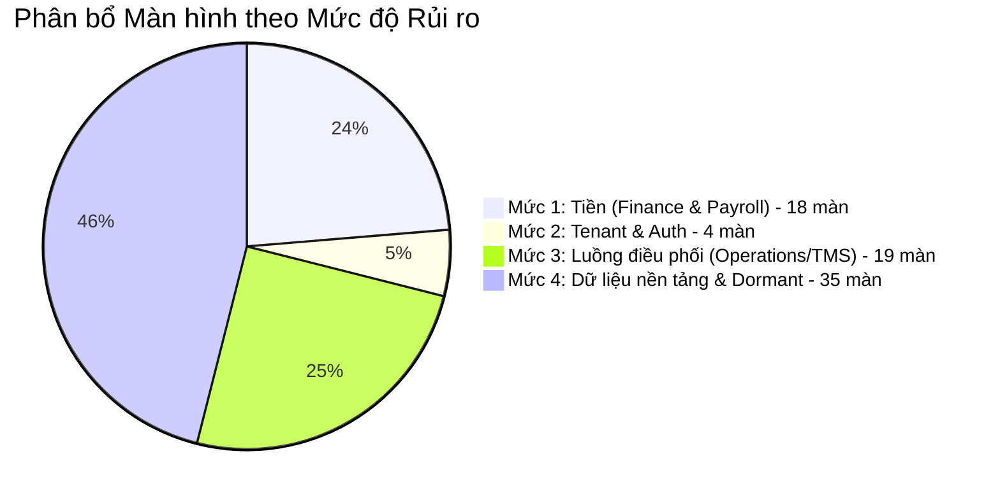

# CHỈ MỤC MÀN HÌNH HỆ THỐNG TMS (SCREEN INDEX)

> **Dự án:** `logictics-app` (Frontend Logistics TMS)  
> **Thời điểm lập:** 26/10/2026  
> **Nguồn đối soát thực tế:**
> - Tuyến đường khai báo: [`src/constants/routes.ts`](file:///home/vumoi/logictics-app/src/constants/routes.ts)
> - Cấu hình Router runtime: [`src/router/AppRouter.tsx`](file:///home/vumoi/logictics-app/src/router/AppRouter.tsx)
> - Bộ lọc Resource Refine: [`src/pages/resourceRegistry.ts`](file:///home/vumoi/logictics-app/src/pages/resourceRegistry.ts) & [`src/pages/index.ts`](file:///home/vumoi/logictics-app/src/pages/index.ts)
> - Năng lực CRUD theo resource: [`src/components/resources/resourceCapabilities.ts`](file:///home/vumoi/logictics-app/src/components/resources/resourceCapabilities.ts)
> - Thanh điều hướng & Menu phân khu: [`src/components/AppSider.tsx`](file:///home/vumoi/logictics-app/src/components/AppSider.tsx) & [`src/components/appNavigation.tsx`](file:///home/vumoi/logictics-app/src/components/appNavigation.tsx)
> - Ma trận phân quyền RBAC: [`src/providers/permissions/roleMatrix.ts`](file:///home/vumoi/logictics-app/src/providers/permissions/roleMatrix.ts)
> 
> **Nguyên tắc kiểm kê:** Chỉ ghi nhận những gì thực tế tồn tại trong mã nguồn, có dẫn chứng file và dòng cụ thể, không suy đoán.

---

## 1. Bảng Thống Kê Tổng Quan (System Metrics)

| Phân loại màn hình | Số lượng | Tỷ lệ | Định nghĩa & Bằng chứng mã nguồn |
| :--- | :---: | :---: | :--- |
| **Màn hình hoạt động (Active & Mounted)** | **42** | **58.3%** | Được mount trực tiếp trong `AppRouter.tsx`, có component xử lý và backend API hỗ trợ đầy đủ. |
| **Màn hình ẩn sau Feature Flag (Feature-Flagged)** | **2** | **2.8%** | Bị kiểm soát bởi cờ runtime (`EXECUTIVE_CONTRACT_CONFIRMED = false`, tự redirect sang Operations/TMS). |
| **Màn hình bị khóa quyền ghi (Capability Disabled)** | **8** | **11.1%** | Đã viết UI nhưng bị vô hiệu hóa route trong `AppRouter.tsx:291` do cờ versioned-writes hoặc commands chưa sẵn sàng (`loads.edit`, `trips.edit`, `trucks.edit`, `payments.create`, `payments.edit`, `documents.create`, `notifications.create`, `notifications.edit`). |
| **Màn hình ngủ đông (Dormant / No Backend)** | **19** | **26.4%** | Có code page trong `src/pages/` nhưng bị lọc bỏ hoàn toàn khỏi `foundationApiResources` (containers, load-board, products, expenses, maintenance, hos-eld, accidents, dvir). |
| **Màn hình mồ côi (Unrouted / Dead Code)** | **1** | **1.4%** | File [`src/pages/map/MapPage.tsx`](file:///home/vumoi/logictics-app/src/pages/map/MapPage.tsx) tồn tại nhưng không được import hay trỏ bởi bất kỳ route nào. |
| **TỔNG CỘNG MÀN HÌNH KHAI BÁO** | **72** | **100%** | Tổng số biến thể màn hình được khai báo trong hệ thống. |

---

## 2. Xếp Hạng Mức Độ Rủi Ro (Risk Levels)

Hệ thống được phân bổ rủi ro theo 4 cấp độ nghiêm ngặt:

1. **MỨC ĐỘ 1: TIỀN (Financial Impact - RẤT CAO)**  
   *Bao gồm các màn hình liên quan trực tiếp đến dòng tiền, công nợ, tính thuế, thù lao tài xế, khóa bảng lương và đối soát ngân hàng.*  
   - Hóa đơn khách hàng (`Invoices`)
   - Thu tiền & Thanh toán (`Payments`)
   - Quyết toán tài xế (`Settlements`)
   - Chính sách thù lao tài xế (`Driver Pay Policies`)
   - Bảng lương & Chi trả (`Payroll Runs`)
   - Đối soát ngân hàng (`Payroll Reconciliation`)
   - Phiếu lương tài xế (`Payslips`)
   - Lợi nhuận chuyến hàng (`Profitability`)

2. **MỨC ĐỘ 2: TENANT & AUTH (Security & Tenant Isolation - CAO)**  
   *Bao gồm các màn hình xác thực, đăng nhập tập trung, ủy quyền danh tính và chuyển đổi không gian làm việc doanh nghiệp.*  
   - Đăng nhập hệ thống (`Login`)
   - Xác thực Lark Suite OAuth (`Lark Callback`)
   - Chọn & Chuyển đổi công ty thuê bao (`Select Tenant`)
   - Kiểm tra chẩn đoán hệ thống (`Diagnostics`)

3. **MỨC ĐỘ 3: LUỒNG ĐIỀU PHỐI (Operations & Dispatching - TRUNG BÌNH CAO)**  
   *Bao gồm các trung tâm điều khiển vận hành, lập kế hoạch ghép chuyến, gợi ý AI và giám sát hành trình.*  
   - Giám sát điều hành thời gian thực (`Operations Dashboard`)
   - Bàn làm việc điều phối TMS (`TMS Flow: Dashboard, Dispatch, Approvals, Shipment Detail`)
   - Điều phối thông minh bằng AI (`AI Dispatch`)
   - Tối ưu hóa phân bổ chuyến đi (`Optimization`)
   - Báo cáo chỉ số đội xe (`Fleet Reports`)
   - Quản lý chuyến hàng & Vận đơn (`Loads`)
   - Quản lý chuyến xe (`Trips`)

4. **MỨC ĐỘ 4: CÒN LẠI (Master Data, Platform & Utilities - TRUNG BÌNH / THẤP)**  
   *Bao gồm dữ liệu danh mục tĩnh, hồ sơ tài sản, kho bãi, tài liệu và các module đang trong quá trình phát triển.*  
   - Khách hàng (`Customers`)
   - Nhân viên & Tài xế (`Employees`)
   - Phương tiện xe đầu kéo (`Trucks`)
   - Cảng & Bến bãi bốc dỡ (`Terminals`)
   - Hồ sơ tài liệu (`Documents`)
   - Thông báo hệ thống (`Notifications`)
   - Trang lỗi hệ thống (`403 Forbidden`, `404 Not Found`)
   - Các module tương lai (`Containers`, `Load Board`, `Products`, `Expenses`, `Maintenance`, `HOS/ELD`, `Accidents`, `DVIR`)

---

## 3. Danh Sách Màn Hình Chi Tiết Theo Phân Nhóm Nghiệp Vụ & Portal

---

### PHÂN NHÓM 1: TÀI CHÍNH, LƯƠNG & DÒNG TIỀN (MỨC ĐỘ 1 - TIỀN)

```
[Portal: Finance & Payroll Zone]
 ├── Hóa đơn (Invoices): Danh sách -> Lập hóa đơn -> Chi tiết -> Sửa (Legacy Draft)
 ├── Thanh toán (Payments): Danh sách -> Chi tiết (Hủy thanh toán)
 ├── Báo cáo Lợi nhuận (Profitability): Doanh thu chuyến hàng / Khách hàng
 ├── Quyết toán (Settlements): Danh sách -> Chi tiết (Tính / Duyệt / Khóa / Điều chỉnh / Đảo nợ)
 ├── Chính sách lương (Pay Policies): Danh sách -> Chi tiết phiên bản chính sách
 ├── Bảng lương (Payroll Runs): Màn hình nhập / Tính -> Chi tiết bảng lương -> Phát hành Payslip
 ├── Đối soát ngân hàng (Payroll Reconciliation): Danh sách vụ việc mở -> Đối soát chứng từ
 └── Phiếu lương cá nhân (Payslips): Phiếu lương của tôi -> Chi tiết & Tải PDF
```

| STT | Màn hình / Phân hệ | Tuyến đường (Route) | File Page Component | Loại màn | API chính nó gọi | Quyền yêu cầu (RBAC) | Trạng thái Runtime | Ghi chú & Bằng chứng kỹ thuật |
| :---: | :--- | :--- | :--- | :---: | :--- | :--- | :---: | :--- |
| 1 | **Hóa đơn: Danh sách** | `/invoices` | [`src/pages/invoices/list.tsx`](file:///home/vumoi/logictics-app/src/pages/invoices/list.tsx) | `list` | `GET /api/invoices` | Resource: `invoices`, Action: `list` (Role: `ADMIN`, `ACCOUNTANT`) | **ACTIVE** | Sử dụng Refine `useTable`. Có filter theo `status`, `type`, `customerId`. |
| 2 | **Hóa đơn: Tạo mới** | `/invoices/create` | [`src/pages/invoices/create.tsx`](file:///home/vumoi/logictics-app/src/pages/invoices/create.tsx) | `create` | `POST /api/invoices`, `GET /api/invoices/rates/preview` | Resource: `invoices`, Action: `create` (Role: `ACCOUNTING`) | **ACTIVE** | Gọi invoice rating snapshot. Backend cấm gửi legacy payroll fields. |
| 3 | **Hóa đơn: Chi tiết** | `/invoices/show/:id` | [`src/pages/invoices/show.tsx`](file:///home/vumoi/logictics-app/src/pages/invoices/show.tsx) | `show` | `GET /api/invoices/:id`, `POST /api/invoices/:id/issue`, `POST /api/invoices/:id/correct` | Resource: `invoices`, Action: `show` (Role: `ACCOUNTING`) | **ACTIVE** | Hiển thị PDF preview, tính năng phát hành (`issue`) và tạo Credit Note điều chỉnh (`correct`). |
| 4 | **Hóa đơn: Chỉnh sửa** | `/invoices/edit/:id` | [`src/pages/invoices/edit.tsx`](file:///home/vumoi/logictics-app/src/pages/invoices/edit.tsx) | `edit` | `PUT /api/invoices/:id` | Resource: `invoices`, Action: `edit` (Role: `ACCOUNTING`) | **ACTIVE (Conditional)** | Chỉ cho phép sửa khi hóa đơn là Legacy Draft (`isLegacyDraftInvoice`). Hóa đơn đã phát hành bị cấm sửa. |
| 5 | **Thanh toán: Danh sách** | `/payments` | [`src/pages/payments/list.tsx`](file:///home/vumoi/logictics-app/src/pages/payments/list.tsx) | `list` | `GET /api/payments` | Resource: `payments`, Action: `list` (Role: `ACCOUNTING`) | **ACTIVE** | Hiển thị bảng thanh toán, lọc theo `invoiceId`, `status`. Số tiền format qua `money`. |
| 6 | **Thanh toán: Chi tiết** | `/payments/show/:id` | [`src/pages/payments/show.tsx`](file:///home/vumoi/logictics-app/src/pages/payments/show.tsx) | `show` | `GET /api/payments/:id`, `POST /api/payments/:id/cancel` | Resource: `payments`, Action: `show` (Role: `ACCOUNTING`) | **ACTIVE** | Hiển thị trạng thái, thông tin địa chỉ thanh toán và nút hủy thanh toán có lý do kiểm toán. |
| 7 | **Thanh toán: Tạo mới** | `/payments/create` | [`src/pages/payments/create.tsx`](file:///home/vumoi/logictics-app/src/pages/payments/create.tsx) | `create` | `POST /api/payments` | Resource: `payments`, Action: `create` | **CAPABILITY_DISABLED** | Bị chặn bởi `PAYMENT_COMMANDS_RUNTIME_VERIFIED = false` tại `resourceCapabilities.ts:23`. Route không được mount. |
| 8 | **Thanh toán: Chỉnh sửa** | `/payments/edit/:id` | [`src/pages/payments/edit.tsx`](file:///home/vumoi/logictics-app/src/pages/payments/edit.tsx) | `edit` | `PUT /api/payments/:id` | Resource: `payments`, Action: `edit` | **CAPABILITY_DISABLED** | Bị chặn bởi `PAYMENT_COMMANDS_RUNTIME_VERIFIED = false`. Backend không cho phép sửa dòng thanh toán tiền mặt. |
| 9 | **Lợi nhuận Chuyến hàng** | `/finance/profitability` | [`src/pages/profitability/ProfitabilityPage.tsx`](file:///home/vumoi/logictics-app/src/pages/profitability/ProfitabilityPage.tsx) | `dashboard` | `GET /api/reports/profitability/loads`, `/api/reports/profitability/summary` | Resource: `profitability`, Action: `PROFITABILITY_VIEW` (Role: `PAYROLL`) | **ACTIVE** | Phân tích doanh thu cước vs chi phí nhiên liệu/lương tài xế theo từng chuyến đi. |
| 10 | **Quyết toán: Danh sách** | `/settlements` | [`src/pages/settlements/SettlementList.tsx`](file:///home/vumoi/logictics-app/src/pages/settlements/SettlementList.tsx) | `list` | `GET /api/driver-settlements` | Resource: `settlements`, Action: `SETTLEMENT_VIEW` (Role: `PAYROLL`) | **ACTIVE** | Danh sách quyết toán tài xế theo kỳ. Có Modal tính lương nhanh. |
| 11 | **Quyết toán: Chi tiết** | `/settlements/:id` | [`src/pages/settlements/SettlementShow.tsx`](file:///home/vumoi/logictics-app/src/pages/settlements/SettlementShow.tsx) | `show` | `GET /api/driver-settlements/:id`, các actions: `review`, `approve`, `lock`, `adjust`, `reverse`, `recalculate-revenue` | Resource: `settlements`, Action: `SETTLEMENT_VIEW` (Role: `PAYROLL`) | **ACTIVE** | Trung tâm quản lý máy trạng thái quyết toán tài xế. Tự động kiểm tra tính nhất quán cước hóa đơn `BILL-DEC-006`. |
| 12 | **Chính sách Lương: Danh sách** | `/settlements/policies` | [`src/pages/settlements/DriverPayPolicyList.tsx`](file:///home/vumoi/logictics-app/src/pages/settlements/DriverPayPolicyList.tsx) | `list` | `GET /api/driver-pay-policies` | Resource: `driver-pay-policies`, Action: `POLICY_VIEW` (Role: `PAYROLL`) | **ACTIVE** | Danh sách chính sách thù lao (theo dặm, giờ, % doanh thu, phụ phí). |
| 13 | **Chính sách Lương: Chi tiết** | `/settlements/policies/:id` | [`src/pages/settlements/DriverPayPolicyShow.tsx`](file:///home/vumoi/logictics-app/src/pages/settlements/DriverPayPolicyShow.tsx) | `show` | `GET /api/driver-pay-policies/:id`, `POST /api/driver-pay-policies/:id/versions` | Resource: `driver-pay-policies`, Action: `POLICY_VIEW` (Role: `PAYROLL`) | **ACTIVE** | Xem lịch sử phiên bản bất biến và tạo phiên bản mới có ngày hiệu lực. |
| 14 | **Bảng lương: Màn hình Nhập** | `/payroll` | [`src/pages/payroll/PayrollEntryPage.tsx`](file:///home/vumoi/logictics-app/src/pages/payroll/PayrollEntryPage.tsx) | `create / khác` | `POST /api/payroll/runs/calculate` | Resource: `payroll`, Action: `PAYROLL_VIEW` / `PAYROLL_CALCULATE` (Role: `PAYROLL`) | **ACTIVE** | Cung cấp Card tra cứu Run theo ID và Form tính toán bảng lương từ danh sách settlement IDs. |
| 15 | **Bảng lương: Chi tiết Đợt** | `/payroll/:id` | [`src/pages/payroll/PayrollRunShow.tsx`](file:///home/vumoi/logictics-app/src/pages/payroll/PayrollRunShow.tsx) | `show` | `GET /api/payroll/runs/:id`, các commands: `recalculate`, `submit-review`, `approve`, `lock`, `schedule`, `dispatch` | Resource: `payroll`, Action: `PAYROLL_VIEW` (Role: `PAYROLL`) | **ACTIVE** | Quản lý vòng đời Run (`CALCULATED` -> `LOCKED` -> `COMPLETED`). Điều phối thanh toán Stripe/Bank. |
| 16 | **Bảng lương: Đối soát Ngân hàng** | `/payroll/reconciliation` | [`src/pages/payroll/PayrollReconciliationPage.tsx`](file:///home/vumoi/logictics-app/src/pages/payroll/PayrollReconciliationPage.tsx) | `list / khác` | `GET /api/payroll/reconciliation-cases`, `POST /api/payroll/payments/:id/reconcile-bank` | Resource: `payroll`, Action: `PAYROLL_VIEW` (Role: `PAYROLL`) | **ACTIVE** | Mount khi `PAYROLL_RECONCILIATION_CONTRACT_CONFIRMED = true`. Giải quyết các vụ việc lỗi chi trả. |
| 17 | **Phiếu lương: Của tôi** | `/profile/payslips` | [`src/pages/payslips/MyPayslipsPage.tsx`](file:///home/vumoi/logictics-app/src/pages/payslips/MyPayslipsPage.tsx) | `list` | `GET /api/payslips/my` | Resource: `payslips`, Action: `PAYSLIP_VIEW` (Tất cả JWT roles: `DRIVER`, `ADMIN`, `PAYROLL`...) | **ACTIVE** | Dành riêng cho tài xế/nhân viên tự phục vụ xem danh sách phiếu lương của mình. |
| 18 | **Phiếu lương: Chi tiết & Tải PDF** | `/payslips/:id` | [`src/pages/payslips/PayslipShow.tsx`](file:///home/vumoi/logictics-app/src/pages/payslips/PayslipShow.tsx) | `show` | `GET /api/payslips/:id`, `GET /api/payslips/:id/pdf` | Resource: `payslips`, Action: `PAYSLIP_VIEW` | **ACTIVE** | Hiển thị chi tiết lương ròng, khấu trừ thuế và nút tải file PDF ký số SHA-256. |

---

### PHÂN NHÓM 2: XÁC THỰC, BẢO MẬT & THUÊ BAO (MỨC ĐỘ 2 - TENANT/AUTH)

```
[Portal: Authentication & Tenant Shell]
 ├── Đăng nhập (/login): OIDC SSO & Lark Suite OAuth
 ├── Lark Callback (/auth/callback): Tiếp nhận authorization code & đổi JWT
 ├── Chọn công ty (/select-tenant): Chuyển đổi ngữ cảnh doanh nghiệp (Tenant Key)
 └── Chẩn đoán hệ thống (/diagnostics): Bootstrap validation & probe API Health
```

| STT | Màn hình / Phân hệ | Tuyến đường (Route) | File Page Component | Loại màn | API chính nó gọi | Quyền yêu cầu (RBAC) | Trạng thái Runtime | Ghi chú & Bằng chứng kỹ thuật |
| :---: | :--- | :--- | :--- | :---: | :--- | :--- | :---: | :--- |
| 19 | **Đăng nhập Hệ thống** | `/login` | [`src/pages/auth/LoginPage.tsx`](file:///home/vumoi/logictics-app/src/pages/auth/LoginPage.tsx) | `khác` | `/api/auth/lark/login`, Identity Provider OIDC | Public (Guest route) | **ACTIVE** | Hỗ trợ 2 phương thức: Đăng nhập Lark (Feishu) hoặc OIDC SSO tiêu chuẩn. Có polar-bear UI. |
| 20 | **Lark OAuth Callback** | `/auth/callback` | [`src/pages/auth/LarkCallbackPage.tsx`](file:///home/vumoi/logictics-app/src/pages/auth/LarkCallbackPage.tsx) | `khác` | `POST /api/auth/lark/callback` | Public (Ngoại lệ ngoài Authenticated guard) | **ACTIVE** | Xử lý redirect từ Lark Suite, kiểm tra URL query code/state, nạp access token và tenant claims. |
| 21 | **Chọn Công ty Thuê bao** | `/select-tenant` | [`src/pages/tenant/SelectTenantPage.tsx`](file:///home/vumoi/logictics-app/src/pages/tenant/SelectTenantPage.tsx) | `khác` | `POST /api/tenant/switch`, `GET /api/tenants` | Protected (Yêu cầu đăng nhập, nằm ngoài TenantGuard) | **ACTIVE** | Cho phép người dùng trực thuộc nhiều công ty chọn tenant active trước khi vào MainLayout. |
| 22 | **Chẩn đoán Khởi động** | `/diagnostics` | [`src/pages/diagnostics/DiagnosticsPage.tsx`](file:///home/vumoi/logictics-app/src/pages/diagnostics/DiagnosticsPage.tsx) | `dashboard / khác` | `GET /api/health` | Public / ReadyBootstrapState | **ACTIVE (Conditional)** | Chỉ mount khi `diagnosticsState` được truyền từ bootstrap shell (`AppRouter.tsx:186-191`). |

---

### PHÂN NHÓM 3: ĐIỀU HÀNH, VẬN TẢI & TRÍ TUỆ NHÂN TẠO (MỨC ĐỘ 3 - LUỒNG ĐIỀU PHỐI)

```
[Portal: Operations & Transport Management]
 ├── Giám sát Vận hành (/operations): KPI tổng, xe trên bản đồ, cảnh báo chậm giờ
 ├── Tổng quan Lãnh đạo (/dashboard): [DORMANT] Executive Dashboard (Tắt sau BE-031)
 ├── Không gian TMS Flow (/tms):
 │    ├── Dashboard TMS (/tms)
 │    ├── Bàn điều phối (/tms/dispatch)
 │    ├── Phê duyệt AI (/tms/approvals)
 │    └── Chi tiết Chuyến hàng (/tms/shipments/:shipmentId)
 ├── Điều phối Thông minh AI (/ai-dispatch, /ai-dispatch/:id): Gợi ý ghép xe, phân tích rủi ro
 ├── Tối ưu hóa ghép chuyến (/optimization, /optimization/runs/:id): Chạy thuật toán tối ưu
 ├── Báo cáo Đội xe (/reports/fleet): Tình trạng kỹ thuật, tiêu hao nhiên liệu, bảo dưỡng
 ├── Chuyến hàng (Loads): Danh sách -> Tạo mới -> Chi tiết (Dispatch / Pickup / Deliver)
 └── Chuyến xe (Trips): Danh sách -> Tạo mới -> Chi tiết hành trình
```

| STT | Màn hình / Phân hệ | Tuyến đường (Route) | File Page Component | Loại màn | API chính nó gọi | Quyền yêu cầu (RBAC) | Trạng thái Runtime | Ghi chú & Bằng chứng kỹ thuật |
| :---: | :--- | :--- | :--- | :---: | :--- | :--- | :---: | :--- |
| 23 | **Bàn làm việc Vận hành** | `/operations` | [`src/pages/dashboard/OperationsDashboardPage.tsx`](file:///home/vumoi/logictics-app/src/pages/dashboard/OperationsDashboardPage.tsx) | `dashboard` | `/api/reports/operations/*`, `/api/loads`, `/api/trips`, `/api/trucks` | JWT Roles (Điều hướng mặc định nếu có quyền reports) | **ACTIVE** | Trung tâm điều khiển chính. Có nút chuyển đổi xem thử dữ liệu mẫu (`OperationsDashboardPreview`). |
| 24 | **Tổng quan Lãnh đạo** | `/dashboard` | [`src/pages/dashboard/DashboardPage.tsx`](file:///home/vumoi/logictics-app/src/pages/dashboard/DashboardPage.tsx) | `dashboard` | `/api/reports/financials/monthly`, `/api/reports/fleet/*` | `ADMIN`, `EXECUTIVE` | **DORMANT (Feature Flag OFF)** | Bị tắt bởi `EXECUTIVE_CONTRACT_CONFIRMED = false`. Khi truy cập tự động redirect qua `LandingRedirect`. |
| 25 | **TMS Flow: Tổng quan** | `/tms` | [`src/pages/tms-flow/OperationsDashboardPage.tsx`](file:///home/vumoi/logictics-app/src/pages/tms-flow/OperationsDashboardPage.tsx) | `dashboard` | `/api/loads`, `/api/trucks`, `/api/ai/dispatch/pending` | Resource: `loads`, Action: `list` (Role: `OPERATIONS`) | **ACTIVE** | Màn hình đầu vào của luồng TMS mới, phân loại tải trọng, mức độ rủi ro chuyến hàng. |
| 26 | **TMS Flow: Bàn Điều phối** | `/tms/dispatch` | [`src/pages/tms-flow/DispatchPage.tsx`](file:///home/vumoi/logictics-app/src/pages/tms-flow/DispatchPage.tsx) | `list / khác` | `/api/loads`, `/api/trucks`, `/api/ai/dispatch/pending`, `/api/loads/:id/timeline` | Resource: `loads`, Action: `list` | **ACTIVE** | Bảng kéo thả điều phối xe/tài xế, trực quan hóa trên MapLibre/Leaflet map. |
| 27 | **TMS Flow: Phê duyệt AI** | `/tms/approvals` | [`src/pages/tms-flow/DispatchPage.tsx`](file:///home/vumoi/logictics-app/src/pages/tms-flow/DispatchPage.tsx) | `list / khác` | `/api/ai/dispatch/pending`, `/api/ai/dispatch/decisions/:id/approve` | Resource: `ai-dispatch`, Action: `AI_DISPATCH_VIEW` | **ACTIVE** | Chế độ lọc chuyên biệt `approvalsOnly={true}` của DispatchPage để duyệt quyết định gán xe của AI. |
| 28 | **TMS Flow: Chi tiết Vận đơn** | `/tms/shipments/:shipmentId` | [`src/pages/tms-flow/ShipmentDetailPage.tsx`](file:///home/vumoi/logictics-app/src/pages/tms-flow/ShipmentDetailPage.tsx) | `show` | `/api/loads/:id`, `/api/loads/:id/timeline`, `/api/trucks/:id` | Resource: `loads`, Action: `list` | **ACTIVE** | Xem chi tiết tiến độ chuyến đi, vị trí xe hiện tại, thời gian dừng đón/trả hàng thực tế. |
| 29 | **AI Dispatch: Trung tâm Gợi ý** | `/ai-dispatch` | [`src/pages/ai-dispatch/AiDispatchPage.tsx`](file:///home/vumoi/logictics-app/src/pages/ai-dispatch/AiDispatchPage.tsx) | `dashboard / khác` | `/api/ai/features`, `/api/ai/gaps`, `/api/ai/dispatch/runs`, `/api/ai/dispatch/sessions` | Resource: `ai-dispatch`, Action: `AI_DISPATCH_VIEW` (Role: `DISPATCH`, `MANAGER`) | **ACTIVE** | Giao diện phát hiện điểm nghẽn (Gaps), khởi chạy phiên AI tối ưu và duyệt quyết định gán tài xế. |
| 30 | **AI Dispatch: Chi tiết Phiên** | `/ai-dispatch/:id` | [`src/pages/ai-dispatch/AiDispatchPage.tsx`](file:///home/vumoi/logictics-app/src/pages/ai-dispatch/AiDispatchPage.tsx) | `show` | `/api/ai/dispatch/sessions/:id` | Resource: `ai-dispatch`, Action: `AI_DISPATCH_VIEW` | **ACTIVE** | Mount đồng thời cho cả route `/ai-dispatch/show/:id`. |
| 31 | **Tối ưu hóa: Chạy Lập lịch** | `/optimization` | [`src/pages/optimization/OptimizationPage.tsx`](file:///home/vumoi/logictics-app/src/pages/optimization/OptimizationPage.tsx) | `create / khác` | `POST /api/optimization/runs` | Resource: `optimization`, Action: `OPTIMIZATION_VIEW` (Role: `DISPATCH`) | **ACTIVE** | Nhập tham số cấu hình thuật toán ghép chuyến (khoảng cách tối đa, thời gian chờ, trọng tải). |
| 32 | **Tối ưu hóa: Kết quả Chạy** | `/optimization/runs/:id` | [`src/pages/optimization/OptimizationRunShow.tsx`](file:///home/vumoi/logictics-app/src/pages/optimization/OptimizationRunShow.tsx) | `show` | `GET /api/optimization/runs/:id`, `POST /api/optimization/runs/:id/assignments/:candId/accept` | Resource: `optimization`, Action: `OPTIMIZATION_VIEW` (Role: `DISPATCH`) | **ACTIVE** | Xem trực quan hóa bản đồ, lộ trình đề xuất và chấp nhận phương án tối ưu. |
| 33 | **Báo cáo Đội xe (Fleet)** | `/reports/fleet` | [`src/pages/fleet/FleetReportPage.tsx`](file:///home/vumoi/logictics-app/src/pages/fleet/FleetReportPage.tsx) | `dashboard` | `/api/reports/fleet/health`, `/api/fleet/policies`, `/api/trucks` | Resource: `fleet-reports`, Action: `FLEET_REPORT_VIEW` (Role: `PAYROLL`) | **ACTIVE** | Báo cáo sức khỏe kỹ thuật đội xe, vi phạm tốc độ/quá giờ, lịch sử bảo dưỡng. |
| 34 | **Chuyến hàng (Loads): Danh sách** | `/loads` | [`src/pages/loads/list.tsx`](file:///home/vumoi/logictics-app/src/pages/loads/list.tsx) | `list` | `GET /api/loads` | Resource: `loads`, Action: `list` (Role: `OPERATIONS`) | **ACTIVE** | Quản lý danh sách tải hàng. Hỗ trợ đồng bộ Lark Base (`LARK_BASE_SYNC`). |
| 35 | **Chuyến hàng (Loads): Tạo mới** | `/loads/create` | [`src/pages/loads/create.tsx`](file:///home/vumoi/logictics-app/src/pages/loads/create.tsx) | `create` | `POST /api/loads` | Resource: `loads`, Action: `create` (Role: `OPERATIONS`) | **ACTIVE** | Form tạo vận đơn mới: địa điểm nhận/giao, kích thước, trọng lượng, cước dự kiến. |
| 36 | **Chuyến hàng (Loads): Chi tiết** | `/loads/show/:id` | [`src/pages/loads/show.tsx`](file:///home/vumoi/logictics-app/src/pages/loads/show.tsx) | `show` | `GET /api/loads/:id`, actions: `dispatch`, `pickup`, `deliver`, `cancel` | Resource: `loads`, Action: `show` (Role: `OPERATIONS`) | **ACTIVE** | Chi tiết vòng đời đơn hàng, gán xe/tài xế, đối soát chi phí chuyến đi (`shipment-costs`). |
| 37 | **Chuyến hàng (Loads): Sửa** | `/loads/edit/:id` | [`src/pages/loads/edit.tsx`](file:///home/vumoi/logictics-app/src/pages/loads/edit.tsx) | `edit` | `PUT /api/loads/:id` | Resource: `loads`, Action: `edit` | **CAPABILITY_DISABLED** | Bị vô hiệu hóa bởi `CORE_VERSIONED_WRITES_RUNTIME_VERIFIED = false` tại `resourceCapabilities.ts:20`. |
| 38 | **Chuyến xe (Trips): Danh sách** | `/trips` | [`src/pages/trips/list.tsx`](file:///home/vumoi/logictics-app/src/pages/trips/list.tsx) | `list` | `GET /api/trips` | Resource: `trips`, Action: `list` (Role: `DISPATCH`) | **ACTIVE** | Danh sách hành trình xe di chuyển thực tế. |
| 39 | **Chuyến xe (Trips): Tạo mới** | `/trips/create` | [`src/pages/trips/create.tsx`](file:///home/vumoi/logictics-app/src/pages/trips/create.tsx) | `create` | `POST /api/trips` | Resource: `trips`, Action: `create` (Role: `DISPATCH`) | **ACTIVE** | Ghép chuyến xe từ các chuyến hàng đã gom. |
| 40 | **Chuyến xe (Trips): Chi tiết** | `/trips/show/:id` | [`src/pages/trips/show.tsx`](file:///home/vumoi/logictics-app/src/pages/trips/show.tsx) | `show` | `GET /api/trips/:id`, actions: `dispatch`, `complete`, `cancel` | Resource: `trips`, Action: `show` (Role: `DISPATCH`) | **ACTIVE** | Theo dõi dừng đỗ (Trip Stops), cập nhật số odometer thực tế (Actual Miles). |
| 41 | **Chuyến xe (Trips): Sửa** | `/trips/edit/:id` | [`src/pages/trips/edit.tsx`](file:///home/vumoi/logictics-app/src/pages/trips/edit.tsx) | `edit` | `PUT /api/trips/:id` | Resource: `trips`, Action: `edit` | **CAPABILITY_DISABLED** | Bị vô hiệu hóa bởi `CORE_VERSIONED_WRITES_RUNTIME_VERIFIED = false` tại `resourceCapabilities.ts:21`. |

---

### PHÂN NHÓM 4: DỮ LIỆU NỀN TẢNG, PHƯƠNG TIỆN & HỆ THỐNG (MỨC ĐỘ 4 - CÒN LẠI)

```
[Portal: Master Data & Platform Utilities]
 ├── Khách hàng (Customers): Danh sách -> Tạo mới -> Sửa -> Chi tiết
 ├── Nhân sự & Tài xế (Employees): Danh sách -> Tạo mới -> Sửa -> Chi tiết
 ├── Xe đầu kéo (Trucks): Danh sách -> Tạo mới -> Chi tiết (Sửa bị vô hiệu)
 ├── Cảng & Bến bãi (Terminals): Danh sách -> Tạo mới -> Sửa -> Chi tiết (Tab Container)
 ├── Tài liệu đính kèm (Documents): Danh sách -> Chi tiết (Upload/Sửa bị vô hiệu)
 ├── Thông báo (Notifications): Danh sách -> Chi tiết (Đánh dấu đã đọc)
 └── Lỗi hệ thống: 403 Forbidden -> 404 Not Found
```

| STT | Màn hình / Phân hệ | Tuyến đường (Route) | File Page Component | Loại màn | API chính nó gọi | Quyền yêu cầu (RBAC) | Trạng thái Runtime | Ghi chú & Bằng chứng kỹ thuật |
| :---: | :--- | :--- | :--- | :---: | :--- | :--- | :---: | :--- |
| 42 | **Khách hàng: Danh sách** | `/customers` | [`src/pages/customers/list.tsx`](file:///home/vumoi/logictics-app/src/pages/customers/list.tsx) | `list` | `GET /api/customers` | Resource: `customers`, Action: `list` (Role: `OPERATIONS`) | **ACTIVE** | Quản lý danh mục đối tác thuê vận chuyển. Lọc `search`, `status`. |
| 43 | **Khách hàng: Tạo mới** | `/customers/create` | [`src/pages/customers/create.tsx`](file:///home/vumoi/logictics-app/src/pages/customers/create.tsx) | `create` | `POST /api/customers` | Resource: `customers`, Action: `create` (Role: `OPERATIONS`) | **ACTIVE** | Đăng ký thông tin pháp nhân, mã số thuế, hạn mức công nợ. |
| 44 | **Khách hàng: Sửa** | `/customers/edit/:id` | [`src/pages/customers/edit.tsx`](file:///home/vumoi/logictics-app/src/pages/customers/edit.tsx) | `edit` | `PUT /api/customers/:id` | Resource: `customers`, Action: `edit` (Role: `OPERATIONS`) | **ACTIVE** | Cập nhật thông tin liên hệ và hợp đồng cước. |
| 45 | **Khách hàng: Chi tiết** | `/customers/show/:id` | [`src/pages/customers/show.tsx`](file:///home/vumoi/logictics-app/src/pages/customers/show.tsx) | `show` | `GET /api/customers/:id` | Resource: `customers`, Action: `show` (Role: `OPERATIONS`) | **ACTIVE** | Xem lịch sử đơn hàng, công nợ lũy kế. |
| 46 | **Nhân sự: Danh sách** | `/employees` | [`src/pages/employees/list.tsx`](file:///home/vumoi/logictics-app/src/pages/employees/list.tsx) | `list` | `GET /api/employees` | Resource: `employees`, Action: `list` (Role: `DISPATCH`) | **ACTIVE** | Quản lý hồ sơ nhân viên điều hành và tài xế. |
| 47 | **Nhân sự: Tạo mới** | `/employees/create` | [`src/pages/employees/create.tsx`](file:///home/vumoi/logictics-app/src/pages/employees/create.tsx) | `create` | `POST /api/employees` | Resource: `employees`, Action: `create` (Role: `DISPATCH`) | **ACTIVE** | Thêm nhân viên/tài xế, gắn số GPLX, số điện thoại, tài khoản Stripe. |
| 48 | **Nhân sự: Sửa** | `/employees/edit/:id` | [`src/pages/employees/edit.tsx`](file:///home/vumoi/logictics-app/src/pages/employees/edit.tsx) | `edit` | `PUT /api/employees/:id` | Resource: `employees`, Action: `edit` (Role: `DISPATCH`) | **ACTIVE** | Cập nhật thông tin nhân viên, điều chỉnh vai trò. |
| 49 | **Nhân sự: Chi tiết** | `/employees/show/:id` | [`src/pages/employees/show.tsx`](file:///home/vumoi/logictics-app/src/pages/employees/show.tsx) | `show` | `GET /api/employees/:id` | Resource: `employees`, Action: `show` (Role: `DISPATCH`) | **ACTIVE** | Xem thông tin hồ sơ thuế, phân loại lao động (`EMPLOYEE` / `CONTRACTOR`). |
| 50 | **Xe tải: Danh sách** | `/trucks` | [`src/pages/trucks/list.tsx`](file:///home/vumoi/logictics-app/src/pages/trucks/list.tsx) | `list` | `GET /api/trucks` | Resource: `trucks`, Action: `list` (Role: `OPERATIONS`) | **ACTIVE** | Quản lý đội xe, phân loại loại rơ-moóc/tải trọng, trạng thái bảo dưỡng. |
| 51 | **Xe tải: Tạo mới** | `/trucks/create` | [`src/pages/trucks/create.tsx`](file:///home/vumoi/logictics-app/src/pages/trucks/create.tsx) | `create` | `POST /api/trucks` | Resource: `trucks`, Action: `create` (Role: `OPERATIONS`) | **ACTIVE** | Nhập biển số xe, số khung VIN, hạn đăng kiểm. |
| 52 | **Xe tải: Chi tiết** | `/trucks/show/:id` | [`src/pages/trucks/show.tsx`](file:///home/vumoi/logictics-app/src/pages/trucks/show.tsx) | `show` | `GET /api/trucks/:id` | Resource: `trucks`, Action: `show` (Role: `OPERATIONS`) | **ACTIVE** | Xem lịch sử phân công chuyến, chi phí bảo trì tích lũy. |
| 53 | **Xe tải: Sửa** | `/trucks/edit/:id` | [`src/pages/trucks/edit.tsx`](file:///home/vumoi/logictics-app/src/pages/trucks/edit.tsx) | `edit` | `PUT /api/trucks/:id` | Resource: `trucks`, Action: `edit` | **CAPABILITY_DISABLED** | Bị vô hiệu hóa bởi `CORE_VERSIONED_WRITES_RUNTIME_VERIFIED = false` tại `resourceCapabilities.ts:22`. |
| 54 | **Bến bãi/Cảng: Danh sách** | `/terminals` | [`src/pages/terminals/list.tsx`](file:///home/vumoi/logictics-app/src/pages/terminals/list.tsx) | `list` | `GET /api/terminals` | Resource: `terminals`, Action: `list` (Tất cả JWT roles) | **ACTIVE** | Danh sách cảng biển, bến bãi ICD, trạm trung chuyển. |
| 55 | **Bến bãi/Cảng: Tạo mới** | `/terminals/create` | [`src/pages/terminals/create.tsx`](file:///home/vumoi/logictics-app/src/pages/terminals/create.tsx) | `create` | `POST /api/terminals` | Resource: `terminals`, Action: `create` (Role: `ADMIN`, `DISPATCHER`...) | **ACTIVE** | Thêm mới bến bãi, mã UN/LOCODE (5 ký tự chuẩn). |
| 56 | **Bến bãi/Cảng: Sửa** | `/terminals/edit/:id` | [`src/pages/terminals/edit.tsx`](file:///home/vumoi/logictics-app/src/pages/terminals/edit.tsx) | `edit` | `PUT /api/terminals/:id` | Resource: `terminals`, Action: `edit` (Role: `ADMIN`, `DISPATCHER`...) | **ACTIVE** | Cập nhật địa chỉ, tọa độ địa lý cảng. |
| 57 | **Bến bãi/Cảng: Chi tiết** | `/terminals/show/:id` | [`src/pages/terminals/show.tsx`](file:///home/vumoi/logictics-app/src/pages/terminals/show.tsx) | `show` | `GET /api/terminals/:id`, `GET /api/containers?currentTerminalId=...` | Resource: `terminals`, Action: `show` (Tất cả JWT roles) | **ACTIVE** | Hiển thị thông tin cảng và tab danh sách container đang lưu bãi. |
| 58 | **Tài liệu: Danh sách** | `/documents` | [`src/pages/documents/list.tsx`](file:///home/vumoi/logictics-app/src/pages/documents/list.tsx) | `list` | `GET /api/documents` | Resource: `documents`, Action: `list` (Role: `OPERATIONS`) | **ACTIVE** | Quản lý chứng từ vận tải (POD, hóa đơn xăng dầu, biên bản giao nhận). |
| 59 | **Tài liệu: Chi tiết** | `/documents/show/:id` | [`src/pages/documents/show.tsx`](file:///home/vumoi/logictics-app/src/pages/documents/show.tsx) | `show` | `GET /api/documents/:id`, `GET /api/documents/:id/download` | Resource: `documents`, Action: `show` (Role: `OPERATIONS`) | **ACTIVE** | Xem chi tiết tệp, mã băm, kích thước và tải về. |
| 60 | **Tài liệu: Tạo / Tải lên** | `/documents/create` | [`src/pages/documents/create.tsx`](file:///home/vumoi/logictics-app/src/pages/documents/create.tsx) | `create` | `POST /api/documents` | Resource: `documents`, Action: `create` | **CAPABILITY_DISABLED** | Bị vô hiệu hóa bởi `resourceCapabilities.ts:25` do chưa có adapter multipart upload. |
| 61 | **Tài liệu: Sửa** | `/documents/edit/:id` | [`src/pages/documents/edit.tsx`](file:///home/vumoi/logictics-app/src/pages/documents/edit.tsx) | `edit` | `PUT /api/documents/:id` | Resource: `documents`, Action: `edit` | **CAPABILITY_DISABLED** | Bị vô hiệu hóa bởi `resourceCapabilities.ts:25`. |
| 62 | **Thông báo: Danh sách** | `/notifications` | [`src/pages/notifications/list.tsx`](file:///home/vumoi/logictics-app/src/pages/notifications/list.tsx) | `list` | `GET /api/notifications` | Resource: `notifications`, Action: `list` (Tất cả JWT roles) | **ACTIVE** | Danh sách thông báo đẩy từ hệ thống. |
| 63 | **Thông báo: Chi tiết** | `/notifications/show/:id` | [`src/pages/notifications/show.tsx`](file:///home/vumoi/logictics-app/src/pages/notifications/show.tsx) | `show` | `GET /api/notifications/:id` | Resource: `notifications`, Action: `show` (Tất cả JWT roles) | **ACTIVE** | Xem nội dung thông báo và đánh dấu đã đọc. |
| 64 | **Thông báo: Tạo mới** | `/notifications/create` | [`src/pages/notifications/create.tsx`](file:///home/vumoi/logictics-app/src/pages/notifications/create.tsx) | `create` | `POST /api/notifications` | Resource: `notifications`, Action: `create` | **CAPABILITY_DISABLED** | Bị vô hiệu hóa bởi `resourceCapabilities.ts:26`. Thông báo do backend sinh tự động. |
| 65 | **Thông báo: Sửa** | `/notifications/edit/:id` | [`src/pages/notifications/edit.tsx`](file:///home/vumoi/logictics-app/src/pages/notifications/edit.tsx) | `edit` | `PUT /api/notifications/:id` | Resource: `notifications`, Action: `edit` | **CAPABILITY_DISABLED** | Bị vô hiệu hóa bởi `resourceCapabilities.ts:26`. |
| 66 | **Lỗi 403 Forbidden** | `/403` | [`src/pages/errors/ForbiddenPage.tsx`](file:///home/vumoi/logictics-app/src/pages/errors/ForbiddenPage.tsx) | `khác` | Không | Public | **ACTIVE** | Hiển thị khi người dùng không đủ quyền RBAC truy cập màn hình. |
| 67 | **Lỗi 404 Not Found** | `/404` & `*` | [`src/pages/errors/NotFoundPage.tsx`](file:///home/vumoi/logictics-app/src/pages/errors/NotFoundPage.tsx) | `khác` | Không | Public | **ACTIVE** | Bắt mọi đường dẫn không tồn tại trong hệ thống. |

---

### PHÂN NHÓM 5: CÁC MÀN HÌNH NGỦ ĐÔNG & CHƯA HỖ TRỢ BACKEND (DORMANT / FUTURE MODULES)

> [!WARNING]
> Toàn bộ các màn hình dưới đây đã có sẵn tệp mã nguồn tại `src/pages/*`, nhưng **bị lọc bỏ hoàn toàn** khỏi `foundationApiResources` trong [`src/pages/resourceRegistry.ts:140-154`](file:///home/vumoi/logictics-app/src/pages/resourceRegistry.ts#L140-L154). Người dùng không thể truy cập các màn hình này trên runtime (truy cập URL trực tiếp sẽ rơi vào `NotFoundPage` 404).

| STT | Phân hệ dự kiến | Đường dẫn dự kiến | File Page Component | Loại màn | Lý do chưa thể hoạt động trong Runtime |
| :---: | :--- | :--- | :--- | :---: | :--- |
| 68 | **Containers (Thùng hàng)** | `/containers` (list, create, edit, show) | `src/pages/containers/{list,create,edit,show}.tsx` | CRUD | Chưa được khai báo trong `foundationApiResources`. Chỉ mới có API đọc phụ trợ tại Tab của Terminal. |
| 69 | **Load Board (Sàn tìm hàng)** | `/load-board` (list, create, edit, show) | `src/pages/load-board/{list,create,edit,show}.tsx` | CRUD | Chưa có backend endpoint `/api/load-board` tương ứng. |
| 70 | **Products (Danh mục hàng hóa)** | `/products` (list, create, edit, show) | `src/pages/products/{list,create,edit,show}.tsx` | CRUD | Chưa có backend endpoint `/api/products` tương ứng. |
| 71 | **Expenses (Chi phí vận tải)** | ~~`/expenses`~~ — đã gỡ route 2026-11-03 | Đã xoá `src/pages/expenses/*` và `src/features/expenses/*` | — | Quyết định gỡ thay vì xây CRUD (không có API CRUD). Expense vẫn được duyệt qua API và chiếu vào lợi nhuận khi APPROVED. |
| 72 | **Maintenance (Bảo dưỡng xe)** | `/maintenance` (list, create, edit, show) | `src/pages/maintenance/{list,create,edit,show}.tsx` | CRUD | Dữ liệu bảo dưỡng hiện được chiếu sang qua báo cáo `FleetReportPage` (`/reports/fleet`). |
| 73 | **HOS / ELD (Nhật ký hành trình)** | `/hos-eld` (list, create, edit, show) | `src/pages/hos-eld/{list,create,edit,show}.tsx` | CRUD | Chưa có tích hợp thiết bị phần cứng ELD thật vào backend. |
| 74 | **Accidents (Biên bản sự cố)** | `/accidents` (list, create, edit, show) | `src/pages/accidents/{list,create,edit,show}.tsx` | CRUD | Chưa có controller xử lý sự cố tai nạn trong Spring Boot backend. |
| 75 | **DVIR (Kiểm tra xe trước chuyến)** | `/dvir` (list, create, edit, show) | `src/pages/dvir/{list,create,edit,show}.tsx` | CRUD | Chưa có bảng dữ liệu kiểm định xe trong DB backend. |
| 76 | **Map (Bản đồ độc lập)** | Không có route | [`src/pages/map/MapPage.tsx`](file:///home/vumoi/logictics-app/src/pages/map/MapPage.tsx) | `khác` | **Màn hình mồ côi (Unrouted)**: File tồn tại nhưng không được import ở bất cứ đâu trong AppRouter hay Navigation. Bản đồ thực tế hiện nhúng trực tiếp trong `OperationsDashboardPage` và `TmsFlowMap`. |

---

## 4. Tổng Kết Phân Bổ Màn Hình & Kiến Nghị Kiến Trúc

### Ma trận đối soát theo mức độ rủi ro:



### Kiến nghị cho QA & Kiến trúc sư Phần mềm:
1. **Kiểm thử trọng tâm (Focus Testing)**: Ưu tiên 100% tài nguyên kiểm thử vào 18 màn hình thuộc **Mức 1 (Tiền)** và 4 màn hình thuộc **Mức 2 (Tenant & Auth)** vì ảnh hưởng trực tiếp đến tính toàn vẹn số liệu kế toán và an toàn dữ liệu khách hàng.
2. **Dọn dẹp mã chết (Dead Code Cleanup)**: Các file page mồ côi như [`src/pages/map/MapPage.tsx`](file:///home/vumoi/logictics-app/src/pages/map/MapPage.tsx) hoặc các wrapper rỗng như `src/pages/ai-dispatch/{list,create,edit,show}.tsx` nên được lập kế hoạch thu dọn để giảm tải kích thước bundle.
3. **Mở khóa năng lực ghi (Unblocking Versioned Writes)**: Khi backend hoàn tất cơ chế khóa lạc quan cho Trucks/Loads/Trips, cần cập nhật cờ `CORE_VERSIONED_WRITES_RUNTIME_VERIFIED = true` tại `resourceCapabilities.ts` để đưa các màn hình chỉnh sửa `/loads/edit/:id`, `/trips/edit/:id`, `/trucks/edit/:id` vào hoạt động chính thức.
