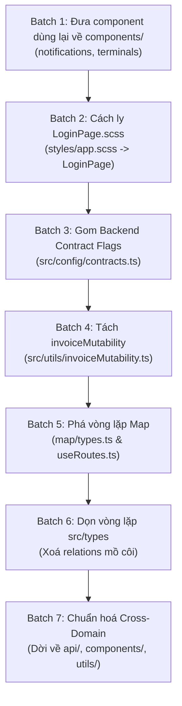

# Kế hoạch Tái cấu trúc: Chuyển đổi sang Cấu trúc Toàn cục (Global Type-based Architecture)

> **Cập nhật kiến trúc (theo `AGENTS.md`)**: Dự án đã chính thức chuyển đổi mục tiêu từ mô hình feature-based (`src/features/`) sang **cấu trúc phân tầng theo loại file ở tầng global**. Thư mục `src/features/` sẽ được giải thể, chuyển toàn bộ file về các thư mục chức năng global (`src/api`, `src/components`, `src/hooks`, `src/pages`, `src/resources`, `src/types`, `src/utils`).  
> **Quy tắc cốt lõi**:
> - Đường dẫn import tường minh đầy đủ qua `@/`, **không tạo `index.ts` gom export**.
> - Chiều phụ thuộc một chiều: `App`/`resources` -> `pages` -> `components` -> `hooks` -> `api` -> `types`/`utils`/`lib`/`constants`. Tầng dưới không import tầng trên.
> - `types/` chỉ chứa type thuần: không chứa resource config, không endpoint, không hằng số.
> - `utils/` chỉ chứa hàm thuần (không React hook, không gọi API), dùng từ 3 nơi trở lên.
> - Page mỏng: chỉ ghép component và hook; logic ở hooks, gọi API ở api.

```
src/
├── api/          # hàm gọi API: api/<domain>/<domain>.api.ts
├── components/   # component dùng lại: components/<domain>/
├── hooks/        # mọi hook: hooks/<domain>/use*.ts
├── pages/        # mỗi màn hình một file: pages/<domain>/
├── resources/    # định nghĩa resource Refine
├── types/        # chỉ type thuần: types/<domain>/*.types.ts
├── utils/        # hàm thuần dùng chung, chia theo chủ đề
├── constants/    # routes, enum
├── lib/          # axios client, query client, i18n
├── locales/
├── App.tsx
└── main.tsx
```

---

## MỤC LỤC
1. [Tổng hợp kết quả quét hiện trạng](#1-tổng-hợp-kết-quả-quét-hiện-trạng)
2. [Phần 1: Tham chiếu từ tầng dùng chung lên Features/Pages (9 tham chiếu)](#2-phần-1-tham-chiếu-từ-tầng-dùng-chung-lên-featurespages-9-tham-chiếu)
3. [Phần 2: Xử lý phụ thuộc chéo giữa các domain theo cấu trúc Global](#3-phần-2-xử-lý-phụ-thuộc-chéo-giữa-các-domain-theo-cấu-trúc-global)
4. [Phần 3: Hai nhóm vòng lặp Import Type-only (Group A & Group B)](#4-phần-3-hai-nhóm-vòng-lặp-import-type-only-group-a--group-b)
5. [Đề xuất Lộ trình thực thi chia nhỏ (7 Batches)](#5-đề-xuất-lộ-trình-thực-thi-chia-nhỏ-7-batches)
6. [Danh sách các Quyết định cần Người dùng (USER) Chốt](#6-danh-sách-các-quyết-định-cần-người-dùng-user-chốt)

---

## 1. Tổng hợp kết quả quét hiện trạng

Từ phân tích AST toàn bộ thư mục `src/`:
- **Tham chiếu từ tầng dùng chung (Shared layer) lên Features/Pages**: Đúng **9 tham chiếu** như yêu cầu ban đầu (gồm `ActionButtons`, `ResourceShowPage`, `AppSider` (3 imports), `appNavigation`, `resourceCapabilities`, `AddressFields`, và `styles/app.scss`).
  *(Lưu ý: `src/router/AppRouter.tsx` cũng có tham chiếu lên feature flags `PAYROLL_RECONCILIATION_CONTRACT_CONFIRMED` và `EXECUTIVE_CONTRACT_CONFIRMED`, sẽ được giải quyết đồng bộ trong batch chuyển feature flags).*
- **Import sâu giữa các Feature (Cross-feature deep imports)**: Xác định được **12 câu lệnh import** trực tiếp giữa các feature (trước đây gom theo 8 cụm phụ thuộc nghiệp vụ). Tất cả đều là deep import do hiện tại chỉ có 3 feature có `index.ts` (`notifications`, `terminals`, `dashboard`).
- **Hai nhóm vòng lặp import Type-only**:
  - **Group A (`src/types`)**: 3 chu trình vòng lặp giữa `document.types.ts`, `employee.types.ts`, `invoice.types.ts`, `load.types.ts`, `truck.types.ts`. Phát hiện quan trọng: Toàn bộ vòng lặp xuất phát từ các interface `*WithRelations` hoàn toàn không có caller nào trong toàn bộ dự án (dead code).
  - **Group B (`src/features/map`)**: 2 chu trình vòng lặp giữa `useRoutes.ts`, `polyline.ts`, `types.ts`. Nguyên nhân do dòng `export type { RouteRequest } from "./hooks/useRoutes"` tại `types.ts:135`.

---

## 2. Phần 1: Tham chiếu từ tầng dùng chung lên Features/Pages (9 tham chiếu)

### Danh sách chi tiết 9 tham chiếu vi phạm phân tầng:

| # | File nguồn (Caller) | Dòng | Symbol gọi | Target hiện tại | Nguyên nhân & Bản chất |
|---|---------------------|------|------------|-----------------|------------------------|
| **1** | `src/components/ActionButtons.tsx` | L1 | `isLegacyDraftInvoice` | `src/features/invoices/utils/invoiceMutability.ts` | Shared component ActionButtons hardcode logic kiểm tra hoá đơn nháp cũ để ẩn/hiện nút Sửa |
| **2** | `src/components/ResourceShowPage.tsx` | L12 | `isLegacyDraftInvoice` | `src/features/invoices/utils/invoiceMutability.ts` | Shared component ResourceShowPage hardcode logic tương tự cho thuộc tính `canEdit` của Refine `Show` |
| **3** | `src/components/AppSider.tsx` | L79 | `NotificationHeaderIcon` | `src/features/notifications/components/NotificationHeaderIcon.tsx` | Sider layout nhúng chuông thông báo vào footer bar |
| **4** | `src/components/AppSider.tsx` | L80 | `EXECUTIVE_CONTRACT_CONFIRMED` | `src/features/executive/config/executive.contract.ts` | Sider layout đọc flag contract để ẩn/hiện mục menu Executive Dashboard |
| **5** | `src/components/AppSider.tsx` | L81 | `PAYROLL_RECONCILIATION_CONTRACT_CONFIRMED` | `src/features/payroll/api/payroll.api.ts` | Sider layout đọc flag contract để ẩn/hiện mục menu Đối soát bảng lương |
| **6** | `src/components/appNavigation.tsx` | L24 | `EXECUTIVE_CONTRACT_CONFIRMED` | `src/features/executive/config/executive.contract.ts` | Shared app navigation định nghĩa danh sách menu cấp cao ứng dụng |
| **7** | `src/components/resources/resourceCapabilities.ts` | L3 | `PAYMENT_COMMANDS_RUNTIME_VERIFIED` | `src/features/payments/api/paymentCommands.ts` | Bộ cấu hình quyền CRUD của Refine đọc flag kiểm chứng runtime ghi cho Payment |
| **8** | `src/forms/AddressFields.tsx` | L3 | `TerminalSelect` | `src/features/terminals/components/TerminalSelect.tsx` | Shared Address form nhúng component chọn bến bãi khi `includeTerminal = true` |
| **9** | `src/styles/app.scss` | L19 | `@use` stylesheet | `src/pages/auth/LoginPage.scss` | Style hub trung tâm import ngược file stylesheet của trang đăng nhập |

---

### Phân tích chi tiết từng trường hợp:

#### Nhóm 1.1: Component dùng lại (Chuyển về `src/components/<domain>/`)
- **`AppSider.tsx` -> `NotificationHeaderIcon`**:
  - Đích theo AGENTS.md: `src/components/notifications/NotificationHeaderIcon.tsx`.
  - Giải pháp: Nhập trực tiếp qua `@/components/notifications/NotificationHeaderIcon` (không tạo `index.ts` gom export).
  - Rủi ro = 0.
- **`AddressFields.tsx` -> `TerminalSelect`**:
  - Đích theo AGENTS.md: `src/components/terminals/TerminalSelect.tsx`.
  - Giải pháp: Nhập trực tiếp qua `@/components/terminals/TerminalSelect` (không tạo `index.ts` gom export).
  - Rủi ro = 0.

#### Nhóm 1.2: Cần chọn Owner / Vị trí mới

- **`invoiceMutability.ts` (`isLegacyDraftInvoice`)**:
  - *Caller*: `ActionButtons.tsx:1`, `ResourceShowPage.tsx:12`, `src/pages/resourceRegistry.ts:9`.
  - *Nội dung*: Hàm thuần tuý kiểm tra `record.status === "DRAFT" && !record.ratingSnapshotId && !record.invoicePurpose && !record.billingChainId`.
  - *Đề xuất owner*: Chuyển về `src/utils/invoiceMutability.ts` (hoặc `src/components/resources/resourceCapabilities.ts`).
  - *Collision*: Không có trùng tên.
  - *Rủi ro*: Cần đảm bảo các type guard nhận `unknown` không bị thu hẹp sai khi truyền record từ Refine context.

- **Các cờ Contract / Runtime Feature Flags (`EXECUTIVE_CONTRACT_CONFIRMED`, `PAYROLL_RECONCILIATION_CONTRACT_CONFIRMED`, `PAYMENT_COMMANDS_RUNTIME_VERIFIED`)**:
  - *Caller*:
    - `EXECUTIVE_CONTRACT_CONFIRMED`: `AppSider.tsx:80`, `appNavigation.tsx:24`, `AppRouter.tsx:3`, `resourceRegistry.ts:13`.
    - `PAYROLL_RECONCILIATION_CONTRACT_CONFIRMED`: `AppSider.tsx:81`, `AppRouter.tsx:2`, `PayrollEntryPage.tsx:15`.
    - `PAYMENT_COMMANDS_RUNTIME_VERIFIED`: `resourceCapabilities.ts:3`, `PaymentCommandForm.tsx:15`, `pages/payments/show.tsx:5`.
  - *Bản chất*: Đây là các feature flag runtime xác nhận xem backend Spring Boot đã hỗ trợ endpoint tương ứng hay chưa (BE-031, OpenAPI verification).
  - *Đề xuất owner*: Tạo file trung tâm `src/config/contracts.ts` (hoặc `src/config/featureFlags.ts`), tập trung toàn bộ các cờ này cùng với `CORE_VERSIONED_WRITES_RUNTIME_VERIFIED` hiện đang nằm lẻ loi trong `resourceCapabilities.ts`.
  - *Collision*: Không có trùng tên.
  - *Rủi ro*: Cực thấp. Chỉ thay đổi vị trí export hằng số boolean tĩnh.

- **`LoginPage.scss` trong `src/styles/app.scss`**:
  - *Caller*: `src/styles/app.scss:19`.
  - *Bản chất*: `LoginPage.scss` chứa style riêng của màn hình đăng nhập (`.login-page`, `.login-card`, `.login-oidc`, `.login-callback-card`). `LoginPage.tsx` hiện KHÔNG import file scss này mà phụ thuộc vào việc `app.scss` nạp toàn cục.
  - *Đề xuất*:
    - **Phương án A (Khuyến nghị)**: Đưa `import "./LoginPage.scss";` trực tiếp vào `src/pages/auth/LoginPage.tsx`, đồng thời xoá dòng `@use "../pages/auth/LoginPage";` khỏi `src/styles/app.scss`. Việc này giúp lazy-loading trang Login không tải CSS thừa cho dashboard và tuân thủ đúng kiến trúc module.
    - **Phương án B**: Di chuyển file sang `src/styles/pages/_login.scss` và cập nhật `@use "./pages/login";` trong `app.scss`.
  - *Collision*: Cần giữ nguyên đường dẫn `@use "../../styles/variables" as v;` trong file SCSS nếu giữ ở pages, hoặc sửa thành `@use "../variables" as v;` nếu đưa vào `styles/pages/`.
  - *Rủi ro*: Thay đổi hiển thị trang Login nếu biến SCSS hoặc thứ tự load CSS bị xáo trộn.

---

## 3. Phần 2: Xử lý phụ thuộc chéo giữa các domain theo cấu trúc Global (12 tham chiếu)

AST scan ghi nhận 12 import chéo giữa các domain. Theo kiến trúc toàn cục `AGENTS.md`, toàn bộ file được dời về `src/api/<domain>`, `src/components/<domain>`, `src/utils/` và import trực tiếp qua `@/`, tuyệt đối **không dùng barrel export `index.ts`**:

### Bảng phân tích chi tiết 12 tham chiếu chéo giữa các Domain:

| # | Domain nguồn | File nguồn | Domain đích | File đích hiện tại | Symbol import | Đích và Giải pháp theo AGENTS.md |
|---|--------------|------------|-------------|-------------------|---------------|-----------------------------------|
| **1** | `accessorials` | `AccessorialChargesTable.tsx` | `profitability` | `profitability.api.ts` | `financialQueryKeys` | Chuyển sang `src/utils/financialQueryKeys.ts` |
| **2** | `shipment-costs` | `ShipmentCostTable.tsx` | `profitability` | `profitability.api.ts` | `financialQueryKeys` | Chuyển sang `src/utils/financialQueryKeys.ts` |
| **3** | `loads` | `LoadFinancialSummary.tsx` | `profitability` | `profitability.api.ts` | `financialQueryKeys`, `PROFITABILITY_ENDPOINTS` | `financialQueryKeys` -> `src/utils/`; `PROFITABILITY_ENDPOINTS` -> `@/api/profitability/profitability.api` |
| **4** | `loads` | `LoadFinancialSummary.tsx` | `profitability` | `ProfitabilitySummary.tsx` | `ProfitabilitySummary` | Chuyển component sang `src/components/profitability/ProfitabilitySummary.tsx` |
| **5** | `loads` | `LoadFinancialPanel.tsx` | `accessorials` | `AccessorialChargesTable.tsx` | `AccessorialChargesTable` | Chuyển component sang `src/components/accessorials/AccessorialChargesTable.tsx` |
| **6** | `loads` | `LoadFinancialPanel.tsx` | `shipment-costs` | `ShipmentCostTable.tsx` | `ShipmentCostTable` | Chuyển component sang `src/components/shipment-costs/ShipmentCostTable.tsx` |
| **7** | `loads` | `LoadFinancialPanel.tsx` | `rates` | `FscPreview.tsx` | `FscPreview` | Chuyển component sang `src/components/rates/FscPreview.tsx` |
| **8** | `loads` | `LoadDocumentsPanel.tsx` | `documents` | `DocumentUploadModal.tsx` | `DocumentUploadModal` | Chuyển component sang `src/components/documents/DocumentUploadModal.tsx` |
| **9** | `optimization` | `useOptimizationActions.ts` | `trips` | `tripExecution.api.ts` | `TRIP_EXECUTION_ENDPOINTS` | Chuyển API sang `src/api/trips/tripExecution.api.ts`, import qua `@/api/trips/tripExecution.api` |
| **10** | `optimization` | `routeGeometry.ts` | `map` | `lib/polyline.ts` | `decodePolyline` | Hàm thuần, chuyển sang `src/utils/polyline.ts` |
| **11** | `rates` | `RatingAcceptance.tsx` | `invoices` | `PrimaryInvoiceForm.tsx` | `PrimaryInvoiceForm` | Chuyển component sang `src/components/invoices/PrimaryInvoiceForm.tsx` |
| **12** | `rates` | `RatingAcceptance.tsx` | `invoices` | `billingCommands.ts` | `BILLING_COMMANDS_RUNTIME_VERIFIED`, `createRatingAcceptance`, `freezeRatingAcceptance` | Tách lệnh rating sang `src/api/rates/ratingCommands.ts` (đúng domain) |

---

### Phân tích đề xuất cho từng nhóm:

1. **Cụm `financialQueryKeys` (#1, #2, #3)**:
   - *Hiện trạng*: `financialQueryKeys` nằm ở `profitability.api.ts` nhưng lại chứa query keys của cả 4 mảng: `summary`, `costs`, `accessorials`, `byLoad`. Khiến `accessorials` và `shipment-costs` phải phụ thuộc ngược vào `profitability`.
   - *Đề xuất*: **Chuyển lên Shared Utility** `src/utils/financialQueryKeys.ts`. Việc này giải quyết cùng lúc 3 deep import vi phạm.
2. **Cụm `loads` nhúng component của các domain khác (#4, #5, #6, #7, #8)**:
   - *Hiện trạng*: Màn hình chi tiết `Load` là trung tâm vận hành, cần nhúng các panel tài liệu, phụ phí, chi phí, cước phí và tóm tắt lợi nhuận.
   - *Đề xuất*: Khi chuyển đổi sang cấu trúc toàn cục, các component dùng lại được đặt tại `src/components/<domain>/`. Trong `loads`, import trực tiếp qua `@/components/<domain>/<ComponentName>`. Không tạo barrel `index.ts`.
3. **Cụm `optimization` -> `decodePolyline` (#10)**:
   - *Hiện trạng*: `routeGeometry.ts` trong `optimization` import hàm giải mã chuỗi toạ độ polyline từ `map/lib/polyline.ts`.
   - *Đề xuất*: **Chuyển sang `src/utils/polyline.ts`**. Giải mã polyline là thuật toán địa lý thuần tuý (Geometry/Geo utility), không phụ thuộc UI map.
4. **Cụm `optimization` -> `TRIP_EXECUTION_ENDPOINTS` (#9)**:
   - *Đề xuất*: Đưa về `src/api/trips/tripExecution.api.ts` và import trực tiếp qua `@/api/trips/tripExecution.api`.
5. **Cụm `rates` -> `invoices` (#11, #12)**:
   - *Hiện trạng*: File `billingCommands.ts` của invoices lại đang chứa cả hàm gọi endpoint `/api/loads/:loadId/rating/accept`.
   - *Đề xuất*:
     - Tách các hàm rating acceptance sang `src/api/rates/ratingCommands.ts` (đúng domain owner).
     - Component `PrimaryInvoiceForm` chuyển về `src/components/invoices/PrimaryInvoiceForm.tsx`, import trực tiếp qua `@/components/invoices/PrimaryInvoiceForm`.

---

## 4. Phần 3: Hai nhóm vòng lặp Import Type-only (Group A & Group B)

### Group A: `src/types` (`document`, `employee`, `invoice`, `load`, `truck`)

#### Dữ liệu chu trình AST (3 Cycles):
```text
Cycle 1: document.types.ts -> load.types.ts -> employee.types.ts -> document.types.ts
Cycle 2: employee.types.ts -> invoice.types.ts -> employee.types.ts
Cycle 3: load.types.ts -> employee.types.ts -> invoice.types.ts -> load.types.ts
```

#### Chi tiết các dòng import tạo vòng lặp:
1. `src/types/document.types.ts`:
   - Dòng 6: `import type { Load } from "./load.types";` (dùng tại L77: `TrackingLinkWithRelations { load?: Load }`)
2. `src/types/employee.types.ts`:
   - Dòng 9: `import type { Document } from "./document.types";` (dùng tại L106: `DriverLicenseWithRelations { document?: Document }`)
   - Dòng 10: `import type { Invoice } from "./invoice.types";` (dùng tại L112: `TimeEntryWithRelations { payrollInvoice?: Invoice }`)
3. `src/types/invoice.types.ts`:
   - Dòng 3: `import type { Employee } from "./employee.types";` (dùng tại L30: `InvoiceWithRelations { employee?: Employee }`)
   - Dòng 4: `import type { Load } from "./load.types";` (dùng tại L28: `InvoiceWithRelations { load?: Load }`)
4. `src/types/load.types.ts`:
   - Dòng 3: `import type { Employee } from "./employee.types";` (dùng tại L67: `assignedDispatcher?: Employee`, L77: `inspectedBy?: Employee`)
   - Dòng 4: `import type { Truck } from "./truck.types";` (dùng tại L66: `assignedTruck?: Truck`)
5. `src/types/truck.types.ts`:
   - Dòng 8: `import type { Employee } from "./employee.types";` (dùng tại L118: `mainDriver?: Employee`, L126: `performedBy?: Employee`)

#### Phát hiện quan trọng về Callers (Dead Code Verification):
- Toàn bộ các interface `TrackingLinkWithRelations`, `DriverLicenseWithRelations`, `TimeEntryWithRelations`, `InvoiceWithRelations`, `LoadWithRelations`, `LoadConditionReportWithRelations`, `TruckWithRelations`: **KHÔNG CÓ BẤT KỲ FILE NÀO TRONG TOÀN BỘ PROJECT IMPORT HAY SỬ DỤNG**.
- Các entity gốc dùng trong Refine (`Document`, `Employee`, `Invoice`, `Load`, `Truck`) đều chỉ sử dụng các trường ID (`loadId`, `employeeId`, `truckId`, `payrollInvoiceId`) mà không chứa nested object lồng nhau.

#### Đề xuất xử lý Group A:
- **Phương án 1 (Khuyến nghị - Triệt để nhất)**: Xoá bỏ các interface `*WithRelations` không sử dụng khỏi 5 file types này và xoá bỏ các câu lệnh import chéo. Khi đó, 3 vòng lặp biến mất 100%, code gọn gàng, 0 rủi ro gãy runtime.
- **Phương án 2 (Nếu muốn bảo toàn định nghĩa quan hệ)**: Tách toàn bộ các interface `*WithRelations` này vào một file riêng: `src/types/relations.types.ts` (hoặc thay bằng quan hệ lỏng `EntityReference { id: string }`).

---

### Group B: `src/features/map` (`useRoutes.ts`, `polyline.ts`, `types.ts`)

#### Dữ liệu chu trình AST (2 Cycles):
```text
Cycle 1: types.ts -> hooks/useRoutes.ts -> types.ts
Cycle 2: types.ts -> hooks/useRoutes.ts -> lib/polyline.ts -> types.ts
```

#### Chi tiết các dòng import tạo vòng lặp:
1. `src/features/map/types.ts`:
   - Dòng 135: `export type { RouteRequest } from "./hooks/useRoutes";` (Re-export type từ hook con!)
2. `src/features/map/hooks/useRoutes.ts`:
   - Dòng 2: `import type { LngLat, RouteData, VehicleType } from "../types";`
   - Dòng 3: `import { VEHICLE_CONFIGS } from "../types";`
   - Dòng 4: `import { decodePolyline } from "../lib/polyline";`
   - Dòng 6-12: Khai báo `export interface RouteRequest { ... }`
3. `src/features/map/lib/polyline.ts`:
   - Dòng 2: `import type { LngLat } from "../types";`

#### Đề xuất xử lý Group B:
- **Khắc phục dứt điểm**:
  1. Di chuyển định nghĩa interface `RouteRequest` (và `RouteAdapter` nếu cần) từ `src/features/map/hooks/useRoutes.ts` về đúng nơi khai sinh của nó: `src/features/map/types.ts`.
  2. Xoá bỏ dòng `export type { RouteRequest } from "./hooks/useRoutes";` (dòng 135) tại `types.ts`.
  3. Trong `useRoutes.ts`, import `type { RouteRequest }` từ `../types`.
- **Kết quả**: Cấu trúc đồ thị chuyển thành một chiều (DAG): `types.ts` độc lập ở tầng dưới; `polyline.ts` và `useRoutes.ts` phụ thuộc vào `types.ts`. Hoàn toàn hết cycle.

---

## 5. Đề xuất Lộ trình thực thi chia nhỏ (7 Batches)

Để giảm thiểu rủi ro, kiểm soát va chạm (collisions) và duy trì build sạch (`tsc -b`), đề xuất chia công việc thành **7 batch nhỏ, tuần tự**:



---

### Chi tiết từng Batch:

### Batch 1: Chuẩn hoá các Component dùng lại (Dời về `src/components/<domain>/`)
- **Phạm vi**:
  - `src/components/AppSider.tsx`: Đổi import `NotificationHeaderIcon` sang `@/components/notifications/NotificationHeaderIcon`.
  - `src/forms/AddressFields.tsx`: Đổi import `TerminalSelect` sang `@/components/terminals/TerminalSelect`.
- **Callers**: `AppSider.tsx:79`, `AddressFields.tsx:3`.
- **Collisions**: Không có.
- **Rủi ro**: Cực thấp. Hoàn toàn không sửa đổi file logic.
- **Tiêu chí nghiệm thu**: `npm run typecheck` pass, test `AppSider.test.tsx` pass.

### Batch 2: Di chuyển và cách ly stylesheet `LoginPage.scss`
- **Phạm vi**:
  - Xoá dòng 19 `@use "../pages/auth/LoginPage";` trong `src/styles/app.scss`.
  - Thêm `import "./LoginPage.scss";` vào `src/pages/auth/LoginPage.tsx` (hoặc chuyển file về `src/styles/pages/_login.scss`).
- **Callers**: `src/styles/app.scss`, `src/pages/auth/LoginPage.tsx`.
- **Collisions**: Đường dẫn `@use "../../styles/variables"` trong `LoginPage.scss`.
- **Rủi ro**: Mất style trang đăng nhập nếu load CSS không đúng thứ tự. Cần chạy `npm run build` và kiểm tra giao diện đăng nhập.
- **Tiêu chí nghiệm thu**: Vite build không cảnh báo SCSS, UI Login render chuẩn.

### Batch 3: Gom cụm các Backend Contract & Feature Flags
- **Phạm vi**:
  - Tạo `src/config/contracts.ts`.
  - Đưa 4 flag về đây:
    - `EXECUTIVE_CONTRACT_CONFIRMED = false`
    - `PAYROLL_RECONCILIATION_CONTRACT_CONFIRMED = true`
    - `PAYMENT_COMMANDS_RUNTIME_VERIFIED = false`
    - `CORE_VERSIONED_WRITES_RUNTIME_VERIFIED = false`
  - Re-export hoặc cập nhật import tại các caller: `AppSider.tsx`, `appNavigation.tsx`, `AppRouter.tsx`, `resourceCapabilities.ts`, `resourceRegistry.ts`, `PaymentCommandForm.tsx`, `PayrollEntryPage.tsx`.
- **Callers**: 7 files đã liệt kê.
- **Collisions**: Không có xung đột tên.
- **Rủi ro**: Rất thấp. Giữ nguyên giá trị boolean của từng flag.
- **Tiêu chí nghiệm thu**: `npm run typecheck` pass, menu AppSider và AppRouter hoạt động chuẩn xác theo quyền.

### Batch 4: Tái cấu trúc quy tắc tính bất biến của Invoice (`invoiceMutability`)
- **Phạm vi**:
  - Chuyển `isLegacyDraftInvoice` từ `src/features/invoices/utils/invoiceMutability.ts` sang `src/utils/invoiceMutability.ts`.
  - Cập nhật import tại: `src/components/ActionButtons.tsx`, `src/components/ResourceShowPage.tsx`, `src/pages/resourceRegistry.ts`.
  - Giữ lại re-export tại `features/invoices` nếu cần backward compatibility.
- **Callers**: 3 files.
- **Collisions**: Không trùng tên.
- **Rủi ro**: Trung bình. Kiểm tra nút "Sửa" trên danh sách Hoá đơn để chắc chắn hoá đơn DRAFT cũ vẫn sửa được, hoá đơn đã chốt không thể sửa.
- **Tiêu chí nghiệm thu**: `npm run test` trên `ResourceShowPage.test.tsx` và `ActionButtons` pass.

### Batch 5: Xoá vòng lặp Feature Map (Group B Cycle)
- **Phạm vi**:
  - Chuyển `RouteRequest` và `RouteAdapter` từ `src/features/map/hooks/useRoutes.ts` sang `src/features/map/types.ts`.
  - Xoá dòng re-export tại `src/features/map/types.ts:135`.
  - Cập nhật import trong `useRoutes.ts`.
- **Callers**: `src/features/map/hooks/useRoutes.ts`, `src/features/map/types.ts`.
- **Collisions**: Không.
- **Rủi ro**: Cực thấp (type-only declaration).
- **Tiêu chí nghiệm thu**: `npm run typecheck` pass, cycle scan trả về 0 chu trình trong map.

### Batch 6: Xoá vòng lặp Type-only `src/types` (Group A Cycle)
- **Phạm vi**:
  - Xoá bỏ các interface `*WithRelations` không sử dụng trong 5 file:
    `document.types.ts`, `employee.types.ts`, `invoice.types.ts`, `load.types.ts`, `truck.types.ts`.
  - Xoá bỏ các import chéo thừa giữa 5 file này.
- **Callers**: Đã kiểm tra AST - không có bất kỳ caller nào bên ngoài 5 file này.
- **Collisions**: Không có.
- **Rủi ro**: Rất thấp.
- **Tiêu chí nghiệm thu**: `npm run typecheck` pass, chu trình Group A giảm về 0.

### Batch 7: Chuẩn hoá các tham chiếu chéo còn lại sang cấu trúc Global
- **Phạm vi**:
  - Tạo `src/utils/financialQueryKeys.ts` và chuyển `financialQueryKeys` về đây.
  - Chuyển `decodePolyline` sang `src/utils/polyline.ts`.
  - Tách rating acceptance commands sang `src/api/rates/ratingCommands.ts`.
  - Di chuyển các component/api sang đúng thư mục toàn cục: `src/api/<domain>`, `src/components/<domain>`.
  - Sửa các import trong `src/pages/loads/`, `src/components/loads/` thành import trực tiếp qua `@/`. Không tạo `index.ts` gom export.
- **Callers**: 12 callers đã phân tích.
- **Collisions**: Không có xung đột.
- **Rủi ro**: Trung bình.
- **Tiêu chí nghiệm thu**: `npm run typecheck` pass, `npm run build` pass, toàn bộ vitest tests pass.

---

## 6. Danh sách các Quyết định cần Người dùng (USER) Chốt

Trước khi tiến hành thực hiện ở Phiên 8 trở đi, kính đề nghị bạn chốt 5 điểm kiến trúc sau:

| STT | Vấn đề cần chốt | Lựa chọn A (Khuyến nghị của Agent) | Lựa chọn B (Phương án thay thế) |
|:---:|-----------------|-----------------------------------|----------------------------------|
| **1** | **Vị trí tập trung các Contract Flags** (`EXECUTIVE_CONTRACT_CONFIRMED`, `PAYROLL_...`, `PAYMENT_...`) | **Tạo file mới `src/config/contracts.ts`** để thể hiện rõ đây là trạng thái tích hợp hợp đồng backend Spring Boot | Tạo `src/config/featureFlags.ts` hoặc đặt trong `src/constants/capabilities.ts` |
| **2** | **Vị trí của `invoiceMutability.ts`** (`isLegacyDraftInvoice`) | **Chuyển thành `src/utils/invoiceMutability.ts`** (để dùng chung cho cả ActionButtons, ResourceShowPage và resourceRegistry) | Tích hợp thành một validator hàm trong `src/components/resources/resourceCapabilities.ts` |
| **3** | **Cách xử lý `LoginPage.scss`** | **Import trực tiếp tại `src/pages/auth/LoginPage.tsx`** và xoá khỏi `styles/app.scss` (tối ưu đóng gói, hỗ trợ lazy load) | Di chuyển file sang `src/styles/pages/_login.scss` và giữ `@use` trong `styles/app.scss` |
| **4** | **Cách xử lý vòng lặp Type-only `*WithRelations` trong `src/types`** | **Xoá bỏ các interface `*WithRelations`** vì kiểm chứng AST cho thấy đây là dead code 100%, không caller nào sử dụng | Di chuyển chúng sang một file riêng `src/types/relations.types.ts` để lưu trữ mô hình quan hệ |
| **5** | **Cách xử lý `financialQueryKeys`** | **Nâng lên Shared `src/utils/financialQueryKeys.ts`** dùng chung cho cả 4 domain tài chính liên kết (`loads`, `accessorials`, `shipment-costs`, `profitability`) | Tách nhỏ query keys về từng domain API `src/api/<domain>/` |

---
*Báo cáo được tạo tự động bởi Antigravity sau khi quét toàn bộ AST TypeScript và phân giải SCSS.*
